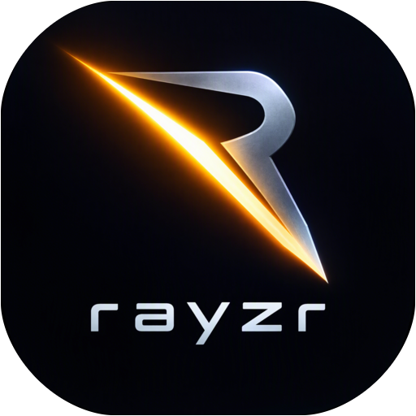

<p align="center"></p>

# Rayzr

A 2D game engine built in Odin utilizing Raylib for rendering, Box2D v3 for physics simulation, and Lua 5.4 for gameplay scripting.

**Website, downloads and documentation: [rayzr.app](https://rayzr.app)** -
the docs are written in this repository ([`docs/`](docs/), the guides in
[`engine/docs/`](engine/docs/), the generated references) and published for
every release; see [docs/contributing/docs.md](docs/contributing/docs.md).

> Formerly **Ore** (the repository was `odin_raylib_engine`). Projects, packages
> and settings from before the rename keep working: a project's `.ore/` folder
> becomes `.rayzr/` when it's opened, `.ore` packages still load, and the
> editor moves `~/.config/ore_editor` to `~/.config/rayzr_editor` on its first
> start. The icon's source is `branding/rayzr_icon_source.png`;
> `odin run scripts/branding/make_icons.odin -file` remakes the editor's icons.

---

## Engine Development Requirements & Coding Standards

> [!IMPORTANT]
> ### Mandatory Requirement: Lua Bindings, Documentation & Language Server (LSP) Stubs
> Going forward, **all new engine features, node types, subsystems, and capabilities added to `engine/` MUST satisfy the following requirements**:
> 1. **Lua 5.4 Bindings**: Implement corresponding Lua bindings in [`engine/script_bindings.odin`](engine/script_bindings.odin). Every native capability must have an accessible, ergonomic Lua counterpart.
> 2. **Language Server Protocol (LSP) Definitions**: Add complete EmmyLua / LuaCATS type annotations, method signatures, parameter descriptions, and return types in [`engine/definitions/engine_api.lua`](engine/definitions/engine_api.lua) and keep the LuaLS configuration (`.luarc.json`) diagnostics clean.
> 3. **Documentation**: Document the architecture, lifecycle integration, code samples, and API reference in [`engine/SCRIPTING.md`](engine/SCRIPTING.md), a guide in [`engine/docs/`](engine/docs/) listed in [`docs/site.json`](docs/site.json), and the feature in [`docs/features.json`](docs/features.json) (`scripts/docs/check_docs.py` fails CI otherwise).
> 4. **Automated Verification**: Include unit tests in [`engine/script_test.odin`](engine/script_test.odin) asserting correctness and zero memory leaks under `mem.Tracking_Allocator`.

---

## Project Structure

- `engine/`: Core game engine architecture.
  - `script_*.odin`: Lua 5.4 scripting subsystem (manager, bindings, VFS, node attachment).
  - `definitions/engine_api.lua`: Language Server Protocol (LSP) EmmyLua stubs.
  - `physics_*.odin`: Box2D v3 integration (bodies, shapes, character movers, sensors, raycasts, joints).
  - `camera_node.odin`: ProCam2D camera system (target tracking, drag damping, shake, rooms, limits).
  - `particle*.odin`: GPU/CPU particle system with color ramps and collision triggers.
  - `ldtk.odin`: LDtk level loader with automatic layer, collision, and entity instantiations.
  - `ui_*.odin`: Immediate-mode UI layout engine with flexbox, docking, and widgets.
- `ui/`: Standalone GUI package.
- `asteroids/`: Demo game showcasing space combat, particles, physics, and Lua scripting.
- `odin_editor/`: Visual node and asset editor.

---

## Building & Running Tests

We use `task` (Taskfile) for automated building and testing:

```bash
# Type-check everything
odin check .

# Run engine unit tests (with zero leak verification)
task test:engine

# Run standalone UI tests
task test:ui

# Build executable
odin build . -out:rayzr

# Run demo game
odin run .
```
