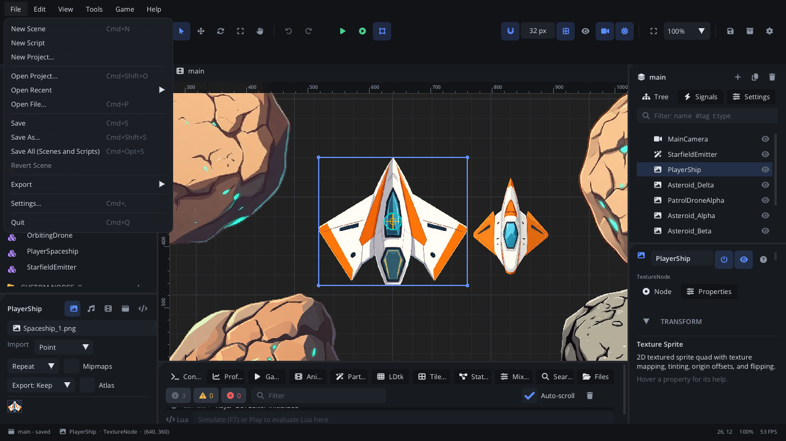

# Scene panel

The Scene panel shows the active scene as a tree of nodes. Here you select
nodes, rename them, change who is whose child, and reach every node action
from one right-click menu. Its **Signals** tab lists every signal
connection in the scene, and its **Settings** tab holds the scene's own
settings. The scene tabs above the viewport switch between open scenes.

## When to use it

- Find a node, select it, or select several at once.
- Build the hierarchy: add children, drag nodes under other nodes, reorder
  them.
- Copy, duplicate, delete, lock or hide nodes; turn a node into a
  component; attach a script.
- See all the scene's signal connections in one list.
- Set the scene's background and ambient light.
- To change a node's values, use the [Inspector](inspector.md); to place
  nodes by eye, the [viewport](viewport.md).

## What's in it

### Header

| Control | What it does |
|---|---|
| **Scene name** | The active scene. An orange dot means unsaved changes. |
| **+** | Add Node: the new node goes under the selected one. Cmd+A (Ctrl+A) |
| **Duplicate** | Duplicate the selected nodes. Cmd+D |
| **Delete** (bin) | Delete the selected nodes. Del |

While the game runs, **Local** / **Remote** buttons appear at the top.
**Local** is the scene you edit; **Remote** is the running game's live
tree - select a node there and the Inspector shows and changes it in the
game.

### Tree tab

**Filter** (the box at the top): type to show only matching nodes (and
their parents). Terms combine - every term must match:

| Term | Matches |
|---|---|
| `player` | Names that contain "player" |
| `#enemy` | Nodes with a tag that contains "enemy" |
| `t:sprite`, `type:CameraNode` | The node type, by its type name or its Add Node name (custom node types too) |

**Rows**: each row has the node type's icon and the node's name. Colours
tell you more:

- dim - disabled, hidden, or hidden in the editor;
- purple - a component instance (faded purple: a node inside one);
- red - a component instance whose file is missing;
- a custom node type's own colour.

At the right end of a row:

| Icon | What it does |
|---|---|
| **Eye** | Show or hide the node (in the game too). |
| **Low-vision eye** | The node is hidden in the editor only. Click to show it. |
| **Lock** | The node is locked in the viewport. Click to unlock. |
| **Script** (blue) | The node has a script. Hover for its file, click to open it. |

**Mouse**:

| Action | What it does |
|---|---|
| Click | Select the node (on release, so you can drag without selecting). |
| Cmd+click, Shift+click | Add to or remove from the selection. |
| Double-click | Centre the viewport on the node and rename it in place (Enter keeps, Esc cancels). |
| Drag onto a row (middle) | Make the dragged node its child. |
| Drag onto a row's top or bottom edge | Place it before or after that row (a line shows where). |
| Drag onto empty space | Move it to the root of the scene. |
| Drag into the Inspector | Fill a node field, like a camera's **Follow Target**. |
| Drag into a script (Code tab) | Insert a typed reference to the node (see [Inspector](inspector.md)). |
| Drop a script from Assets onto a row | Attach it (or replace the node's script). |
| Right-click a row | The node menu (below). |
| Right-click empty space | **Add Node...**, **Paste**, **Select All**. |

Moving or renaming a node keeps it where it is in the world, and keeps
scripts pointing at it: node properties update, and `get_node(...)` paths
in scripts are offered for update.

### The node menu

Right-click a node. If several are selected, the actions apply to all of
them.

| Item | What it does |
|---|---|
| **Add Child...** | Add Node, under this node. Cmd+A |
| **Add Component as Child** | Pick a component from `components/`. |
| **Cut / Copy / Paste** | Cmd+X / C / V |
| **Paste as Child** | Paste under this node. |
| **Duplicate** | Cmd+D |
| **Rename** | F2 (one node at a time). |
| **Delete** | Del |
| **Move Up / Move Down** | Change its place among its siblings (draw order and tree order). |
| **Move to Root** | Make it a child of the scene root. |
| **Select Children** | Select its direct children. |
| **Enable / Disable** | A disabled node doesn't update or collide. |
| **Show / Hide** | Same as the eye. |
| **Lock / Unlock in Viewport** | Cmd+L |
| **Hide / Show in Editor** | Cmd+Shift+H |
| **Frame in Viewport** | Centre the view on it. F |
| **Copy to Scene / Move to Scene** | Put the selection into another scene of the project, at the same world position, and open that scene. |
| **Open Script / Detach Script** | When it has a script. |
| **Attach Script** | **New Script...** or any script in `scripts/`. |
| **Documentation** | The node type's page. Shift+F1 |
| **Save as Component** / **Save as Component Named...** | Save this node and its children as a reusable component. |
| **Save as Custom Node...** | Make a node type of your own from this node (its type, values and script). |
| **Edit Component** | On an instance: open its component. |
| **Select All Instances** | Every instance of this component in the scene. |
| **Apply Changes to Component** | Write this instance's changes into the component file. |
| **Save as New Component...** | Save the instance, with its changes, as a new component. |
| **Revert Overrides** / **Revert This Node** | Drop the instance's changes. |
| **Unlink** | Turn the instance into ordinary nodes. |
| **Edit the &lt;Type&gt; Type** | On a custom node: open its type. |
| **Change Base Type...** | In a custom node type's own document. |
| **Camera Follows This** / **Camera Stops Following** | Make the scene's camera follow this node. |
| **Copy Node Path** | Its path from the scene root, for `get_node`. |

### Signals tab

Every saved signal connection in the scene, one row each: the node and
its event (for example `Timer  timeout`) over the target and its method.

| Control | What it does |
|---|---|
| Click a row | Select the node that sends the event. |
| Double-click a row, or **code** button | Open the method in the Code tab. |
| **Unlink** button | Disconnect, and remove the generated handler. |
| Orange or red text | The target is gone, has no script, or its script has no such method. Hover for which. |

You make connections in the Inspector's **Signals** section.

### Settings tab

The scene's own settings (the Inspector's **Scene Settings...** button
opens this tab too):

| Setting | What it does |
|---|---|
| **File** | Where the scene is saved. |
| **Background** | Tick to give the scene its own background colour. |
| **Ambient** | The light where no light reaches. White = unlit. **Presets**: Day, Dusk, Night, Dark. |
| **Draw Bounds** | Draw node bounds when the game runs (for debugging). |

### Scene tabs

Each scene you open gets a tab above the viewport. A cubes icon marks a
component, a puzzle piece a custom node type.

| Action | What it does |
|---|---|
| Click a tab | Switch to it. Each tab keeps its own view, selection and undo history. |
| Drag a tab | Reorder. The arrow at the left lists every tab. |
| Dot on a tab | Unsaved changes (hover for the file). |
| **x**, middle-click, Cmd+W | Close it. With unsaved changes it asks: **Save**, **Don't Save**, **Cancel**. The last tab can't be closed. |
| Ctrl+Tab / Ctrl+Shift+Tab | Next / previous tab (also Ctrl+PageDown / PageUp, Cmd+Opt+Right / Left). |
| Right-click a tab | **Close**, **Close Others** (ones with unsaved changes stay open), **Copy Path**. |

You can't switch tabs while simulating. The open tabs come back the next
time you open the project.

## Walkthrough

Set up a player with a sprite and a camera that follows it:

1. Click **+** (or press Cmd+A), search for `Character Mover`, and create
   it. It appears in the tree, selected.
2. Double-click the row, type `Player` and press Enter.
3. With Player selected, press Cmd+A again and add a **Texture Sprite**.
   It goes under Player.
4. In the Inspector's **Sprite** section, pick an image for **Texture**.
5. Add a camera at the root: right-click empty space in the tree,
   **Add Node...**, pick **Camera 2D**.
6. Right-click **Player** and choose **Camera Follows This**.
7. Type `t:texture` in the filter to check what you have, then clear it.
8. Right-click **Player**, **Attach Script > New Script...**, and name it.
   A blue script icon appears on the row.
9. Press Cmd+S (Ctrl+S) to save.

## Tips

- Drag a row onto a row's edge to reorder without reparenting - children
  draw in tree order within their layer.
- The tree only draws the rows on screen, so scenes with thousands of
  nodes stay fast.
- Nodes inside a component instance keep their parent: change the
  structure in the component itself (**Edit Component**).
- Locked nodes can still be edited in the tree and the Inspector.
- More: [Inspector](inspector.md), [viewport](viewport.md),
  [toolbar and menus](toolbar-menus.md), [components](../../engine/docs/components.md),
  [custom nodes](../../engine/docs/custom_nodes.md),
  [draw order](../../engine/docs/draw_order.md),
  [CameraNode](../nodes/CameraNode.md).
