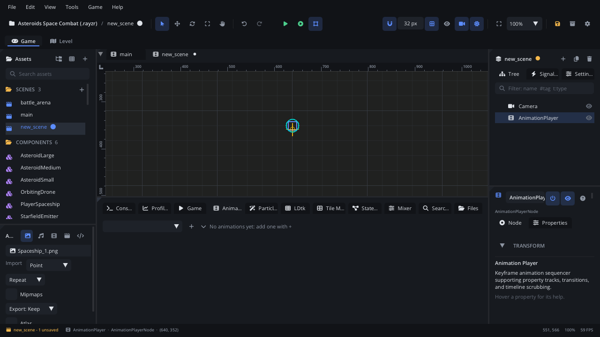

# Animation tab

The **Animation** tab is the timeline for an
[Animation Player](../nodes/AnimationPlayerNode.md). It edits the player's
animations: their frames and range, their speed, and keyframed **tracks**
that animate any node's properties (position, rotation, colour...), call
script methods, play sounds, emit particles, spawn components or turn
nodes on and off. The Inspector only holds the player's own settings; the
rest is here. For the ideas behind curves, events and onion skin, read
[Animation editing](../../engine/docs/animation_editing.md).

## When to use it

- **Making a sprite animation**: a walk cycle from a folder of frames or a
  sprite sheet, its frame order, range, speed and per-frame durations.
- **Animating properties over time**: a door sliding open, a coin bobbing,
  a flash of colour when hit. Add a property track and key it.
- **Timing gameplay to an animation**: call `on_hit` on the frame the sword
  lands, play a footstep sound, burst dust particles, enable a hitbox.
- **Shaping motion**: easing, bezier handles and the value graph.
- To choose *which* animation plays when, use a
  [State Machine](tab-stategraph.md). For one-off motion from a script, use
  `Tween.to` instead of a track.
- For particles' own settings use the [Particles tab](tab-particles.md);
  for sounds' buses, the [Mixer tab](tab-mixer.md).

## What's in it

Select an Animation Player (or click **Open Animation Timeline** in its
Inspector) and the tab shows it. With **Bottom Panel Follows Selection**
on ([Settings](settings.md) > General), selecting a player switches to this
tab by itself. With nothing to edit it says *Select an AnimationPlayer
node...*.

**View > Workspaces > Animation** gives the timeline a tall panel.

### The toolbar

From left to right:

| Control | What it does |
|---|---|
| **Pin** chip (player name) | Shown when another node is selected: the tab keeps editing this player so you can key the other node. Click it to select the player again. |
| **×** next to the pin | Stop editing the pinned player. |
| Animation picker | The animation being edited (also the one the player shows). |
| **+** | A new empty animation (`anim_2`, `anim_3`...). |
| **▾** | **From a Folder of Frames** (each folder under `textures/`; its PNGs become the frames), **From a Sprite Sheet** (a PNG under `textures/`), **Slice a Sprite Sheet...** (opens the slicer). |
| **Pen** | Rename the animation. Names must be unique. The player's Default animation and State Machine states that play it follow the new name. |
| **Duplicate** | Copies the animation - frames, range, settings and tracks - right after it as `<name>_copy`. |
| **Hand** | Drag it into a script: it writes `animation_play("name")` for this player. |
| **Trash** | Delete the animation. Cmd+Z (Ctrl+Z) brings it back. |
| **Play / Pause** | Play the animation in the viewport (tracks too). The scene's values are saved first. |
| **Stop** | Stop and put the scene back as it was before the preview. |
| **Auto-key** (red dot) | On: every change you make to the selected nodes - typed in the Inspector or dragged in the viewport - is keyed at the playhead. Scrubbing, playback and undo don't record. |
| **Loop** | The animation starts over at the end. |
| **Reverse** | This animation plays from its last frame to its first. (The player's own **Reverse** in the Inspector flips all of them.) |
| **Onion skin** | Show neighbouring frames ghosted in the viewport: before in red, after in blue. Right-click it for **Before** (0-5), **After** (0-5) and **Opacity**. |
| **fps** field | This animation's frame rate. Dimmed, it shows the player's rate; drag to give the animation its own. Right-click goes back to the player's. |
| **Star** | Make this the animation selected when the scene loads (the Inspector's **Default**); it plays then if **Autoplay** is on. Click again to clear. |
| **Frame n / m (s)** | Where the playhead is: frame, length and time. |
| Duration field | How long the selected frame (or frames) stays, in seconds. Right-click resets it to 1/fps. |
| **Add Track** | Add a track (see below). |

When the panel is narrow, the last items wrap to a second line.

### Header and ruler

| Control | What it does |
|---|---|
| **Copy / Paste / Delete** (left) | Act on the selected keys, else the selected frames. Paste puts keys at the playhead, frames after the selection (else at the end). The count of what is selected is shown next to them. |
| **Chart** button | Swap the track rows for the value graph (and back). |
| **Clock** button | Ruler in frames or in seconds. |
| **%** button | The timeline zoom. Click for 100%. |
| Ruler | Click or drag inside the blue band to scrub (move the playhead). The wheel over the ruler zooms. |
| Blue band | The **range**: the frames that play. Drag its handles at each end to change it. |

Cmd+wheel (Ctrl+wheel) anywhere over the timeline also zooms, keeping the
frame under the mouse in place (25% to 600%).

### Frames row

Every frame of the animation as a thumbnail. Frames outside the range are
dimmed; the frame shown is highlighted.

- **Click** a frame to select it and move the playhead there. **Shift+click**
  selects a run, **Cmd+click** (Ctrl+click) adds or removes one.
- **Drag** a frame onto another to move it (frame animations).
- **Drop textures** from the Assets panel on the **+** box at the end to add
  frames (frame animations).
- **from / to** fields under the **Frames** label set the range by number.
- **Right-click** a frame: **Copy**, **Paste After**, **Delete**, **Insert
  Empty Frame**, **Append Empty Frame**, **Start the Range Here**, **End the
  Range Here**.

Images paste into frame animations; sprite-sheet cells paste into
animations of the same sheet.

### Track rows

Tracks are grouped under a row for their node (the player's first). Click a
node's row to fold its tracks; folded, its keys show as small dots. Hover a
track's name for its full path and property.

Each track row has, at the left:

| Button | What it does |
|---|---|
| **Yellow dot** | Key the current value at the playhead. On an event track it adds a key at the playhead (copying the previous key's action). |
| **Sliders** / **Code** | Event tracks only: open the track's settings at the right (see below). |
| **×** | Remove the track. |

Keys sit on their frame. Property keys are yellow diamonds (a small dot
under one means it eases or has a curve to the next key). Method keys are
blue squares; other event keys are blue circles, with what they do written
next to them (`emit 12`, `stop`, `spawn Explosion`, `disable`,
`on_hit(3)`, a sound's name). Between eased keys the row draws the curve.

Working with keys:

- **Click** a key to select it and jump the playhead to it. **Shift** or
  **Cmd** (Ctrl) + click adds or removes keys.
- **Drag a box** from an empty spot to select the keys inside (with Shift or
  Cmd: add them).
- **Drag** selected keys to move them in time. They snap to frames; hold
  **Shift** to place them anywhere. A key dropped on another replaces it.
- **Cmd+C** (Ctrl+C) copies the selected keys, **Cmd+V** (Ctrl+V) pastes
  them at the playhead - onto their own tracks, or onto the selected track
  when they came from one track of the same kind. **Cmd+D** (Ctrl+D)
  duplicates them one frame after the last. **Delete** (or Backspace)
  removes them.
- **Right-click** a key for its menu:
  - Property keys: **Easing** to the next key (hover a name to see its
    curve), **Edit Curve...**, **Delete Key**.
  - Method keys: the method name (with a pick list of the target script's
    methods), an **argument** (empty: the frame number), **Script Call
    Settings...**, **Delete Key**.
  - Sound keys: the sound to play, **Sound Settings...**, **Delete Key**.
  - Particles / spawn / enable keys: what the key does (see Event tracks),
    **Delete Key**.

These keys act on the timeline only while the tab has focus; elsewhere
they act on scene nodes as usual.

### Add Track

**Add Track** lists every node of the scene. Pick one, then pick a
property: `position`, `rotation`, `scale`, `origin`, `zIndex`, `enabled`
and every other property of that node that can be animated (numbers,
vectors, colours, checkboxes, choices, a sprite's texture). The new track
gets a first key with the current value at the playhead.

Under **Events**:

| Track | Its keys |
|---|---|
| **Call Script Methods** | Call a method on the node's script on that frame. |
| **Play Sounds** | Play an audio file. |
| **Emit Particles** > *emitter* | **Restart**, **Emit a burst** of N particles, **Start** or **Stop** one of the scene's particle emitters. |
| **Spawn Component** | Instantiate a component at the node's position. |
| **Enable / Disable** | Enable or disable the node (an Area, a Raycast...). |

### The right side

The area right of the timeline changes with what you are doing:

- **Preview** (nothing selected, panel wide enough): the animation plays by
  itself in a box - its range, fps and direction, looping. **Pause** it to
  see the frame the timeline is on.
- **Key inspector** (keys selected): edits the selected keys.
- **Track settings** (an event track's sliders / code button, or one of
  its keys clicked).

The key inspector:

| Control | What it does |
|---|---|
| **×** | Deselect the keys. |
| **Frame** / **Time** | The (first) key's frame, or its time in seconds (free, not snapped). Other selected keys keep their spacing. |
| **Value** | The property's own widget: a number, a vector, a colour, a checkbox, a choice, or a texture picker for a sprite's `texture`. With several keys, all get the value. Needs keys of one kind of property. |
| **Easing** | The motion to the next key: an easing (`linear`, `in_sine`, `out_quad`... `constant`) or **bezier**. Properties that step (checkboxes, choices, text) say *Holds its value until the next key*. |
| **Out handle** / **In handle** | With **bezier** on one key: the handles as time / value offsets, one row per component. |

A single particles, spawn or enable key shows **Does** with its action.

Track settings for a **sound** track: **Track Name**, **Bus**, **SFX Node**
(play through a Sound node in the scene), **Volume**, **Pitch** and **Pan**
as min / max ranges (equal values: fixed; a range: random per play),
**Positional 2D Sound** with **Min Dist** / **Max Dist**, **Voices** (how
many may overlap) and **Test** (plays the first sound with these settings).

Track settings for a **script call** track: the **Target Node** (change
it), the **Attached Script** (**Open / Edit Script**, switch it, or
**Create New Script** / attach one when there is none), and the key at the
playhead: **Method Name**, a pick list of the script's methods, the
**Argument**, **Generate <method> in Script** when the method is missing,
**Test Call** (runs it now), or **Add Method Key at Frame n** when there is
no key there. **Script Properties** lists the script's current values.

Track settings for a **particles, spawn or enable** track: the **Emitter**
or **Target Node**, and every key with its frame (click to go there), its
action, and a delete button.

### The value graph

The **chart** button at the ruler shows each number, vector and colour
track as a curve over the same frames and playhead. Vectors and colours
split into components.

| Control | What it does |
|---|---|
| Curve list (left) | Click a curve's name to hide or show it. |
| **Frame All** (F) | Fit the shown curves' values. |
| Drag a key | Move it in time (snapped to frames; Shift: free) and value. |
| Drag a handle | Shape a bezier key's curve. The pair stays in line; hold **Alt** to break it. |
| Wheel | Move the values up and down. |
| Alt+wheel | Zoom the values. |
| Right-click a key | **Bezier Handles**, **Flatten Handles (ease in and out here)**, **Linear**, **Delete Key**. |

### Edit Curve

Right-click a property key > **Edit Curve...** opens a popup for the
motion to the next key. Drag the two handles, or click a preset: **Ease
In**, **Ease Out**, **Ease In Out**, **Back Out**, **Anticipate**, **Snap**.
The curve is shown as `cubic-bezier(...)`. **Use Easing** goes back to the
key's plain easing. The last key has no curve.

### Keys from the Inspector

While this tab edits a player, each animatable property in the Inspector
has a **diamond** at the end of its name: faint (no track yet), outlined
(a track, no key here) or filled (a key at the playhead). Click it to key
the value (the track is added if needed). Right-click it for **Previous
Key**, **Next Key** and **Remove Key Here**. Select a child or another node
and the tab stays on the player (the pin chip), so you can key that node.
The diamonds are hidden while Simulate runs.

## Walkthrough

A coin that bobs and flashes, and plays a sound:

1. Add a **Texture Sprite** node named `Coin` with a coin picture, then an
   **Animation Player** as its child. Select the player: the **Animation**
   tab opens.
2. Click **+** for a new animation. Click the **pen**, type `bob`, press
   Enter.
3. Turn on **Loop**. Set the **fps** field to 12.
4. Click **Add Track**, pick `Coin`, then `position`. A first key appears
   at frame 1.
5. Drag in the ruler to frame 6. Select `Coin`: the tab stays on the player
   (the pin chip shows). In the Inspector, change Position Y by -8, then
   click the diamond after **Position** to key it.
6. Scrub to frame 12 and click the diamond again after setting Y back to
   the start value.
7. Right-click the key at frame 1 > **Easing** > `in_out_sine`. Do the same
   on frame 6. Press **Play**: the coin bobs smoothly.
8. Click the pin chip to select the player again. **Add Track** >
   **Events** > **Play Sounds**. Scrub to frame 1 and click the track's
   yellow dot, then right-click the new key and pick `sounds/coin.wav`.
9. Press **Stop**: the scene goes back to how it was. Click the **star** so
   `bob` is selected when the scene loads, and tick **Autoplay** in the
   Inspector.
10. Save the scene (Cmd+S / Ctrl+S) and press **F6** to see it in the game.

## Tips

- The timeline's Delete, Cmd+C, Cmd+V and Cmd+D work only while the tab has
  focus (click in it first); otherwise they act on scene nodes.
- Previews never get saved into the scene: Stop, picking another animation
  or selecting another player puts the animated values back.
- Keys are timed in seconds: a key keeps its time when you change the fps, and tracks longer than the frames set the animation's length.
  See [Animation editing](../../engine/docs/animation_editing.md).
- Onion skin draws only while the player itself is selected.
- Scripts crossfade with `node:animation_play(name, blend)`; method keys
  also emit the player's `animation_event` signal.
- Related: [Animation Player](../nodes/AnimationPlayerNode.md),
  [State Machine tab](tab-stategraph.md), [Inspector](inspector.md),
  [Particles tab](tab-particles.md), [Mixer tab](tab-mixer.md).
