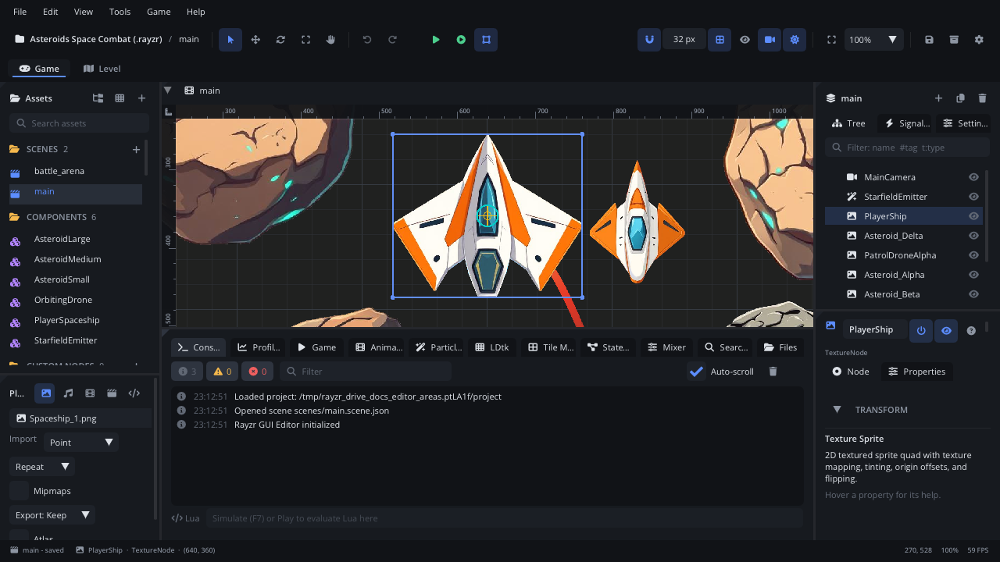

# Console tab

The **Console** is the first tab of the bottom panel. Everything the
editor, a build and the running game have to say ends up here: what was
saved, imported or exported, script errors, and the game's own `print`
output. Below the log is the **Lua** line, where you type Lua and run it in
the simulation or the running game.

## When to use it

- See what just happened - a save, an import, an export, a moved file and
  how many references were updated.
- Read a script error and jump to its line.
- Follow your game's output while it plays (`print`, warnings, errors).
- Ask the running game or the simulation a question
  (`Scene.find_node("Player").position`) or change something
  (`GameState.score = 100`) without editing a script.
- For live node values, use the [Game tab](tab-game.md); for frame times,
  the [Profiler tab](tab-profiler.md); to search the project's files, the
  [Search tab](tab-search.md).

## What's in it

When there are errors, the tab's label shows an error icon and how many. Cmd+J (Ctrl+J) focuses it.

### The toolbar

| Control | What it does |
|---|---|
| Info / Warning / Error buttons | Each shows how many lines of its level there are; click to hide or show that level. |
| **Filter** | Keeps the lines whose message contains the text (any case). |
| **Auto-scroll** | Keeps the newest line in view while you are at the bottom (on by default). Scroll up to read older lines; scroll back to the bottom to follow again. |
| Bin (**Clear console**) | Removes every line. |

### The log

Each line has its level icon, the time (`14:03:27`) and the message.

| Source | Looks like |
|---|---|
| The editor | `Saved scenes/level_1.scene.json` |
| A build (Play in a source checkout, or a runner built for export) | `[build] ...` |
| The running game | `[game] ...` - a line containing "error" is shown as an error, one containing "warn" as a warning. |
| The Lua line | `› your code`, then `= result` or the error |

The console keeps the last 500 lines. When there is nothing yet it says
*No messages*.

- **Double-click** a line that names a script and line
  (`scripts/player.lua:12: ...`) to open the script there; the mouse
  shows a hand over such lines.
- **Right-click** a line: **Copy Message**, **Copy All** (every line with
  its time), **Open <file>:<line>** (when the line names one) and **Clear
  Console**.

### The Lua line

| | |
|---|---|
| **Where it runs** | While simulating (F7): in the editor's simulation. While the game runs from Play: in the game. Otherwise it is disabled, with the hint *Simulate (F7) or Play to evaluate Lua here*. The hint names the target. |
| **An expression** | Shows its value(s): `Scene.find_node("Player").position` prints `= ...`. |
| **A statement** | Runs it: `GameState.score = 100`. |
| **Enter** | Runs the line and clears it; the focus stays for the next one. |
| **Up / Down** | Walk back and forth through the lines you ran. |

What you can use is the same as in scripts: the engine API, global scripts
by name (Project Settings > Globals), and any global your scripts set. See
the [Lua API](../lua/Engine.md).

## Walkthrough

Check a value in the running game and change it on the fly.

1. Press F5 to play. `[game]` lines start appearing in the Console.
2. Click in the **Lua** line; its hint says *Evaluate in the running
   game*.
3. Type `Scene.find_node("Player").position` and press Enter. The console
   shows `› Scene.find_node("Player").position  (game)` and then the
   position.
4. Type `GameState.lives = 99` and press Enter (with a global script named
   `GameState`). The game now has 99 lives.
5. Press Up twice to bring back the first line and press Enter again: the
   player has moved since.
6. An error appears: `[game] scripts/enemy.lua:42: attempt to index a nil
   value`. Double-click it - the Code tab opens `enemy.lua` at line 42.
7. Click the Info button to hide the info lines and read only warnings and
   errors; click it again to bring them back.

## Tips

- Type part of a message into **Filter** (`Imported`, `slime`, `.lua`) to
  find it among hundreds of lines.
- Clearing before you press Play leaves only that run's output.
- **Copy All** is the quickest way to paste a whole run's log into a bug
  report (**Help > Report a Bug...** adds the last lines for you).
- The Lua line works in Simulate too - handy for poking at a scene without
  starting the game.
- Right-click the tab > **Help: Console** opens this page.
- More: [Playtesting](playtesting.md), [Game tab](tab-game.md),
  [Code tab](../../editor/CODE_EDITOR.md),
  [scripting guide](../../engine/SCRIPTING.md).
