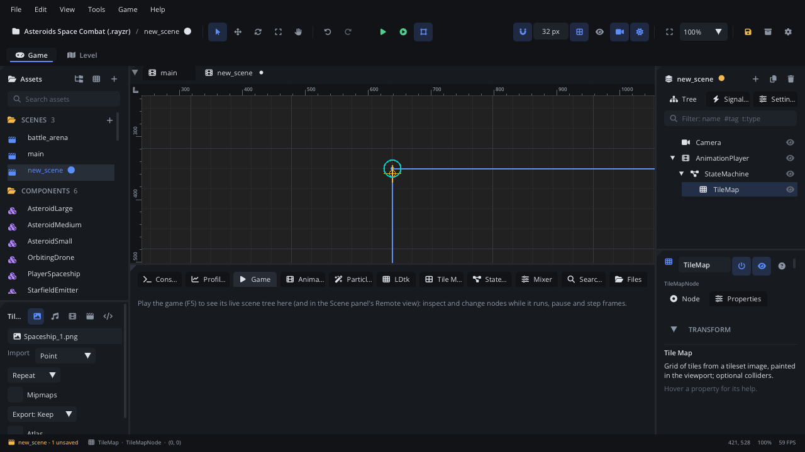

# Game tab

The **Game** tab in the bottom panel is your window into the game while it
runs from **Play**. It shows the running game's scene tree on the left and
the selected node's live properties on the right, with **Pause**,
**Resume** and **Step** above them. When a script stops at a breakpoint, it
also shows where, the call stack, the local variables and your watch
expressions.

## When to use it

- See which nodes exist in the running game right now - spawned enemies,
  bullets, nodes a script added or removed.
- Read and change a node's values live (position, colour, a script's
  exported value), then keep the good ones with **Apply to Scene**.
- Freeze the game and advance it one frame at a time.
- Debug a script: see the call stack and locals at a breakpoint, and watch
  expressions.
- For the same tree in the Scene panel (with the Inspector beside it), use
  the Scene panel's **Remote** view - see [Playtesting](playtesting.md).
  For log output and the Lua line, use the [Console](tab-console.md).

## What's in it

Before you press Play the tab says how to start; while the game starts it
says *Connecting to the game...*. Once linked, the tab's icon becomes a
gamepad.

### The debugger (at a breakpoint)

Shown only while a script is stopped on a breakpoint or a step:

| Control | What it does |
|---|---|
| *Paused at file:line* | Where the script stopped (and why). The script opens at that line in the Code tab. |
| **Continue** | Runs on to the next breakpoint. |
| **Step Over** (F10) | Runs the line, stepping over calls. |
| **Step Into** (F11) | Steps into the function called on the line. |
| **Step Out** (Shift+F11) | Runs to the end of the current function. |
| **Call stack** | Every frame: function, file and line. Click one to see its locals (and its line in the Code tab). |
| **Locals** | The selected frame's variables: tables one level deep, nodes as `Type(Name)`. Hover a value for more. |
| **Watch** | Expressions evaluated at every stop. Type one in **+ expression** (`self.vx`, `#enemies`) and press Enter; **x** removes it. A failing expression shows its error in red. |

While stopped at a breakpoint, Pause and Step (below) are disabled. Set
breakpoints by clicking a line number in the
[Code tab](../../editor/CODE_EDITOR.md).

### The toolbar

| Control | What it does |
|---|---|
| **Pause** / **Resume** | Freezes or continues the game. A paused game is still drawn. Same as F9. |
| **Step** | Runs one frame (1/60 s) and pauses. Same as Shift+F9. |
| *frame N · scene · paused* | The game's frame count, the scene file it runs, and whether it is paused. |

### The scene tree (left)

The running game's nodes, refreshed twice a second (only re-read when
something changed).

| Control | What it does |
|---|---|
| **Filter** | Keeps the nodes whose name or type contains the text, with their parents. |
| Crosshair (**Pick**) | Click it, then click something in the game window: that node is selected here. Click again to cancel. |
| Click a row | Selects the node; it is outlined in the game window and its properties appear on the right. |
| Click the arrow | Folds or unfolds the node's children. |
| Hover | The node's path and type. |
| Power button | The node's **enabled** (it updates). |
| Eye | The node's **visible** (it is drawn). |

Disabled or hidden nodes are dimmed. Right-click a node:

| Item | What it does |
|---|---|
| **Apply to Scene** | Copies the node's current values into the edited scene (below). |
| **Remove from Game** | Deletes the node from the running game only. |
| **Copy Path** | Its path from the scene root (`Level/Enemies/Slime`), for `get_node`. |

### Properties (right)

The selected node's live values, each with a widget for its type: drag
numbers and vectors (double-click to type one), tick check boxes, pick
colours and enum values, and type text, pressing Enter to send it.
Read-only values (such as the global position) are greyed. The node's
script's exported values are listed too, after its own properties. Every change goes to the game at once (while you drag, up
to 20 times a second).

**Apply to Scene** (button at the top, or in the tree's menu) copies the
node's current values into the node with the same path in the scene you
are editing - one undoable step. Script values are not copied. It works
when the game runs the scene you have open; a node that only exists in the
game (spawned while playing) can't be applied.

## Walkthrough

Tune an enemy's speed while the game runs.

1. Press F6 to play the level. Open the **Game** tab.
2. Type `slime` in **Filter**. The matching enemies appear with their
   parents.
3. Click one. It is outlined in the game window; its properties appear on
   the right.
4. Drag **Speed** (the script's `speed`) from 40 to 70 and watch it chase
   faster. Script values change live but aren't applied to the scene, so
   note the value.
5. Press **Pause**, then **Step** a few times to watch one frame at a time.
6. Drag its **Scale** to 1.5, 1.5 and press **Apply to Scene**: the edited
   scene's slime is now bigger (Cmd+Z (Ctrl+Z) takes it back).
7. Press **Resume**, then stop the game with Shift+F5 and put 70 in the
   script's property in the [Inspector](inspector.md).

## Tips

- Pick (the crosshair) is the quickest way to find a node you can see but
  not name.
- Toggling **enabled** off stops one node updating while the rest of the
  game runs - handy for isolating a bug.
- Changes made here are lost when the game stops unless you **Apply to
  Scene** (and save).
- Saving a scene while the game runs restarts that scene in the game with
  the saved version.
- Right-click the tab > **Help: Game** opens this page.
- More: [Playtesting](playtesting.md), [Console](tab-console.md),
  [Scene tree](scene-tree.md), [Inspector](inspector.md).
