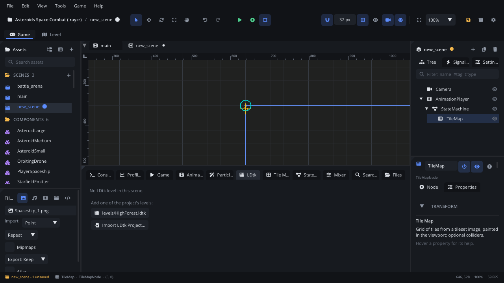

# LDtk

The **LDtk** tab shows the LDtk level of an [LDtk Level](../nodes/LdtkLevelNode.md)
node and sets how the game builds it. You pick the world and level, look
through its layers, entities, fields and enums, and decide what the level
turns into when it runs: what each entity spawns as, which IntGrid values
collide, and how linked entities connect. The level's tiles and placements
are edited in the [Level tab](../../engine/docs/level_editor.md) or in LDtk;
this tab sets up the scene side.

## When to use it

- **Choosing the level** an LDtk Level node shows, or turning on **World
  mode** to load a whole world.
- **Making entities spawn as your nodes**: map the *Player* entity to a
  component or custom node type, or create a component from its fields.
- **Setting up collision**: which IntGrid values are solid, one-way
  platforms or triggers, with friction and bounce.
- **Connecting linked entities**: a lever's EntityRef field to the door it
  opens, as a signal or a parent.
- **Checking what's in a level**: layer sizes and parallax, where each
  entity is placed, level field values, enums.
- **Not** for painting tiles, placing entities or editing definitions: use
  the [Level tab](../../engine/docs/level_editor.md) (or LDtk). For a simple
  painted grid without LDtk, use a [Tile Map](tab-tilemap.md).

## What's in it

### Opening it

- Select an LDtk Level node (or any node under it). With **Settings >
  General > Bottom Panel Follows Selection** on (the default), the tab shows
  by itself.
- The Inspector's LDtk section: **Layers, Entities, Collision...**.
- The **LDtk** tab in the bottom panel.

The tab shows the selected LDtk Level node, or the one the selection is
inside. Otherwise it keeps the last one it showed, or the scene's first.

**No LDtk level in the scene**: the tab lists the project's `.ldtk` files
as buttons - click one to add it as a level at the viewport's centre - and
has **Import LDtk Project...**. Without any `.ldtk` file it says *Import an
LDtk project (.ldtk) to get started.*

### The header

The node's name and its `.ldtk` file, then:

| Control | What it does |
|---|---|
| World picker | The world to show (only when the project has more than one). |
| Level picker | The level to show, from the current world. |
| **World mode** | Shows and builds every level of the world at its world position. Lit when on. |
| **Parallax preview** | Layers move with the editor camera as they will in the game. On by default. |
| **IntGrid overlay** | Draws IntGrid values in their LDtk colours in the viewport. |
| **Fit** | Frames the level (or the world's levels) in the viewport. |
| **Reload** | Reads the `.ldtk` file again. |
| **Edit in the Level tab** | Opens this file and level in the [Level tab](../../engine/docs/level_editor.md). |
| **Open in LDtk** | Opens the file with the computer's app for `.ldtk` files (LDtk, when it is installed). |
| Size | The level's size in pixels; in World mode, how many levels are loaded. |

Changing the world, the level or World mode is an undo step. If the node
has no file yet, the tab says *Pick an LDtk project for this node in the
Inspector.*

The pages are listed down the left: **Layers**, **Entities**,
**Collision**, **Links**, **Level Fields**, **Enums**, **World**.

### Layers

Every layer of the level, top first, as in LDtk.

| Column | What it shows |
|---|---|
| Eye | Hides or shows the layer **in the editor only**. The game uses LDtk's own visibility. |
| Target (solo) | Shows only this layer. Click again to show all. |
| **Layer** | The layer's name and type icon. Hover a row to outline the layer in the viewport; click to select it. A layer hidden in LDtk says so in its tooltip. |
| **Type** | IntGrid, Entities, Tiles or AutoLayer. |
| **Grid** | The cell size in pixels. |
| **Size** | Cells across x down. |
| **Parallax** | The parallax factor (x, y); a mark when parallax scaling is on. `-` for none. |
| **Opacity** | The layer's opacity. |
| **Content** | Entities, painted cells or tiles in the layer. |

- **Reset to LDtk** (shows once you hide or solo a layer) puts every layer
  back as LDtk has it.
- Select an IntGrid layer to see its values under the table: colour, number
  and name.

### Entities

A list of the project's entity definitions on the left: icon, name, how
many are placed, and what each spawns as. Click one to see it on the right.

- **Auto also spawns the custom node type named like the entity** (the
  checkbox above the list): an *Auto* entity with no component of its name
  spawns the project's [custom node type](../../engine/docs/custom_nodes.md)
  of that name, if there is one.
- **Spawn as**:

  | Option | What it spawns |
  |---|---|
  | **Auto (component by name)** | `components/<Entity>.component.json` if it exists (the line under it says which file, or that it isn't there), else a plain Node. |
  | **Component** | The component you pick under it. |
  | **Plain Node** | An empty Node at the entity's position. |
  | **Don't spawn** | Nothing. |
  | **Custom Node Type** | The custom node type you pick under it. |

- **Create Component...** writes `components/<Entity>.component.json` and a
  script `scripts/<entity>.lua` with a property for each field, then sets
  the entity to that component. If the component exists already, it is used.
- **Fields** table: each field, its type, and whether it reaches a script
  property. A tick means the spawned node's script has a property of the
  same name, so the value is copied onto it. Others are read with
  `node:ldtk_field()`; EntityRef fields are links (see **Links**).
- **Placed in this level** (or *this world*): every instance, with its
  level, position and field values. **Click a row** to centre the viewport
  on it; it is highlighted for two seconds.

### Collision

What each IntGrid value builds when the level runs. Each IntGrid layer has
a table of its values:

| Column | What it does |
|---|---|
| Colour, **Value** | The value's colour, number and name. |
| **Cells** | How many cells hold it. |
| **Collision** | **None**, **Solid**, **One-way** (solid from above, passable from below) or **Trigger** (an area with `body_entered` / `body_exited`; its tooltip gives the area's name). |
| **Friction** | 0-2, for Solid and One-way. |
| **Bounce** | 0-1, for Solid and One-way. |

- **Show colliders while simulating** draws the built colliders when you
  Simulate.
- A warning shows when the node's **Enable Physics** is off in the
  Inspector: then nothing is built.
- Neighbouring cells with the same setting merge into a few large boxes.

### Links

For every entity field of type EntityRef: its name, type and how many
references the level has.

- **Add Rule** adds a rule for that field. Each rule is one of:
  - **Connect signal**: type the source's *signal* and the target's
    *method*. When the entity emits the signal, `Target:method(value,
    source)` runs on each entity in the field.
  - **Parent target to source** or **Parent source to target**.
- The bin button removes a rule.
- **References**: every reference in the level - source, field, target.
  Click a row to centre the viewport on the source. A target in another
  level shows that level's name (*not loaded: World mode links it* when
  it isn't loaded).

Rules work when both ends are spawned. Scripts can always follow a link with
`node:ldtk_ref("field")`.

### Level Fields

The project's level fields as rows, with a column per loaded level showing
its value (`-` when unset). Scripts read them with
`level:ldtk_get_level_field(name [, level])`.

### Enums

Each enum with its values (icon or colour chip), *(external)* for enums from
another file, and where it's used: entity fields, level fields, tileset
tags. Scripts get an enum field as its value's id (a string).

### World

A mini-map of the current world's levels (at the current level's depth),
with the layout and the number of levels.

- **World mode** checkbox: the same as the header button.
- **Click a level**: opens it - or, in World mode, frames it in the
  viewport. The current level has an accent outline.
- Hover a level to see its size, position and neighbours on the right.

## Walkthrough

Bring an LDtk level into a scene, make the *Player* entity spawn your
player and make the walls solid:

1. Import your `.ldtk` file (Assets > **Import Assets...**, or **Import LDtk
   Project...** in this tab when the scene has no level).
2. With the scene open, the LDtk tab lists the file: click it. An LDtk
   Level node is added and the tab shows it.
3. Pick the level in the header's level picker. Click **Fit** to frame it.
4. Open **Entities** and click *Player* in the list.
5. Set **Spawn as** to **Component** and pick
   `components/Player.component.json` - or click **Create Component...** to
   make one with a script that has the entity's fields as properties.
6. Open **Collision**. In the *Collisions* layer's table, set value `1`
   (walls) to **Solid** and value `2` (platforms) to **One-way**.
7. Tick **Show colliders while simulating**, then press **F7**
   (Simulate). The colliders show over the walls and the player spawns at
   its LDtk position. Press **Shift+F5** to stop.
8. To change the level's tiles, click **Edit in the Level tab** in the
   header, paint, and save: the scene's level reloads.

## Tips

- Hiding a layer with the eye only changes the editor view - handy to see
  under a foreground layer. The game draws what LDtk says.
- The settings made here (spawn modes, collision, link rules, world mode)
  are saved in the scene with the node, not in the `.ldtk` file.
- Colliders and entities are only built when you Simulate or Play; while
  editing, the viewport shows entity placements and reference arrows.
- Lua access to the whole project - layers, entities, fields, triggers
  (`level:ldtk_get_triggers()`) - is in the
  [LDtk guide](../../engine/LDTK.md) and the
  [LDtk Level node page](../nodes/LdtkLevelNode.md).
- Related: [Level editor guide](../../engine/docs/level_editor.md),
  [Inspector](inspector.md), [Viewport](viewport.md),
  [Tile Map tab](tab-tilemap.md), [Components](../../engine/docs/components.md).
