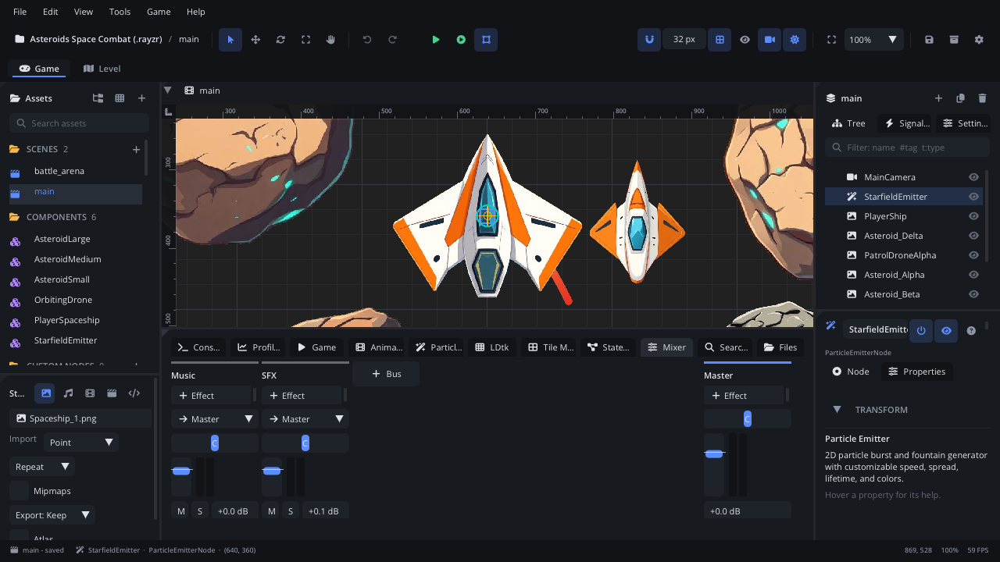

# Mixer tab

The **Mixer** tab is the project's audio mixing console. Each **bus** -
Master, Music, SFX and any you add - is a strip with its effects, output,
pan, fader, level meter, mute and solo. Sounds and music play into buses,
so one fader sets the volume of all weapons, one reverb covers all cave
sounds. Changes are heard at once, in Simulate and in a game started with
Play. For buses, effects and scripting the mixer, read
[The audio mixer](../../engine/docs/audio_mixer.md).

## When to use it

- **Balancing the game's sound**: music against effects, quiet footsteps
  against loud explosions.
- **Adding effects to a group of sounds**: reverb in a cave, a low-pass
  under water, a limiter on Master.
- **Grouping**: send several buses (Weapons, Footsteps) into one (SFX) so
  one fader moves them all, which is what a players' volume menu needs.
- **Mixing while you play**: run the game with Play and adjust the faders;
  the meters show the game's levels.
- To pick which bus a sound plays into, use the **Bus** setting of a
  [Sound Effect](../nodes/SoundNode.md) or [Music](../nodes/MusicNode.md)
  node in the [Inspector](inspector.md).

## What's in it

The buses are strips from left to right; **Master** is pinned at the far
right. When the strips don't fit, the area scrolls sideways. Every project
starts with **Master**, **Music** and **SFX**.

### A strip, top to bottom

| Control | What it does |
|---|---|
| Name | **Double-click** to rename. **Right-click**: **Rename**, **Delete Bus**. (Not on Master.) |
| Effects | The chain, run top to bottom. **Click** an effect to edit its parameters. The **dot** before it bypasses it (a crossed circle: bypassed). **Right-click**: **Move Up**, **Move Down**, **Remove**. A compressor or limiter shows how much it reduces, e.g. `Compressor -4`. |
| **+ Effect** | Add an effect at the end: EQ, Low-pass, High-pass, Compressor, Limiter, Delay, Reverb, Distortion. Up to 8 per bus. |
| **→ Output** | Where the bus goes: Master, or another bus (a group). A choice that would make a loop is refused with a warning. (Not on Master.) |
| Pan | Left / right: `L 50`, `C`, `R 50`. **Double-click**: centre. |
| Fader | Volume. 0 dB (unchanged) is the tick at about 70% of its travel; the top is +6 dB. **Double-click**: 0 dB. |
| Meter | The bus's level after its fader, left and right: green, yellow from -12 dB, red over 0 dB. A red bar above it: it clipped recently. |
| **M** | Mute. (Not on Master.) |
| **S** | Solo: only soloed buses, and the buses they feed, are heard. (Not on Master.) |
| dB field | The fader's level. Click it, type a value (`-6`, `-inf`) and press Enter. Values go from -96 to +6 dB. |

### + Bus

**+ Bus** (after the last strip) adds a bus named `Bus` (then `Bus 2`...)
that goes into Master.

### The effect popup

Clicking an effect opens a popup titled with its name:

- A slider per parameter, with its unit (frequencies and times on a log
  scale). See the table below.
- **Gain reduction** (compressor and limiter): how much it is turning the
  sound down now.
- **Defaults**: put every parameter back to its default.
- **Esc** or a click outside closes it.

| Effect | Parameters |
|---|---|
| **EQ** | Low, Low Freq, Mid, Mid Freq, High, High Freq |
| **Low-pass** | Cutoff, Resonance |
| **High-pass** | Cutoff, Resonance |
| **Compressor** | Threshold, Ratio, Attack, Release, Makeup |
| **Limiter** | Ceiling, Release |
| **Delay** | Time, Feedback, Mix |
| **Reverb** | Room Size, Damping, Mix |
| **Distortion** | Drive, Mix, Output |

### Live

- Everything applies at once and is saved in `project.json`.
- In **Simulate** (F7) you hear the scene through the editor's mixer, and
  the meters show its levels.
- While a game started with **Play** (F5 / F6) runs, each change is sent
  to the game, and the meters show the game's levels.

## Walkthrough

Weapons that echo, and music that fits under them:

1. Click the **Mixer** tab in the bottom panel.
2. Click **+ Bus**. Double-click the new strip's name, type `Weapons`,
   press Enter.
3. On the `Weapons` strip, set **→ Output** to `→ SFX`: weapons are now
   part of the effects group.
4. Click **+ Effect** > **Delay**. Click the new **Delay** button and set
   **Time** to 180 ms, **Feedback** to 0.2, **Mix** to 0.25.
5. Select each gun's Sound Effect node and set its **Bus** in the
   Inspector to `Weapons`.
6. On **Master**, click **+ Effect** > **Limiter** so loud moments don't
   clip.
7. Press **F5** to play the game. Shoot, and watch the `Weapons` and `SFX`
   meters. Drag the **Music** fader down until the shots stand out, or type
   `-8` in its dB field and press Enter.
8. Click the dot before **Delay** to hear the shots without it, then click
   it again. Stop the game: the mix is already saved.

## Tips

- Mixer changes are saved to the project at once and are not part of the
  scene's undo history. Note a value before you experiment, or use
  **Defaults** in an effect's popup.
- Renaming or deleting a bus doesn't update the nodes that used its name:
  Sound Effect nodes on it play into **SFX**, Music nodes into **Music**.
  Set their **Bus** again. Buses that went into a deleted bus go to Master.
  There is no confirmation and no undo for **Delete Bus**.
- A Sound Effect or Music node's **Preview** button in the Inspector plays
  through its bus, so you hear the bus's effects.
- Scripts can set bus volumes for a players' options menu - see
  [The audio mixer](../../engine/docs/audio_mixer.md).
- Related: [Sound Effect](../nodes/SoundNode.md),
  [Music](../nodes/MusicNode.md), [Animation tab](tab-animation.md) (sound
  tracks pick a bus too), [Playtesting](playtesting.md).
