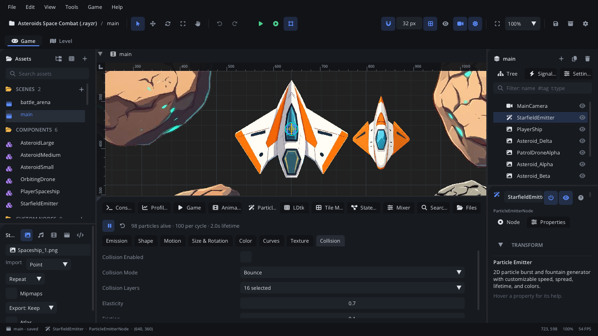

# Particles tab

The **Particles** tab edits the selected
[Particle Emitter](../nodes/ParticleEmitterNode.md): how many particles it
makes and for how long, where they are born, how they move, grow, spin and
change colour, their texture, and whether they collide. Every emitter in
the scene runs in the viewport while you edit, so each change shows at once.

## When to use it

- **Designing an effect**: fire, smoke, sparks, rain, dust, magic. Start
  from a **Preset**; the sub-tabs group the emitter's many settings.
- **Colour over a particle's life**: the gradient editor and its alpha
  plot are only here.
- **Size, alpha and speed curves** over a particle's life.
- **Picking a particle texture or sprite sheet**, with its grid shown.
- To fire bursts at the right moment of an animation, add an **Emit
  Particles** track in the [Animation tab](tab-animation.md). To fire them
  from a script, see the [Particle Emitter](../nodes/ParticleEmitterNode.md)
  page.

## What's in it

Select a Particle Emitter (or click **Open Particle Editor** in its
Inspector). With **Bottom Panel Follows Selection** on
([Settings](settings.md) > General), selecting an emitter switches to this
tab by itself. With no emitter selected it says *Select a Particle Emitter
node...*.

### Toolbar

| Control | What it does |
|---|---|
| **Pause / Play** | Pause or resume the preview of **every** emitter in the viewport. |
| **Restart** (circular arrow) | Kill this emitter's particles and start it again. |
| **Preset** | A starting look: **Fire**, **Smoke**, **Sparks**, **Rain**, **Snow**, **Explosion** or **Magic**. It replaces the emitter's look and motion settings (its texture stays) and restarts it; one Cmd+Z (Ctrl+Z) puts the old settings back. |
| Status line | Particles alive now (*GPU* in GPU mode), particles per cycle, lifetime. |

### Sub-tabs

Most sub-tabs are a list of the emitter's settings, the same widgets as the
Inspector. Hover a setting for its help; the
[Particle Emitter](../nodes/ParticleEmitterNode.md) page explains them.

| Sub-tab | Settings |
|---|---|
| **Emission** | **Gpu**, **Amount**, **Lifetime**, **Lifetime Variance**, **Burst**, **Emitting**, **Continuous**, **Local Space**, **Prewarm**, **Seed**, **Auto Visibility**, **Visibility Rect**, and the particle **Shape** (what each particle is drawn as). |
| **Shape** | Where particles are born and which way they leave: **Emission Shape**, **Emission Radius**, **Emission Inner Radius**, **Emit Along Normal**, **Spread**, **Angle**, **Angle Variance**, **Angle Spread**. |
| **Motion** | **Velocity** (with **Variance**, **Spread**, **Scale**), **Acceleration**, **Gravity Direction**, **Gravity Velocity**, **Wind**, **Radial Velocity**, **Orbit Velocity**, **Damping**. |
| **Size & Rotation** | **Size** (with **Variance**, **Spread**), **Scale Start**, **Scale End**, **Rotation** (with **Variance**, **Spread**), **Torque** (with **Variance**, **Spread**), **Torque Acceleration**. |
| **Color** | The gradient editor (below). |
| **Curves** | **Size over life**, **Alpha over life**, **Speed over life** (below). |
| **Texture** | The particle picture and its sprite sheet (below). |
| **Trails** | **Trail Length** (points; 0 = no trail), **Trail Segment** (pixels between points), **Trail Width** (at the particle, a fraction of its size): a ribbon behind each particle that thins and fades. In GPU mode it only says that GPU particles have no trails. |
| **Collision** | **Collision Enabled**, **Collision Mode**, **Collision Layers**, **Elasticity**, **Friction**. In GPU mode it only says that GPU particles don't collide. |

### Color

| Control | What it does |
|---|---|
| **Gradient** checkbox | On: colour comes from the gradient. Off: a simple **Particle Color** to **Color End**. |
| **Color Variance** | How much each particle's colour differs. |
| Gradient bar | The colour over the particle's life, left (birth) to right (death). **Double-click** it to add a stop there. |
| Stop markers | Under the bar. **Click** to select one, **drag** to move it, **right-click** to remove it (a gradient keeps at least two). |
| **Stop n of m** | The selected stop's place, *at n% of life*. |
| **Color & Alpha** | The selected stop's colour and alpha. |
| **Remove Stop** | Remove the selected stop. |
| **Reset Gradient** | Back to the default gradient. |
| Plot | Red, green, blue and alpha over the particle's life. **Drag the white points** up or down to change each stop's alpha. |

### Curves

Each curve has a checkbox. Off, the plain settings apply; on, a small curve
editor appears (time 0-1 left to right, value up). **Drag** a point,
**double-click** to add one, **right-click** a point to remove it.

| Curve | Value |
|---|---|
| **Size over life** | Scale over the life (replaces Scale Start / End): 1 = its size. |
| **Alpha over life** | Opacity, multiplying its colour's: 1 = as is, 0 = gone. |
| **Speed over life** | Movement: 1 = as is, 0 = stopped, 2 = twice as fast. Not in GPU mode. |

### Texture

| Control | What it does |
|---|---|
| **Texture** | Pick a picture from `textures/`. Picking one switches **Shape** to Texture. The reset button clears it. |
| **Sheet Columns** / **Sheet Rows** | The texture as a sprite sheet grid. |
| **Frame Mode**, **Frame Speed** | How particles pick and play the sheet's frames. |
| **Blend Mode** | How particles mix with what is behind (Additive for fire and glow). |
| **Align To Velocity** | Turn each particle to face where it moves. |
| Preview | The texture, with the sheet's grid drawn over it. |

If a texture is set but **Shape** is not Texture, the tab says the texture
is shown only when Shape is Texture.

## Walkthrough

A campfire:

1. **Add Node** (Cmd+A / Ctrl+A) > **Particle Emitter**, name it `Fire`,
   and put it where the fire goes. The **Particles** tab opens and the
   emitter is already running in the viewport.
2. **Emission**: set **Amount** to 60 and **Lifetime** to 1. Leave
   **Continuous** and **Emitting** on.
3. **Shape**: set **Emission Shape** to a line or rectangle a little wider
   than the logs, and **Angle** so particles leave upwards with a small
   **Angle Spread**.
4. **Motion**: give a small upward **Velocity** with some **Variance**, and
   a little **Damping** so they slow down.
5. **Size & Rotation**: **Scale Start** 1, **Scale End** 0.2.
6. **Color**: keep **Gradient** on. Click the left stop and make it bright
   yellow; double-click the middle of the bar to add an orange stop; make
   the right stop dark red. Drag the right stop's white point in the plot
   down to 0 so particles fade out.
7. **Texture**: pick a soft round picture and set **Blend Mode** to
   Additive.
8. Click **Restart** to see a clean start. Use **Pause** to freeze all
   emitters while you look at the scene.
9. Save the scene (Cmd+S / Ctrl+S).

## Tips

- A **sub-emitter** (bursts where particles die or hit: fireworks,
  splashes) is set in the Inspector: **Sub Emitter**, **Sub Emitter On**,
  **Sub Emitter Amount**. See the
  [Particle Emitter](../nodes/ParticleEmitterNode.md) page.
- The **Pause** button stops every emitter's preview, not only the
  selected one - useful when many effects clutter the viewport.
- GPU mode (**Gpu** in Emission) handles huge counts but has no collision
  and no speed curve, trails or sub-emitters; the tab hides or marks those.
- With **Local Space** off, particles stay where they were born when the
  node moves: drag the emitter in the viewport to see a trail.
- Every edit here can be undone with Cmd+Z (Ctrl+Z).
- Right-click the tab's name > **Help: Particles** opens this page.
- Related: [Particle Emitter](../nodes/ParticleEmitterNode.md),
  [Animation tab](tab-animation.md), [Inspector](inspector.md),
  [Viewport](viewport.md).
