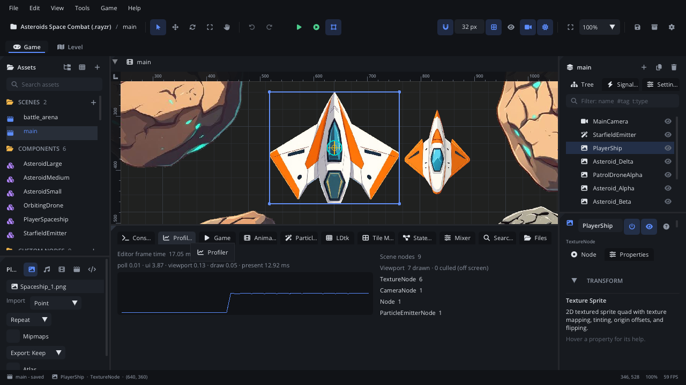

# Profiler tab

The **Profiler** tab in the bottom panel shows how fast the editor runs and
what is in the open scene: the frame time and its phases, a frame-time
graph, how many nodes the scene has (by type), how many the viewport drew
or culled, and the scene's node pools. It measures the editor itself - in
Simulate that includes your scene's update and drawing - not a game started
with Play.

## When to use it

- **The editor or Simulate feels slow**: see which phase of the frame takes
  the time (the panels, the viewport, the GPU).
- **A scene has more nodes than you expect**: the count by type shows
  leftovers, such as bullets or effects that never get removed.
- **Checking culling**: the viewport line shows how many nodes were drawn
  and how many were skipped because they were off screen.
- **Checking a node pool** while Simulate runs: if *made* keeps growing,
  something takes from the pool and never gives back. See
  [Object pooling](../../engine/docs/pooling.md).
- For a game started with **Play** (F5), watch it in the
  [Game tab](tab-game.md) and the [Console](tab-console.md) instead: this
  tab does not read the running game.

## What's in it

The tab has two columns.

### Left: frame time

| Item | What it shows |
|---|---|
| **Editor frame time** | This frame's time in milliseconds and the frames per second. *uncapped* is added when the editor runs without vsync or a frame cap. |
| Phase line | The smoothed time of each phase, in ms: **poll**, **ui**, **viewport**, **draw**, **present**. Hover it for what each phase is. |
| Heap line | Allocations, frees and the temp arena per frame. Only in an editor built with `-define:RAYZR_PROF=true`. |
| Graph | The frame time over the last frames. The scale runs from 0 to 33 ms, so a line near the top is about 30 FPS. |

The phases:

- **poll** - file watchers and hot reloads.
- **ui** - the panels (ImGui), without the viewport.
- **viewport** - the scene: its render, plus Simulate's update while it
  runs.
- **draw** - sending ImGui's draw lists to the GPU.
- **present** - the buffer swap. It waits for the GPU and for vsync or the
  frame cap, so it is large when the editor is idle. Run the editor with
  `--uncapped` to measure the real cost.

### Right: the scene

| Item | What it shows |
|---|---|
| **Scene nodes** | How many nodes the open scene has. |
| **Viewport** | Nodes drawn this frame, and nodes culled (off screen, so not drawn). |
| **Pool** lines | One line per node pool (`Pool.take`): `Pool <component>  <n> taken · <n> parked · <n> made`, and `(max <n>)` when the pool has a cap. Shown only while the scene has pools - that is, while Simulate runs and a script has used one. |
| Type list | Each node type in the scene with its count, e.g. `TextureNode  12`. |

The tab has no buttons. It updates every frame while it is shown.

## Walkthrough

Find a bullet leak with Simulate:

1. Open the scene that fires bullets from a pool (`Pool.take`).
2. Click the **Profiler** tab in the bottom panel.
3. Press **F7** to simulate the scene.
4. Fire for a while. Watch the **Pool** line for the bullet component:
   *taken* goes up and down, *parked* fills as bullets come back.
5. If *made* keeps climbing while *parked* stays near 0, bullets are not
   returned. Check that each bullet calls `destroy()` when it leaves the
   screen or hits something (pooled nodes go back to the pool then).
6. Look at the type list too: a count that only ever grows (for example
   `ParticleEmitterNode`) points to something else that is never removed.
7. Press **F7** again to stop Simulate (the scene goes back to how it was).

## Tips

- The numbers are the editor's. A game started with Play runs in its own
  process with its own frame rate.
- A high **present** time with low other phases is normal: the editor is
  waiting for vsync. Compare the other phases instead.
- The tab only counts nodes of the open scene tab. Switch scene tabs to
  profile another one.
- Right-click the tab's name > **Help: Profiler** opens this page.
- Related: [Game tab](tab-game.md), [Console](tab-console.md),
  [Playtesting](playtesting.md), [Object pooling](../../engine/docs/pooling.md).
