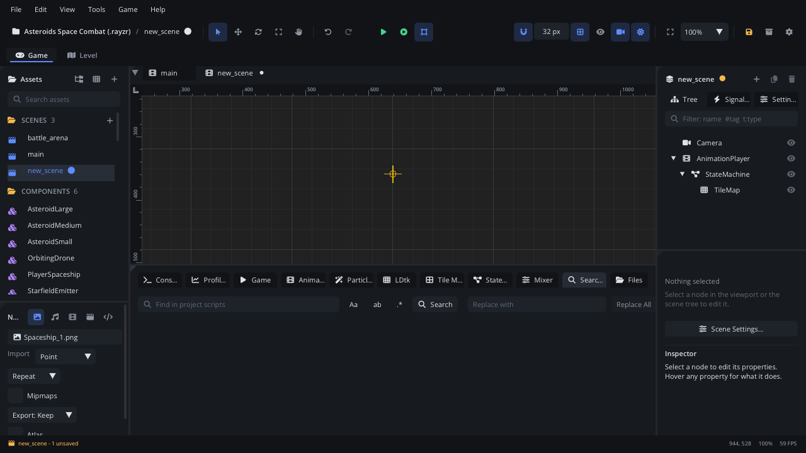

# Search

The **Search** tab finds text in every script and shader of the project at
once, and can replace it everywhere. Matches are listed by file, with the
line around each one; click a match to open the script at that line.

## When to use it

- **Finding every use of something**: a function, a signal name, an input
  action, a node name passed to `get_node`.
- **Renaming text across scripts**: a property or a string used in many
  files - type it, type the new text, **Replace All**.
- **Finding where a message comes from**: paste a log line's text and see
  which script prints it.
- **Not** for searching one file: use **Find** (Cmd+F (Ctrl+F)) in the
  Code tab - see [the Code tab reference](../../editor/CODE_EDITOR.md).
- **Not** for renaming a Lua name the language server knows: **Rename**
  (F2) in the Code tab follows the code, not just the text.
- **Not** for finding nodes or assets: filter the [Scene](scene-tree.md)
  panel, or use the [Assets](assets.md) panel's search and **Go to File**
  (Cmd+P (Ctrl+P)).

## What's in it

### Opening it

- **Cmd+Shift+F** (Ctrl+Shift+F) - **Find in Files**, from anywhere in the
  editor. It shows the Search tab and puts the cursor in the search box.
  When text is selected in the Code tab (on one line), it becomes the query.
- The Code tab's right-click menu: **Find in Files**.
- The command palette (Cmd+Shift+P (Ctrl+Shift+P) or F1): *Find in Files*.
- The **Search** tab in the bottom panel.

### The search row

| Control | What it does |
|---|---|
| Search box (*Find in project scripts*) | The text to find. **Enter** runs the search. |
| **Aa** | Match case. Lit when on. Clicking it runs the search again. |
| **ab** | Whole word: `speed` does not match `max_speed`. Runs the search again. |
| **.\*** | Regular expression. Runs the search again. A bad pattern shows *Invalid regular expression*. |
| **Search** | Runs the search. |
| **Replace with** | The text that replaces each match. |
| **Replace All** | Replaces every match listed. Greyed out when there are no matches, and when **.\*** is on (regex replace is not supported). |

Under the row, a summary: *N match(es) in M file(s)*. The search stops at
2000 matches and says *(stopped at 2000)*.

### What it searches

- Every `.lua`, `.fs`, `.vs` and `.glsl` file in the project.
- Hidden folders (names starting with `.`, such as `.rayzr/`) are skipped.
- A script open in the Code tab is searched as it is in the editor, with
  its unsaved changes - not as it is on disk.

### The results

- One row per file: its path in the project and its number of matches.
  Click the arrow to fold a file's matches away.
- Under it, one row per match: the line number, then the line with the
  match highlighted. Long lines are cut so the match stays in view.
- **Click a match** to open the script in the Code tab with the cursor on
  it. It opens as a preview tab: the next match you click replaces it,
  until you edit it.

### Replace All

- Scripts open in the Code tab are changed in the editor, as one undo step
  per file (Cmd+Z (Ctrl+Z) in that script undoes it). Save them as usual.
- Scripts that are not open are written to disk straight away.
- The Console reports *Replaced N match(es) in M file(s)*, and the search
  runs again (so the list is empty if every match was replaced).
- **Aa** and **ab** apply to the replace too.

## Walkthrough

Rename the input action `"jump"` to `"jump_pressed"` in every script:

1. Press **Cmd+Shift+F** (Ctrl+Shift+F). The Search tab opens with the
   cursor in the search box.
2. Type `"jump"` (with the quotes, so `jumping` does not match) and press
   **Enter**.
3. Read the summary - for example *5 match(es) in 3 file(s)* - and check
   the list. Click a match to see it in context.
4. Turn on **Aa** if the project also has `"Jump"` you want to leave alone.
5. In **Replace with**, type `"jump_pressed"`.
6. Click **Replace All**. The Console says how many matches were replaced,
   and the list empties.
7. Scripts that were open in the Code tab now show as changed: save them
   with **Cmd+Alt+S** (Ctrl+Alt+S, *Save All*). Rename the action in
   **Project Settings > Input** too.

## Tips

- Select a word in the Code tab before pressing Cmd+Shift+F: it is
  searched straight away when you press Enter.
- Replace All can't be undone in one step for files that weren't open (they
  are written to disk). Open the scripts first, or use version control,
  for big renames.
- With **.\*** on you can search with a pattern (`timer_set_\w+`), but not
  replace: turn it off to replace.
- Only scripts and shaders are searched. Scenes, components and other JSON
  files are not.
- Related: the Code tab's own find and replace in
  [CODE_EDITOR.md](../../editor/CODE_EDITOR.md), [Console](tab-console.md),
  [Files](tab-files.md) (finds files by name outside the project).
