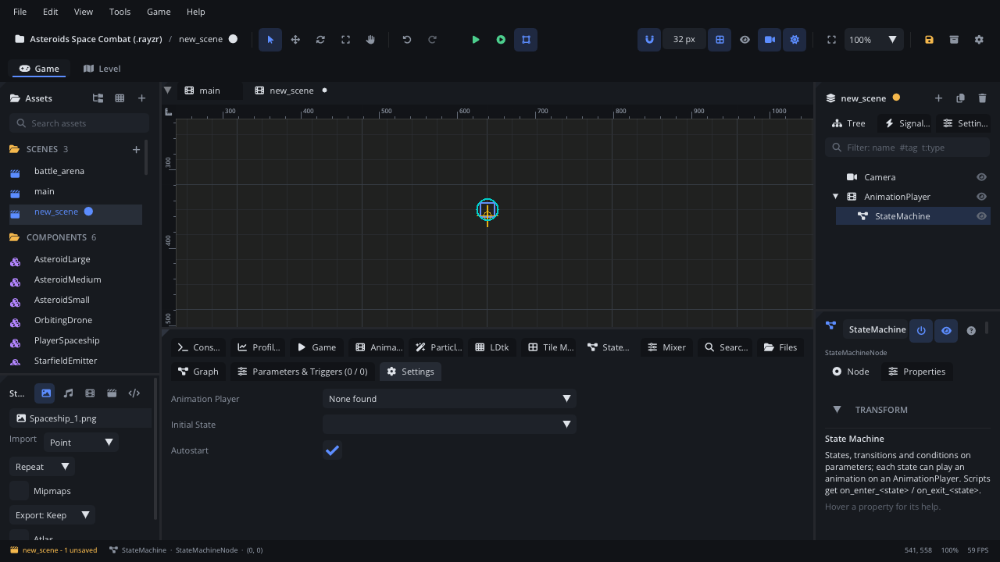

# State Machine tab

The **State Machine** tab edits the selected
[State Machine](../nodes/StateMachineNode.md) as a graph: states are boxes,
transitions are arrows with their conditions. Its other pages hold the
machine's parameters, triggers and settings. While the scene runs (Simulate
or Play) it shows the machine live: the current state, the arrow that
fired, why the others wait. For what states, arrows, conditions, guards
and triggers mean, read [State machines](../../engine/docs/state_machine.md).

## When to use it

- **Choosing which animation plays**: idle, run, jump, fall, attack, with
  arrows on `speed > 0.1` or a `jump` trigger.
- **Gameplay states without animation**: an enemy's patrol / chase /
  attack, a door's open / closed, a game's menu / playing / paused, with
  script callbacks per state.
- **Debugging behaviour**: watch the live view and **Ways out** to see why
  a state doesn't change, or stop the game with **Break on Enter**.
- To make or edit the animations themselves, use the
  [Animation tab](tab-animation.md). For a fixed sequence over time, an
  animation track is simpler than a machine.

## What's in it

Select a State Machine node (or click **Edit in State Machine Tab** in its
Inspector). With **Bottom Panel Follows Selection** on
([Settings](settings.md) > General), selecting one switches to this tab by
itself. With no machine selected it says *Select a State Machine node...*.

The tab has three pages: **Graph**, **Parameters & Triggers** (its label
shows the counts) and **Settings**.

### Graph: the canvas

What you see:

- **State boxes**: the name, and under it a film icon with its animation,
  or *gameplay*; a child machine's name after a sitemap icon. A **flag**
  marks the initial state, a **red dot** Break on Enter, a **circular
  arrow** Allow Retrigger, a **lock** guards (hover the lock for what they
  refuse).
- The **Any state** box: arrows from it can fire from every state.
- **Arrows** with their conditions at the middle: `speed > 10`, `!on_floor`,
  `jump!` (a trigger), `anim done`, `after 0.5s`, `sees_player()`, `a | b`
  (or-groups), `always` (none). **Manual** arrows are **dashed** and their
  label starts with `manual`; **Automatic** ones are solid. A pair of
  arrows both ways curves apart; an arrow to the same state loops over it.
- A **dot** on the right edge of each box: drag from it to make an arrow.

Mouse and keys:

| Action | What it does |
|---|---|
| Click a box or arrow | Select it (the side panel edits it). Click empty space to deselect. |
| Drag a box | Move it (snaps to 10 px; positions are saved). The Any box moves too. |
| Drag a box's **dot** onto another box | Add an arrow (new arrows are Manual). From the Any box's dot: an Any-state arrow. |
| Drag a dot out and back onto its own box | An arrow to itself; this turns on the state's **Allow Retrigger**. |
| **Delete** / Backspace | Remove the selected state or arrow. |
| Wheel, middle-drag | Pan. **Shift+wheel** pans sideways. |
| **Cmd+wheel** (Ctrl+wheel) | Zoom at the mouse (30% to 250%). |
| **F** | Frame everything (also done when a machine is first shown). |
| Right-click empty space | **Add State** (a gameplay state named `state`), **Add State for Animation** > *animation* (named after it, playing it), **Frame All**. |
| Right-click a state | **Set as Initial State**, **Break on Enter**, **Add Script Callbacks**, **Add Guard Callbacks**, **Delete State**. |

An empty machine shows *Right-click to add a state...* on the canvas. New
states never land on top of another box.

### Graph: the side panel

**Nothing selected**: the machine's name and counts (states, transitions,
parameters). While running: the current state and its time (*in the
running game* during Play), **Ways out**, the live **Parameters &
Triggers** with an **Edit Parameters & Triggers** button.

**A state selected**:

| Control | What it does |
|---|---|
| **Name** | Rename it (Enter or click away). Arrows follow; a name already used is refused. |
| **Animation** | The animation it plays on entering, or *(none: gameplay)*. Lists the machine's Animation Player's animations. |
| **Child Machine** | Another State Machine in the scene that runs only while this state is current. |
| **Initial** | The state the machine starts in. |
| **Break on Enter** | Pause Simulate or the running game when the machine enters this state. |
| **Allow Retrigger** | It may go to itself: on_exit, on_enter and the animation run again. Off: such arrows are skipped. |
| **Ways out (live)** | Only while it is the current state (see below). |
| **Guards** > **Leave After** | No arrow leaves before it has been in the state this long (*any time* at 0). |
| **Guards** > **Any State Interrupts** | Off: Any-state arrows don't fire while in this state (dead, a cutscene). |
| **Can leave when** | Conditions that must hold to leave (empty: any time). |
| **Can enter when** | Conditions that must hold to come in (empty: any time). |
| **Script callbacks** | Which script gets them (the machine's, else its parent's) and the names `on_enter_<state>`, `on_update_<state>`, `on_exit_<state>`. **Add Missing Callbacks** writes those that are missing; **Add Guard Callbacks** writes `can_exit_<state>(next)` / `can_enter_<state>(previous)` returning true. Without a script it says to attach one first. |
| **Transitions out** | Each arrow out of the state; click one to select it. |

**An arrow selected**:

| Control | What it does |
|---|---|
| From → To | The arrow's two states (From can be Any). |
| **Trash** | Remove the arrow. |
| **Mode** | **Manual** (only a script's `sm_transition` takes it) or **Automatic** (taken by itself when its conditions hold). |
| **blend** | Crossfade time, in seconds, into the target's animation. |
| Conditions | The rows below. |

Under the arrow, a note explains its mode, warns when a self-arrow can
never fire (Allow Retrigger off), and, while running, says what blocks it.

**Conditions** (an arrow's, and a state's Can leave / Can enter):

- Each row reads `when` / `and` + a parameter or trigger + an operator +
  a value: **is true**, **is false**, **==**, **!=**, **>**, **<**,
  **trigger**, **animation finished**, **after (s)** (time in the state),
  **script says** (a method name on the machine's script, else its
  parent's; it holds when the method returns true).
- **×** removes a row.
- **+ Condition** adds a row (on the first parameter, else the first
  trigger, else *animation finished*).
- **Or** starts another group: any group holding is enough.
- While running, each row starts with a green check or a red cross: does
  it hold now?

**History** (under the side panel, while running and after a run): the
last 12 changes, newest first - time, from → to, and why.

### Live view

In **Simulate** (F7) and while the game runs from **Play** (F5 / F6, read
over the editor link):

- The current state is lit, with a bar along its bottom for its time.
- The arrow that fired flashes.
- An arrow whose conditions hold but a guard refuses is drawn red.
- **Ways out** lists each arrow out of the current state (Any-state ones
  too): *fires*, *waiting for ...* (the conditions still missing),
  *manual: a script calls sm_transition(...)*, or *blocked: ...* with the
  guard and the time so far. Click one to select the arrow.

### Parameters & Triggers page

Two columns.

**Parameters** - values the game sets every frame (`sm_set("speed", 4.2)`)
that conditions compare:

| Column | What it does |
|---|---|
| **Name** | Rename it; conditions that use it follow. |
| **Type** | float, int or bool. |
| **Starting value** | The value when the scene loads. While simulating, the column is **Value** and edits the running machine. |
| **Live** | While running: the value now. |
| **Trash** | Remove it (conditions that use it stay, unmatched). |

**Add Parameter** adds a bool named `param` (change the type in its row).

**Triggers** - one-shot events (`sm_trigger("jump")`):

| Column | What it does |
|---|---|
| **Name** | Rename it; conditions follow. |
| **Buffer** | How long it stays set waiting for an arrow it can open (*none*: only the next update). 0.15 s lets a jump pressed just before landing still jump. |
| **Live** | While running: pending with its time left, or **Fire** (Simulate only) to set it now. |
| **Trash** | Remove it. |

**Add Trigger** adds one named `trigger`.

### Settings page

| Setting | What it does |
|---|---|
| **Animation Player** | The player whose animations the states play. **Auto**: a sibling, else a child. Not needed for gameplay-only machines. |
| **Initial State** | The state it starts in. |
| **Autostart** | Enter the initial state when the game starts (else call `sm_start()`). A child machine always waits for its parent's state. |
| **Add a State per Animation** | A state for each of the player's animations that has none yet. |

## Walkthrough

Idle, run and jump for a player:

1. The player has an **Animation Player** with `idle`, `run` and `jump`
   animations. Add a **State Machine** next to it (same parent).
2. The **State Machine** tab opens. Go to its **Settings** page:
   **Animation Player** shows *Auto (...)*, the player next to it. Click
   **Add a State per Animation**: three states appear.
3. Go to **Graph**. Right-click `idle` > **Set as Initial State**.
4. Open **Parameters & Triggers**. **Add Parameter**, name it `speed`, type
   **float**. **Add Trigger**, name it `jump`, **Buffer** 0.15 s.
5. Back in **Graph**, drag from `idle`'s dot onto `run`. Select the arrow:
   set **Mode** to **Automatic**, **+ Condition**, pick `speed`, **>**,
   value `0.1`.
6. Drag from `run`'s dot onto `idle`: Automatic, `speed` **<** `0.1`.
7. Drag from the **Any state** dot onto `jump`: Automatic, **+ Condition**,
   pick **trigger** and `jump`. Then drag from `jump` to `idle`: Automatic,
   **animation finished**.
8. In the player's script, call `machine:sm_set("speed", math.abs(vx))`
   every frame and `machine:sm_trigger("jump")` when the jump key is
   pressed.
9. Press **F7**. Move and jump: the current state lights up and the side
   panel's **Ways out** says what each arrow waits for. On the Parameters
   page, press **Fire** next to `jump` to test it without input.
10. Press **F7** again to stop, and save (Cmd+S / Ctrl+S).

## Tips

- New arrows are **Manual** (dashed): they do nothing until a script calls
  `sm_transition`. Switch **Mode** to Automatic for arrows the machine
  should take by itself.
- **Delete** in the graph removes a state or arrow, not the selected
  scene node, while the tab has focus.
- **Break on Enter** is kept by the editor, not saved in the scene, and is
  sent to every game Play starts.
- Every state in the project is in the generated Lua types, so typing
  `function Player:on_update_` completes the state names.
- Renaming an animation in the [Animation tab](tab-animation.md) renames
  it in the states of machines that drive that player.
- Related: [State machines guide](../../engine/docs/state_machine.md),
  [State Machine node](../nodes/StateMachineNode.md),
  [Animation Player](../nodes/AnimationPlayerNode.md),
  [Playtesting](playtesting.md).
