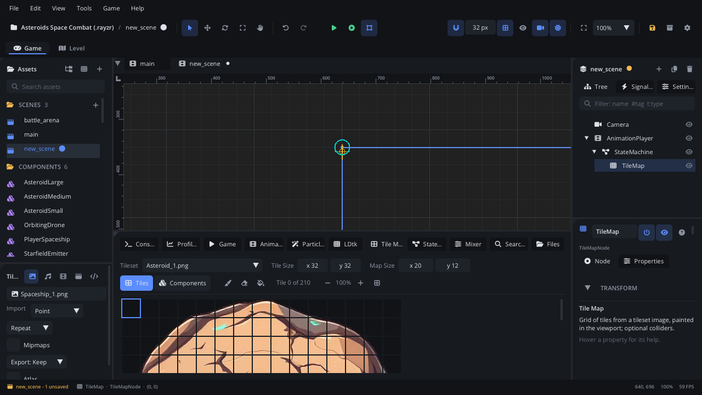

# Tile Map

The **Tile Map** tab is where you paint a [Tile Map](../nodes/TileMapNode.md)
node. It sets the map's tileset, tile size and map size, holds the painting
tools, and shows the tileset's tiles to pick from. You pick a tile here and
paint in the viewport. Its **Components** layer paints components (coins,
enemies, spikes) on the same grid.

## When to use it

- **Painting a room in the scene**: ground, walls and platforms from one
  tileset image.
- **Placing many copies of a component on a grid**: a row of coins, spikes
  along a floor, enemies on a grid - the **Components** layer.
- **Fixing up a generated map**: a [Level Generator](../nodes/LevelGeneratorNode.md)
  writes into a Tile Map; touch it up here.
- **Not** for levels with many layers, auto-tiling rules or entities with
  fields: use an LDtk level and the [LDtk tab](tab-ldtk.md) (edited in the
  [Level tab](../../engine/docs/level_editor.md)).
- **Not** for a map that comes from an Aseprite tilemap layer: set the
  node's **Aseprite Layer** in the [Inspector](inspector.md) and paint in
  Aseprite.

## What's in it

### Opening it

- Select a Tile Map node. With **Settings > General > Bottom Panel Follows
  Selection** on (the default), the tab shows by itself, and the bottom
  panel goes back to the tab you had when you select something else.
- The Inspector's **Tile Map** section: **Edit in Tile Map Tab**.
- The **Tile Map** tab in the bottom panel.

The tab works on the **selected** Tile Map node. With nothing selected (or
another node selected) it says *Select a Tile Map node to paint its tiles.*

### The settings row

| Control | What it does |
|---|---|
| **Tileset** | The image the tiles are cut from: pick one of the project's images (or none). |
| **Tile Size** (x, y) | The size of one tile in the image, in pixels (1-512). Drag or type. |
| **Map Size** (x, y) | The map in cells: columns, rows (1-1024). Drag or type. |

Each change is one undo step. You can also right-click an image in
[Assets](assets.md) > **Use as Tileset of Selected Tile Map**.

### The tools row

| Control | What it does |
|---|---|
| **Tiles** | The tools paint tileset tiles (the tile list shows below). |
| **Components** | The tools paint component instances (the component list shows below). |
| **Paint** (brush) | Left button paints the picked tile (or component) on each cell the mouse crosses. |
| **Erase** (eraser) | Left button clears cells. |
| **Fill** (paint bucket) | Left click flood-fills the connected cells that hold the same tile as the clicked one. |
| *Tile N of M* | The picked tile and how many the tileset has. On the Components layer: the picked component and how many are on the map. |
| **-** / **+** | Smaller / bigger tiles in the tile list (25% to 800%). The number between them is the zoom. |
| Grid button | Tiles touching, with lines between them. Off: tiles spaced apart. |

Click the lit tool again to turn it off: the viewport then selects and
moves nodes as usual. Clicking a tile (or a component) when no tool is on,
or **Erase** is on, switches to **Paint**.

The zoom and grid buttons only show on the **Tiles** layer, once a tileset
is picked.

### Painting in the viewport

While a tool is on, the viewport shows the map's outline and the cell under
the mouse (the accent colour to paint, red to erase).

| Action | What it does |
|---|---|
| Left button | Paints, erases or fills, by the tool. Drag to paint a line of cells - fast strokes don't skip cells. |
| Right button | Always erases, whatever the tool. |
| Shift + click (Components, **Paint**) | Places one component exactly where you click, off the grid. |

- **One stroke is one undo step** (Cmd+Z (Ctrl+Z)).
- The map size is an outline, not a limit: you can paint outside it, and
  those tiles are saved (and solid) too. Making the map smaller never
  deletes tiles - grow it back and they are still there.
- **Fill** started inside the map stays inside it. Started outside, it stays
  inside the area that has tiles.

### The tile list (Tiles layer)

The tileset's tiles, laid out as in the image. Hover a tile for its number,
column and row; click one to paint with it. The picked tile has an accent-coloured
outline. Scroll when the tileset is bigger than the panel.

Before a tileset is picked, the tab says *Pick a tileset image above to
paint with.*

### The component list (Components layer)

The project's components (`.component.json` files) as cards: a picture from
the first image the component uses, or a cube icon. A component bigger than
one cell shows its footprint (*2x2*) in the corner. Click one to paint with
it.

- The brush puts one linked instance on each cell, centred. A component
  bigger than a cell takes its whole footprint and replaces what it covers.
- **Erase**, the right button and **Fill** work on this layer too. A fill
  stops at 4096 components.
- The instances are ordinary children of the tile map, saved with the
  scene: select one to nudge it or override its properties. Editing the
  component file updates every painted copy.
- With no components in the project, the tab says so: select nodes and use
  **Save as Component** first.

## Walkthrough

Paint a floor and add coins above it:

1. **Add Node** (Cmd+A (Ctrl+A)) > *Tile Map*. The bottom panel shows the
   **Tile Map** tab.
2. In **Tileset**, pick your tileset image (for example
   `textures/tiles.png`).
3. Set **Tile Size** to the size of one tile in the image, for example
   `16` and `16`. The tile list below shows the cut tiles.
4. Set **Map Size** to `40` x `12`.
5. Click a ground tile in the list. **Paint** turns on.
6. In the viewport, drag along the bottom row of the map outline to paint
   the floor. Right-drag over a mistake to erase it.
7. In the Inspector, tick **Solid** so the floor blocks bodies.
8. Click **Components** in the tools row, then click your coin card.
9. In the viewport, drag along a row above the floor: one coin per cell.
   Hold **Shift** and click to drop a coin between cells.
10. Click the lit **Paint** button to turn the tool off, then press
    **F6** to play the scene.

## Tips

- Colliders for **Solid** maps are built when the scene runs (Play or
  Simulate), not while you edit. Painted components keep their own
  colliders; **Solid** only covers tiles.
- Use **-** / **+** for small pixel-art tiles: the list starts at about
  32 px per tile.
- Scripts can read and change the map: `map:tilemap_component_at(x, y)`,
  `map:tilemap_set_component(x, y, path)`,
  `map:tilemap_clear_component(x, y)` (0-based cells). See the
  [Tile Map node page](../nodes/TileMapNode.md).
- Related: [Inspector](inspector.md), [Viewport](viewport.md),
  [Assets](assets.md), [LDtk tab](tab-ldtk.md),
  [Components](../../engine/docs/components.md).
