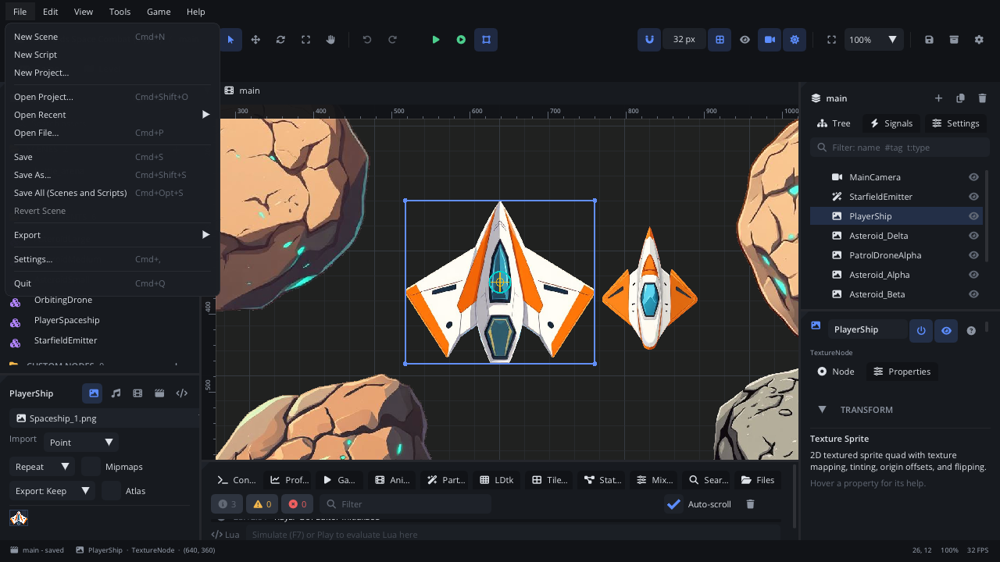

# Toolbar and menus

The menu bar at the top of the window holds every editor command, and the
toolbar under it holds the ones you use all the time: the transform tools,
undo, play, snapping, view toggles, zoom and save. Every command comes from
one table, so the shortcut a menu shows is the shortcut that works, and the
**command palette** finds any of them by name.

## When to use it

- Switch tools (select, move, rotate, scale, pan) and run the game.
- Save, export, open another project, or change settings.
- Turn viewport overlays on and off (grid, bounds, camera frames, lighting).
- Find a command you don't know the shortcut for: open the palette with
  Cmd+Shift+P (Ctrl+Shift+P) or F1 and type.
- For editing nodes, use the [Scene panel](scene-tree.md) and the
  [Inspector](inspector.md); for moving around the scene, the
  [viewport](viewport.md).

## What's in it

Shortcuts are shown for macOS; on Windows and Linux, Cmd is Ctrl and Opt is
Alt. Ctrl+Tab and the other Ctrl shortcuts use the Control key everywhere.
Change any shortcut in **File > Settings** (Keymap).

### Game / Level tabs

Above the toolbar, two tabs switch the whole window:

| Control | What it does |
|---|---|
| **Game** | Scenes, nodes and scripts - the scene editor. Cmd+Shift+1 (Ctrl+Shift+1). |
| **Level** | The LDtk level editor (shows the open `.ldtk` file, a dot when unsaved). Cmd+Shift+2. It has its own toolbar; Play stays. See the [level editor guide](../../engine/docs/level_editor.md). |

### The toolbar

From left to right:

| Control | What it does |
|---|---|
| **Project name** (folder icon) | Click for **Project Settings**. Hover for the project's path. |
| **/ scene name** | The active scene. A dot means some open scene has unsaved changes. |
| **Select** | Click to select nodes, drag on empty space for a box selection. **Q** |
| **Move** | Arrows to move the selection (X, Y or both). **W** |
| **Rotate** | A ring to rotate the selection. **E** |
| **Scale** | Handles to scale the selection (X, Y or both). **R** |
| **Pan** | Drag to move the view (the middle mouse button pans with any tool). **T** |
| **Undo / Redo** | Undo and redo scene edits. Cmd+Z (Ctrl+Z) / Cmd+Shift+Z (Cmd+Y also redoes). |
| **Play** (green) | Play the project from its startup scene. Saves your changes first and rebuilds if code changed. **F5** |
| **Play Scene** (green circle) | Play only the current scene. **F6** |
| **Colliders** (square) | Whether the running game draws collision shapes. Lit = shown. Also switches a game that is already running. |
| **Status** | *Building...*, *Running*, *Paused* or *Breakpoint*. |
| **Snap to grid** (magnet) | Moves, guides and shape handles snap to the grid. Shift+S |
| **Grid size** | The grid step in pixels (drag or type, 4 to 256). |
| **Show grid** | The background grid and the origin axes. Shift+G |
| **Show bounds & colliders** (eye) | Outlines every node and its collision shapes, not only the selected ones. |
| **Show camera frames** (camera) | Draws each camera's frame: what the game will show. |
| **Screen shape** | Only with the project's **Screen Fill: Expand**. Picks the screen shape to preview (16:9, 16:10, 4:3, 21:9, phone portrait). |
| **Preview lighting** (sun) | Shows lights, the scene's ambient light and post effects in the viewport. |
| **Fit** | Zoom to show the whole scene. **Home** |
| **Zoom** (100%) | Pick 25%, 50%, 100%, 200%, 400%, or **Fit Scene**, **Fit Game View**, **Fit Selection**. |
| **Save** (disk) | Save the active scene. Turns orange when there are unsaved changes. Cmd+S |
| **Export** (box) | Export a `.rayzr` package (asks for a folder). |
| **Settings** (gear) | Project Settings. |

While the game runs, Play and Play Scene become:

| Control | What it does |
|---|---|
| **Pause / Resume** | Pause the game, or resume it. **F9** |
| **Step** | Pause and run one frame. Shift+F9 |
| **Restart** | Save, rebuild if needed, and play the same again. Cmd+Shift+F5 |
| **Stop** (red) | Stop the game. Shift+F5 |

While a build runs, the red button cancels the build.

### File menu

| Item | Shortcut | What it does |
|---|---|---|
| **New Scene** | Cmd+N | A new scene, added to the project. |
| **New Script** | | A new Lua script. |
| **New Project...** | | A new project from a template. |
| **Open Project...** | Cmd+Shift+O | Open another project folder (asks about unsaved work first). |
| **Open Recent** | | Projects you opened before. |
| **Open File...** | Cmd+P | Go to any scene, script, component or asset by name (`>` for commands, `:` for a line). |
| **Save** | Cmd+S | Saves the focused script, else the active scene (on the Level tab: the `.ldtk` file). |
| **Save As...** | Cmd+Shift+S | Saves the focused script or the scene (a component as a new component) under a new name. |
| **Save All (Scenes and Scripts)** | Cmd+Opt+S | Every open scene and script. |
| **Revert Scene** | | Throw away unsaved changes to the scene (only when it has some). |
| **Export > .rayzr Package** | | A portable package of the project. |
| **Export > Standalone Game** | | A game you can run without the editor. |
| **Export > Open Web Export in Browser** | | After a web export. |
| **Settings...** | Cmd+, | Editor settings (general, keymap, theme, code editor) and project settings. |
| **Quit** | Cmd+Q | Asks about unsaved scenes and scripts first. |

### Edit menu

| Item | Shortcut | What it does |
|---|---|---|
| **Undo / Redo** | Cmd+Z / Cmd+Shift+Z, Cmd+Y | Every scene edit, one step at a time. |
| **Cut / Copy / Paste** | Cmd+X / C / V | The selected nodes. Pasting into another scene keeps their world positions. |
| **Duplicate** | Cmd+D | A full copy (properties, script values, children) next to the original. |
| **Delete** | Del or Backspace | The selected nodes. |
| **Rename Node** | F2 | A rename box for the selected node. |
| **Lock in Viewport** | Cmd+L | The node and its children can't be picked or moved in the viewport. |
| **Hide in Editor** | Cmd+Shift+H | Hidden in the viewport only; the game still shows it. |
| **Add Node...** | Cmd+A | The Add Node dialog; the new node goes under the selected one. |
| **Select All Nodes** | Cmd+Shift+A | Every node except locked ones. |
| **Deselect** | Esc | Clears the selection (first leaves shape editing). |
| **Align** | | With two or more nodes selected: **Align Left / Right / Top / Bottom Edges**, **Align Horizontal / Vertical Centers**, **Distribute Horizontally / Vertically** (even spacing between centres). |

The arrow keys nudge the selection by 1 pixel (Shift: one grid step). A
quick burst of nudges is one undo step.

### View menu

| Item | Shortcut | What it does |
|---|---|---|
| **Command Palette** | Cmd+Shift+P, F1 | Every command, searchable, recent ones first. |
| **Grid** | Shift+G | Show the grid. |
| **Bounds & Colliders** | | Outline every node and its shapes. |
| **Camera Frames** | | Draw camera frames. |
| **Show All Colliders** | | Every collision shape (bodies, LDtk levels, tile maps), even when the project hides them. |
| **Rulers & Guides** | Cmd+Shift+R | Rulers on the viewport edges; drag from one to add a guide. |
| **Clear Guides** | | Removes every guide in the scene. |
| **Inspector Help** | | The help pane at the bottom of the Inspector. |
| **File Browser** | Cmd+Shift+B | A file browser window. |
| **Colour Vision: Protanopia / Deuteranopia / Tritanopia** | | Shows the viewport as players with that colour vision see it (pick it again to turn it off). |
| **Snap to Grid** | Shift+S | Grid snapping. |
| **Snap Rotation** | | Rotation snaps to 15°. |
| **Smart Snapping** | | Moved nodes snap to other nodes' edges and centres and to guides. On by default. |
| **Frame Selection** | F | Centre the view on the selected node. |
| **Zoom In / Zoom Out** | Cmd+= / Cmd+- | Zoom by steps (10% to 1000%). |
| **Reset Zoom (100%)** | Cmd+0 | |
| **Fit Scene to View** | Home | The whole scene. |
| **Fit Game View** | Shift+Home | The camera's frame at the project's resolution. |
| **Fit Selection** | Shift+F | Zoom to the selected nodes. |
| **Focus Viewport / Code Editor / Console** | Cmd+1 / Cmd+2 / Cmd+J | Move the keyboard focus. |
| **Bottom Panel** | | Tick or untick each bottom panel tab (at least one stays). |
| **Workspaces** | | *Default*, *Level Design*, *Scripting*, *Animation* and layouts you saved; **Save Workspace As...**, **Delete Workspace**. |
| **Show Tab Bars** | | Give every docked window its tab. |
| **Reset Layout** | | Back to the Default layout. |

Installed plugins can add a **Plugins** submenu with their panels, and
commands to any menu.

### Tools menu

| Item | Shortcut | What it does |
|---|---|---|
| **Select / Move / Rotate / Scale / Pan** | Q / W / E / R / T | The transform tools. |
| **Sprite Sheet Slicer...** | | Cut a sprite sheet into frames. |
| **New Plugin...** | | Start an editor plugin. |

### Game menu

| Item | Shortcut | What it does |
|---|---|---|
| **Play Project** | F5 | Run the game from its startup scene. |
| **Play Current Scene** | F6 | Run only this scene. |
| **Pause** | F9 | Pause or resume the running game. |
| **Step One Frame** | Shift+F9 | |
| **Restart** | Cmd+Shift+F5 | |
| **Stop** | Shift+F5 | |
| **Show Colliders in Game** | | Same as the toolbar's colliders button. |
| **Simulate in Editor** | F7 | Run the scene's scripts and physics inside the viewport. Press F7 again to stop: the scene goes back to how it was. |
| **Save Data > Open Folder** | | Where the game's save files are. |
| **Save Data > Delete Save Files** | | Start fresh. |

### Help menu

| Item | Shortcut | What it does |
|---|---|---|
| **Welcome** | | The Welcome window (recent projects, templates). |
| **Scripting Reference** | | The Lua API. |
| **Editor Manual** | | This manual, inside the editor. |
| **Node Reference** | | Every node type. |
| **Level Editor Reference / Shortcuts** | | The Level tab's help. |
| **Keyboard Shortcuts** | Cmd+Shift+K | Every shortcut, from the same table. |
| **Command Palette** | Cmd+Shift+P | |
| **Check for Updates** | | |
| **Report a Bug...** | | Opens a bug report. |
| **Open Crash Reports Folder** | | |
| **About** | | The editor version (in the console). |

Shift+F1 opens the documentation for the selected node's type.

### Debugger keys

While the game is stopped at a breakpoint: **Continue** F8, **Step Over**
F10, **Step Into** F11, **Step Out** Shift+F11. See the
[Code tab](../../editor/CODE_EDITOR.md).

## Walkthrough

Try a change and see it in the game:

1. Press **W** for the Move tool and click a node in the viewport.
2. Click the magnet (or press Shift+S) so it snaps, and set the grid size
   to `16`.
3. Drag the node's arrows. It moves in 16 px steps.
4. Press Cmd+S (Ctrl+S). The toolbar's save button stops being orange.
5. Press **F6** to play the scene. The status shows *Running*.
6. Press **F9** to pause, then Shift+F9 to step one frame at a time.
7. Click the colliders button to see the collision shapes in the running
   game, then press Shift+F5 to stop.
8. Can't remember a command? Press F1, type `fit`, and pick
   **Fit Selection**.

## Tips

- **Simulate** (F7) has no toolbar button: use the Game menu or F7. Edits
  made while simulating are thrown away when you stop.
- Play and Restart save your changes before they start the game.
- Shortcuts don't fire while you type in a text field, and the Code tab
  has its own keys when it has focus.
- Two shortcuts on one key? Settings > Keymap flags the conflict.
- More: [editor tour](tour.md), [viewport](viewport.md),
  [Scene panel](scene-tree.md), [Inspector](inspector.md),
  [pixel-perfect settings](../../engine/docs/pixel_perfect.md).
