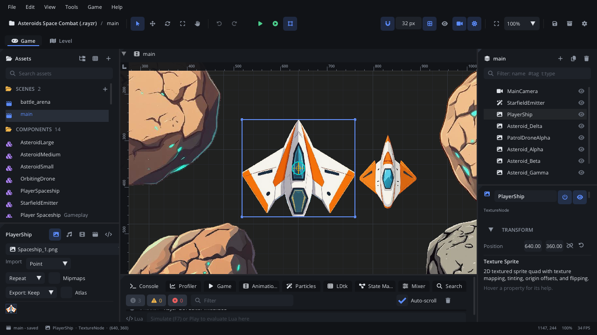
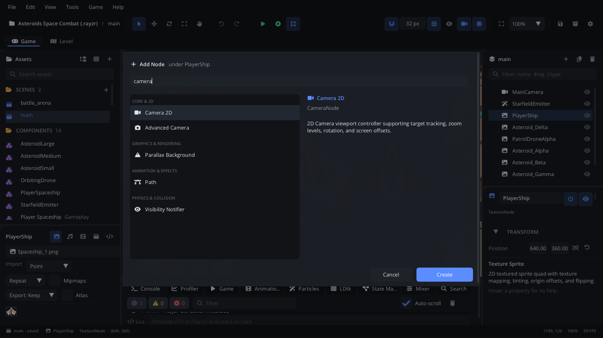

# Editor tour

A map of the editor window: what each part is for and where to read more.
The numbers on each screenshot match the list below it. (The screenshots are
taken by the editor's own test drives, so they show this version.)

## The window

Panels dock wherever you drag them. **View > Workspaces** switches between
layouts - *Default*, *Level Design* (a big viewport), *Scripting* (the Code
tab in the middle), *Animation* (a tall timeline) and any you save; pick
*Default* to get the standard layout back. The
[editor manual](../../editor/README.md) describes every panel in depth.

## The toolbar

| Shortcut | Action |
|---|---|
| **Q / W / E / R / T** | Select, move, rotate, scale, pan |
| **F5 / F6** | Play the project / play the current scene |
| **F7** | Simulate the scene inside the editor |
| **Shift+F5** | Stop |
| **Cmd+S** | Save the scene (Ctrl on Windows and Linux) |
| **Cmd+Shift+P** or **F1** | The command palette: every action, searchable |

**Help > Keyboard Shortcuts** (Cmd+Shift+K) lists every shortcut, and
**Settings** lets you change them.

## Selecting and editing nodes

A scene is a tree of **nodes**. Selecting one - in the viewport or the
Scene panel - shows it in the **Inspector**:

- **Transform**: position, rotation, scale and origin, plus draw order
  (layer, Z index, Y-sort).
- **The node's own properties**: a sprite's texture, a camera's follow
  mode, a body's collision shapes... hover any of them for its help.
- **Script**: attach a Lua script; its declared properties appear here.
- **Signals**: connect the node's events (a timer's `timeout`, an area's
  `body_entered`) to script methods.

Every property is documented in the [node reference](../../docs/generated/nodes.json).

## Adding nodes

**Cmd+A** (or **+** in the Scene panel) opens **Add Node**: type to search,
pick a node, **Create**. It is added under the selected node.

## Tabs and modes

- **Game / Level** (top left) switch between the scene editor and the
  [level editor](../../engine/docs/level_editor.md) for LDtk projects.
- **Scene tabs** above the viewport hold each open scene; each keeps its
  own camera, selection and undo history.
- The **Code** tab edits Lua scripts with completion, hover docs, go to
  definition, rename and a debugger ([Code tab](../../editor/CODE_EDITOR.md)).
- The bottom panel has the **Console**, **Animation** timeline,
  **Particles**, **State machine** graph, **Mixer**, **Profiler**, project
  **Search** and the live **Game** tree while the game runs.
