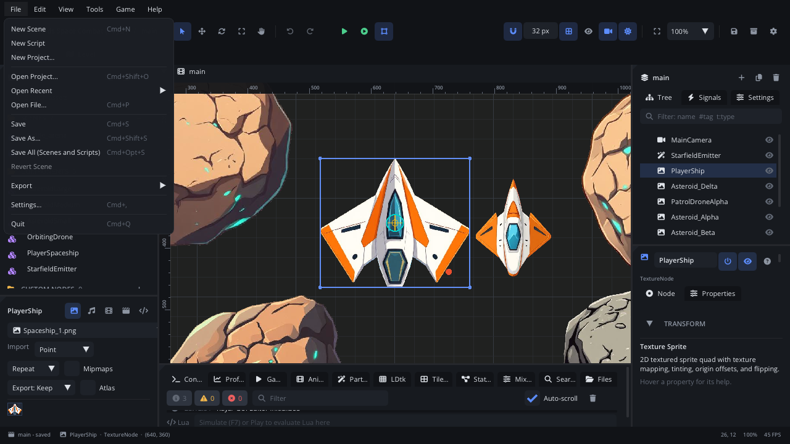

# Viewport

The viewport shows the active scene the way the game draws it, and lets you
work on it directly: pick nodes, move, rotate and scale them with gizmos,
edit collision shapes, and drop assets in from the Assets panel. Overlays
show what the game doesn't draw - the grid, node bounds, colliders, the
camera's frame, guides.

## When to use it

- Place and arrange nodes by eye.
- Check what the game's camera will see.
- Edit a physics body's collision shapes with handles.
- Add images, sounds, components and levels by dragging them in.
- Try the scene with **Simulate** (F7) without leaving the editor.
- For exact values use the [Inspector](inspector.md); to find a node by
  name, the [Scene panel](scene-tree.md).

## What's in it

### Moving around

| Action | What it does |
|---|---|
| Mouse wheel | Zoom around the mouse (10% to 1000%). |
| Middle mouse drag | Pan, with any tool. |
| **Pan** tool (T) + left drag | Pan. |
| Cmd+= / Cmd+- (Ctrl+= / Ctrl+-) | Zoom in / out. |
| Cmd+0 | Zoom to 100%. |
| **Home** | Fit the whole scene. |
| Shift+Home | Fit the game view: the camera's frame at the project's resolution. |
| Shift+F | Fit the selected nodes. |
| **F** | Centre the view on the selected node (the zoom stays). |

The toolbar's zoom box has the same fits and fixed levels (25% to 400%).
The status bar shows the mouse's world position and the zoom.

### Selecting

| Action | What it does |
|---|---|
| Click a node | Select it. The one drawn on top wins (layer, Z index, Y sort, tree order). |
| Cmd+click, Shift+click | Add to the selection. |
| Drag on empty space (Select tool) | Box select: every node the box touches. |
| Click empty space | Deselect. |
| Esc | Deselect (first leaves shape editing). |

Nodes that draw nothing (timers, sounds, plain nodes) show a small square
you can click. Locked and editor-hidden nodes can't be picked.

### Gizmos

Pick a tool in the toolbar or with its key. The gizmo sits on the selected
node; with several selected, the others move along.

| Tool | Handles |
|---|---|
| **Select** (Q) | A ring marks the node; no handles. |
| **Move** (W) | The square moves freely; the red arrow moves along X, the green one along Y. |
| **Rotate** (E) | Drag the blue ring. |
| **Scale** (R) | The red and green squares scale X or Y; the white corner dot scales both. |

While you drag, a tooltip shows the new position, rotation or scale.
Gizmos work in world space, so children of rotated or scaled parents
behave. Each drag is one undo step.

**Pivot**: hold **Alt** when you start dragging the move square to move
the node's pivot instead. What it shows stays where it is - its image,
children, line points and collision shapes. The pivot snaps to the node's
own edges and centre.

The arrow keys nudge the selection 1 pixel (Shift: one grid step).

### Snapping

| Setting | Where | What it does |
|---|---|---|
| **Snap to Grid** | Magnet button, Shift+S | Moves snap to the grid size (toolbar). |
| **Snap Rotation** | View menu | Rotation snaps to 15°. |
| **Smart Snapping** | View menu, on by default | The moved node's edges and centre snap to other nodes' edges and centres and to guides, within a few pixels. A magenta line shows the match. Grid snapping applies on the other axis. |

### Rulers and guides

**View > Rulers & Guides** (Cmd+Shift+R) shows rulers along the top and
left edge, in world units, with the mouse position marked.

- Drag from the left ruler for a vertical guide, from the top one for a
  horizontal guide.
- Drag a guide to move it; drag it back onto a ruler (or out of the
  viewport) to remove it.
- **View > Clear Guides** removes them all.

Guides snap to the grid, are saved with the scene and are ignored by the
game.

### Overlays

| Overlay | Turn it on | What it shows |
|---|---|---|
| **Grid** | Toolbar, Shift+G | The grid (every fifth line brighter) and the origin axes: red for X, green for Y. |
| **Bounds & Colliders** | Toolbar eye, View menu | Every node's outline. Without it, only the selection is outlined (with corner dots). |
| **Show All Colliders** | View menu | Every collision shape, also of LDtk levels and tile maps. |
| **Camera frames** | Toolbar camera, View menu | Each camera's frame - what the game will show at the project's virtual resolution - with its name, size and zoom, its limits and dead zones. Without a camera, the default view. |
| **Screen shape** | Toolbar, only with **Screen Fill: Expand** | A dashed frame for the picked screen shape (16:9, 4:3, phone portrait...) around the design frame; edge-anchored HUD follows it. |
| **Lighting** | Toolbar sun | Lights, the scene's ambient light and post effects. |
| **Colour vision** | View menu | The scene as players with protanopia, deuteranopia or tritanopia see it. |

The viewport also draws editor-only helpers: a marker for each light (and
the radius of selected ones), visibility notifier rectangles (yellow),
navigation regions, paths, a dashed line from a selected camera to the
node it follows, the Y-sort line of a selected node under a Y-sorted
parent, LDtk entity placements, and onion skins while you animate.

Screen Layers (HUD) sit inside the camera frame, where the game will show
them.

### Editing collision shapes

Select a physics body (Static, Dynamic, Area, Character Mover). An **Edit
Shapes** button appears at the top left of the viewport (or use **Edit in
Viewport** in the Inspector's **Collision Shapes** section). The gizmo
gives way to handles on the body's shapes:

| Shape | Handles |
|---|---|
| Any | Drag the centre to move it; drag the orange knob to rotate it (not circles). |
| Box | Edges and corners resize it; the opposite side stays put. Hold **Shift** to resize around the centre. |
| Circle | A radius handle. |
| Capsule | Radius (side) and length (ends). |
| Polygon, chain | Drag points. Click a **+** between two points to add one; right-click a point to remove it. |
| Segment | Its two end points. |

A polygon must be convex: a concave one turns red, and collides as its
outline (its convex hull). Grid snapping applies, and with it rotation
snaps to 15°. Every drag is one undo step. Press **Esc** or click the
button again to stop.

Other nodes have their own handles while selected: a Path's points and
curve handles, and a Tile Map's painting tools (see the
[Tile Map tab](tab-tilemap.md)).

### Dropping assets

Drag from the Assets panel into the viewport. The new node lands where you
drop it (several selected assets land in a row).

| Asset | What happens |
|---|---|
| Image | A Texture Sprite with it. |
| Aseprite file | An Aseprite node playing its first tag. |
| Vector file (SVG) | A Vector Shape - or, dropped onto one, that shape draws it. |
| Sound | A Sound node with it. |
| Component | An instance of it. |
| Custom node type | A node of that type. |
| LDtk level | A level node. |
| Script | Attached to the node under the mouse (else the selected one). |
| Shader | Applied to the node under the mouse (else the selected one). |
| Level generator | Opens the Level Generator. |

You can also drop files from your computer's file browser onto the
viewport: they are imported into the project, and images, sounds,
components, levels, Aseprite and vector files are placed where you drop
them.

### Right-click

The scene viewport has no context menu: right-click a node in the
[Scene panel](scene-tree.md) for its actions. In the viewport, right-click
removes a polygon point while editing shapes and erases while painting
tiles.

### Simulate

**Game > Simulate in Editor** (F7) runs the scene's scripts, physics and
tweens in the viewport. Particle emitters run all the time, so you see
changes at once. Press F7 again to stop: the scene goes back to how it was
before. You can't switch scene tabs while simulating.

## Walkthrough

Lay out a row of platforms:

1. Drag a platform image from Assets into the viewport. A Texture Sprite
   appears where you drop it.
2. Press Cmd+Shift+R (Ctrl+Shift+R) for the rulers. Drag down from the
   top ruler to put a guide at `y = 320`.
3. Press **W**. Drag the sprite's square onto the guide: its bottom edge
   snaps to it (magenta line).
4. Press Cmd+D twice to duplicate it, and drag each copy along the guide.
5. Box select all three on empty space with the Select tool (Q), then
   **Edit > Align > Distribute Horizontally**.
6. Select one platform, press Cmd+A and add a **Static Platform** under
   it. It starts with a box shape. With it selected, click **Edit Shapes**
   and drag the box's edges to fit the image.
7. Press Shift+Home to see the camera's frame. Turn on the camera button
   in the toolbar if you don't see it.
8. Press F7 to simulate, watch, and F7 again to stop.

## Tips

- Lock a background (Cmd+L) so clicks go to what's in front of it.
- Hide in Editor (Cmd+Shift+H) clears the view without changing the game.
- Each scene tab keeps its own view position and zoom.
- An empty scene shows a hint: Cmd+A adds a node, or drop assets in.
- More: [toolbar and menus](toolbar-menus.md),
  [Scene panel](scene-tree.md), [Inspector](inspector.md),
  [CameraNode](../nodes/CameraNode.md),
  [StaticBodyNode](../nodes/StaticBodyNode.md),
  [draw order](../../engine/docs/draw_order.md),
  [paths](../../engine/docs/paths.md).
