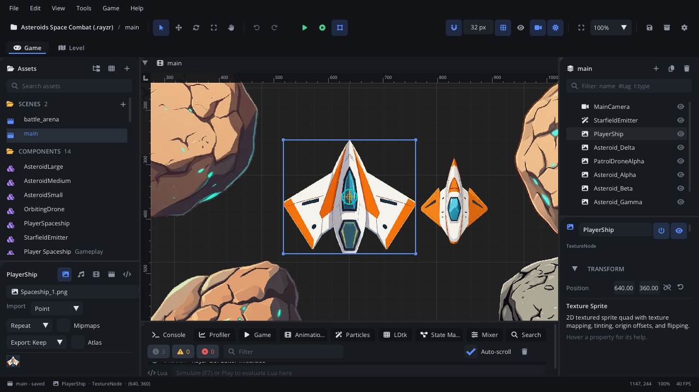

# Your first game

This tutorial makes a project from the **Platformer** template, plays it,
and then changes it three ways: a property in the Inspector, the level
itself, and a Lua script. It takes about ten minutes.

## 1. Make a project

1. Start the editor. The **Welcome** window opens (later: **Help > Welcome**).
2. Under **New Project**, pick **Platformer**, type a name, choose a folder
   and click **Create Project**.

The project opens with its level scene. Every project is a folder: scenes
(`scenes/*.scene.json`), scripts (`scripts/*.lua`), art and sounds, and
`project.json` with the project's settings.

## 2. Play it

Press **F5** (or the green **Play** button in the toolbar). The game runs in
its own window: move with A / D or the arrows, jump with Space. Collect the
coins, stomp the enemy, reach the door. Close the window (or press
**Shift+F5** in the editor) to stop.



## 3. Change a property

Select the **Player** in the **Scene** panel. The **Inspector** shows its
properties - the ones its script declares come last: *Run Speed*,
*Jump Velocity*, *Coyote Time*...

1. Set **Jump Velocity** to `360`.
2. Press **F5** again: the player jumps much higher.

Every property shows its help when you hover it, and the help pane at the
bottom of the Inspector explains the selected one. The values are saved in
the scene; the script only declares the defaults.

## 4. Change the level

1. Select the **Level** tile map in the Scene panel.
2. In the viewport, paint with the tile brush (Inspector > *Tile Map* picks
   the tile); right-drag erases.
3. To add more coins, select a coin and press **Cmd+D** (Ctrl+D on Windows
   and Linux) to duplicate it, then drag the copy where you want it.

**Cmd+Z** undoes anything. **Cmd+S** saves the scene (Play saves for you).

## 5. Change a script

Coins are counted by `scripts/hud.lua` and collected by `scripts/coin.lua`.
Make each coin worth five:

1. In **Assets**, double-click `scripts/hud.lua`. It opens in the **Code**
   tab, with completion and hover docs for the whole engine API.
2. Change `add_coin`:

   ```lua
   function Hud:add_coin()
       self.coins = self.coins + 5
       self:refresh()
   end
   ```

3. Save (**Cmd+S**) and play. Scripts reload while the game runs, so you can
   also leave the game open and save again: the change applies at once.

A script is a table with methods the engine calls - `ready()` once,
`update(dt)` every frame, and `on_<event>` handlers such as the coin's
`on_body_entered(other)`. The [scripting guide](../../engine/SCRIPTING.md)
covers them all.

## 6. Export it

**File > Export Standalone Game...** builds the game for each target set up
in **Project Settings > Export** (the gear in the toolbar): macOS, Windows,
Linux or the web. Anyone can play the result without the editor.

## Where next

- The [editor tour](../editor/tour.md) names every part of the window.
- The [templates](../../templates/README.md) page describes the other
  starting points: a top-down RPG, a shoot 'em up, a Sokoban puzzle and the
  Platformer Adventure sample.
- The [engine guides](../../engine/docs/README.md) teach one feature at a
  time, each with a tutorial.
