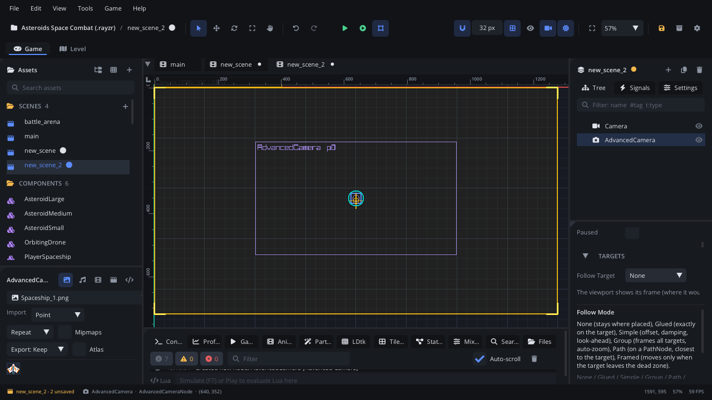

## What it's for

An Advanced Camera is a virtual camera: a shot the game can show. It
decides where to look (follow a target, frame a group, ride a path, stay
put), how far in to zoom and where the view must stay. It doesn't draw
anything itself: the scene's [Camera 2D](CameraNode.md) (the host) shows
the Advanced Camera with the highest **Priority**, and blends to another
one when it takes over. It also has a trauma shake, where hits stack up and
fade out.

## When to use it

- **Several shots that switch**: one camera following the player, one
  framing a boss arena, one riding a rail for a cutscene. Raise a camera's
  priority (or call `make_active()`) and the host blends to it.
- **Room-by-room levels**: **Limit Mode** *Ldtk Level* keeps the view
  inside the LDtk level the target is in, and glides to the next level when
  the player walks into it.
- **Platformer framing**: *Framed* moves only when the target leaves a dead
  zone; **Lookahead** shows what's coming.
- **Screen shake that stacks**: `add_trauma` on each hit; small hits are
  subtle, several in a row make a big shake.
- **Not** needed for one simple follow camera: a
  [Camera 2D](CameraNode.md) with a **Follow Target** does that alone.
- **Not** a way to draw a HUD: use a [Screen Layer](ScreenLayerNode.md).

## Using it

1. **Add Node** (Ctrl+A) > *Advanced Camera*. Place it where the shot
   should look when it has no target.
2. In the Inspector's **Targets** section, pick the **Follow Target** (or
   drop a node from the Scene panel onto it). For a group, set **Follow
   Mode** to *Group* and use **Add To Group**; for a rail, *Path* and
   **Follow Path** (a [Path](PathNode.md)); for node limits, **Limit
   Mode** *Node* and **Limit Node**.
3. Set **Priority**, **Follow Mode**, **Damping**, **Zoom**, the limits,
   **Blend Time** / **Blend Ease** and the shake settings in the Node tab's
   **Properties** section.
4. The viewport draws each Advanced Camera's frame in violet: where it
   would look now, at its zoom, with its name and priority. Selected, it
   also shows its dead zone (*Framed*) and its limits (pink).
5. Simulate (F7): the Inspector shows **Make Active** (raise its priority
   above the others) and **Shake** (add 0.6 trauma) to try it out.

## How it works

- **The host.** The scene's current [Camera 2D](CameraNode.md) shows the
  enabled Advanced Camera with the highest priority (a tie: the one added
  last). With no Camera 2D in the scene, one is added when the game runs
  (it isn't saved).
- **Blending.** When another camera becomes active, the host eases its
  position, zoom and rotation from what it showed to the new camera over
  the new camera's **Blend Time**, with **Blend Ease**. The first camera
  shown is shown at once. Switching mid-blend is smooth too.
- Every Advanced Camera keeps tracking while inactive, so a blend starts
  from where the new camera really is.
- **Follow modes**: *None* stays where placed; *Glued* sits exactly on
  the target (plus **Follow Offset**); *Simple* adds offset, **Damping**
  (smoothing time in seconds; 0 locks on) and **Lookahead**; *Group*
  frames the centre of all targets and, with **Auto Zoom**, zooms to fit
  them; *Path* takes the point on the path closest to the target;
  *Framed* moves only when the target leaves the **Dead Zone**. **Axis
  Lock** stops following along X, Y or both. With no target found it stays
  where it is.
- **Limits**: *Rect* (**Limit Rect**: left, top, right, bottom), *Node*
  (a TileMap, LDtk level node, Navigation Region or Static Body's bounds),
  or *Ldtk Level* (the level the target is in). **Limit Margin** shrinks
  or grows them, **Limit Blend** is the seconds to glide to new limits.
  Rooms smaller than the view are centred.
- **Trauma shake**: `add_trauma` adds to the trauma (up to 1), which falls
  by **Shake Decay** per second. The shake is trauma raised to **Trauma
  Exponent**, times **Shake Intensity** (pixels) and **Shake Rotation**
  (degrees), from smooth noise at **Shake Frequency**.
- **Snap To Pixel** rounds its position to whole pixels (pixel art).
- Targets are paths from the camera (`../Player`); a bare name (`Player`)
  also works and finds the first node with that name.

## Signals

| Signal | When | Value |
|---|---|---|
| `became_active` | The host switched to this camera | nil |
| `became_inactive` | Another camera took over from this one | nil |

## Example

A boss arena: when the player enters the arena's trigger, its camera takes
over and frames the player and the boss; when the boss is defeated, the
player's camera comes back.

```lua
---@class Arena : ScriptInstanceBase
local Arena = {}

function Arena:ready()
    self.cam = self.node:get_node("ArenaCam") ---@type AdvancedCameraNode
    local trigger = self.node:get_node("Trigger") ---@type AreaNode
    trigger:connect("body_entered", function(body)
        if body ~= nil and body:get_name() == "Player" then
            self.cam:make_active()
        end
    end)
    self.cam:connect("became_active", function()
        Log.info("Boss fight camera")
    end)
end

-- Called by the boss when it takes damage.
function Arena:boss_hit(damage)
    self.cam:add_trauma(math.min(damage / 50, 0.6))
end

function Arena:boss_defeated()
    self.cam.priority = -1 -- below the player's camera: the host blends back
end

return Arena
```

The scene has a `PlayerCam` (priority 0, *Simple*, following the player)
and, under the arena, `ArenaCam` (priority -1, *Group* with the player and
the boss, **Auto Zoom** on, **Blend Time** 1.2). `make_active()` raises
ArenaCam's priority above every other camera. From any script,
`Camera.add_trauma(0.4)` shakes whichever Advanced Camera is active, and
`Camera.get_active()` returns it. After teleporting the target, `snap()`
jumps the camera there without damping.

More tutorials (LDtk room limits, a cutscene rail):
[Advanced camera](../../engine/docs/advanced_camera.md).

## Screenshot


