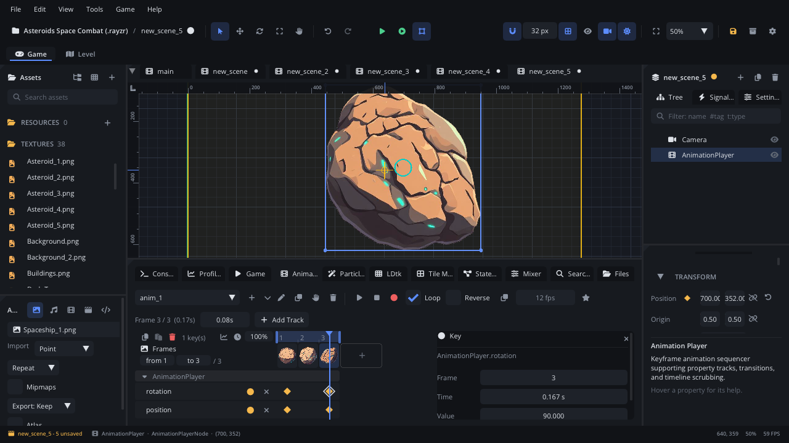

## What it's for

An Animation Player holds a character's or an object's named animations
("idle", "run", "attack") and plays one at a time. Each animation can have
sprite frames (separate images or cells of a sprite sheet) and keyframed
tracks: a property of the player or of any other node changing over time
(position, rotation, scale, colours, any number), plus event tracks that
call script methods, play sounds, fire particles, spawn components or
turn nodes on and off at set moments.

## When to use it

- **A sprite with several animations**: a player with idle, run, jump and
  attack, switched from a script or a [State Machine](StateMachineNode.md).
- **Motion made of keys**: a door that slides open, a pickup that bobs, a
  boss's attack pattern, a cutscene moving several nodes at once.
- **Things that must happen on a frame**: a footstep sound, a hitbox on
  only during the swing, dust when the foot lands.
- **Not** for one looping list of images with nothing else: a
  [Frame Animation](FrameAnimationNode.md) is simpler.
- **Not** for `.aseprite` files: an [Aseprite Sprite](AsepriteNode.md)
  plays their tags as Aseprite does.
- **Not** for Spine or DragonBones exports: use a [Skeleton](SkeletonNode.md).
- **Not** for a one-off movement decided in code (a pop on a button, a
  coin flying to the HUD): `Tween.to` in a script does that without keys.

## Using it

1. **Add Node** (Ctrl+A) > *Animation Player*. Selecting it shows the
   **Animation** tab in the bottom panel (or click **Open Animation
   Timeline** in the Inspector). **View > Workspaces > Animation** gives
   the tab more room.
2. Click **+** next to the animation picker for an empty animation, or its
   **▾** to make one from a folder of frames or a sprite sheet. The pen
   renames it, **Duplicate** copies it, the trash deletes it.
3. Frames: drop textures from Assets on **+** in the frame strip, drag
   frames to reorder them, and drag the blue band's handles to set the
   range that plays. The toolbar has **Loop**, **Reverse**, the
   animation's **FPS** and the **star** (the animation selected when the
   scene loads).
4. Tracks: **Add Track** > pick the player or another node > a property.
   Move the playhead, change the value (in the Inspector or the viewport)
   and click the track's yellow dot to key it. The **diamond** after a
   property's name in the Inspector keys it too, and **Auto-key** (the red
   dot by Stop) keys every change you make.
5. Polish: click keys to select them and drag them along the timeline;
   the key inspector at the right edits their time, value and easing. The
   **chart** button at the ruler shows the value graph, where you shape
   the curves with bezier handles.
6. Events: **Add Track > Events** > *Call Script Methods*, *Play Sounds*,
   *Emit Particles*, *Spawn Component* or *Enable / Disable*.
7. In the Inspector set **Autoplay** to start playing when the scene
   starts, and the player's **FPS** (used by animations without their
   own).

The full editor guide is the editor README's *Animation timeline*;
curves, events and onion skin are in
[Animation editing](../../engine/docs/animation_editing.md).

## How it works

- The player draws the current animation's frame at its position, like a
  sprite. A negative **scale** mirrors it around its **origin**: with the
  origin at the centre, a character flips in place.
- Keys are timed in seconds. Tracks play smoothly between frames, so a
  2 fps sprite animation still moves its properties every game frame. When
  the keys run past the last sprite frame, the tracks set the animation's
  length.
- Numbers, vectors and colours interpolate between keys (with each key's
  easing or curve). Enums, text and a sprite's texture step: each key holds
  until the next.
- Tracks can drive any node in the scene, not only the player's children.
- `animation_play` always starts the animation from its first frame (its
  last when reversed), even if it is already playing. Call it when the
  animation should change, not every frame.
- With a blend time (`animation_play("run", 0.15)`) the property tracks
  the two animations share crossfade; the frames switch at once.
- Method keys and other event keys fire once when playback passes them,
  not when you scrub in the editor.
- **Reverse** in the Inspector flips every animation; an animation's own
  Reverse flips just that one.
- An animation's FPS is the player's until you change it in the toolbar
  (right-click it to go back to the player's). Single frames can have
  their own duration.

## Signals

| Signal | When | Value |
|---|---|---|
| `animation_finished` | A non-looping animation reached its end | The animation's name |
| `animation_event` | A *Call Script Methods* key fired | The method's name |

A method key also calls that method on the target node's script, with the
key's **argument** (a number, `true` / `false` or text), or the frame when
it has none.

## Example

A player (a [Character Mover](CharacterMoverNode.md)) with an Animation
Player child named `Anim`. It has `idle`, `run` and a non-looping `attack`
whose timeline has a *Call Script Methods* key `attack_hit` and a
*Play Sounds* key for the swing.

```lua
---@class Player : ScriptInstanceBase
local Player = {}

function Player:ready()
    self.anim = self.node:get_node("Anim") ---@type AnimationPlayerNode
    self.attacking = false
    self.anim:animation_play("idle")
    self.anim:connect("animation_finished", function(name)
        if name == "attack" then
            self.attacking = false
            self:play("idle")
        end
    end)
end

-- Switch only when the animation changes (animation_play restarts it).
function Player:play(name)
    if self.anim:animation_get_current() ~= name then
        self.anim:animation_play(name, 0.1)
    end
end

function Player:update(dt)
    if self.attacking then return end
    if Input.is_action_pressed("attack") then
        self.attacking = true
        self.anim:animation_play("attack")
        return
    end
    local vx = self.node:character_get_velocity()
    self:play(math.abs(vx) > 10 and "run" or "idle")
    if vx ~= 0 then self.anim:set_scale(vx < 0 and -1 or 1, 1) end
end

-- Called by the attack's method key, on the frame the blade lands.
function Player:attack_hit(frame)
    Camera.shake(4, 0.1)
end

return Player
```

The method key's track targets the player, so `attack_hit` runs on this
script. The negative x scale flips the sprite (set the player's origin to
its centre). For many states, let a [State Machine](StateMachineNode.md)
pick the animation instead of `update`.

## Screenshot


