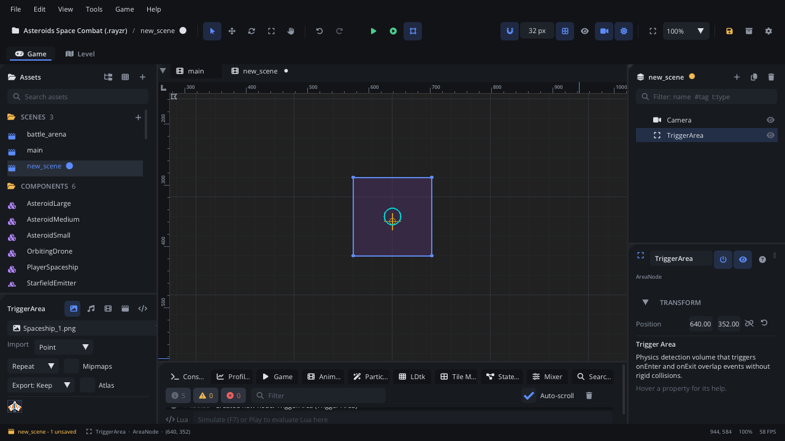

## What it's for

A Trigger Area is a region that notices bodies entering and leaving it,
without pushing anything. It's how a game asks "is something here?":
pickups, checkpoints, doors that open as you approach, damage zones,
hitboxes and hurtboxes.

## When to use it

- **Something should react when a body arrives**: a coin collected by the
  player, a trap that springs, a camera zone. The area raises
  `body_entered` / `body_exited`.
- **Hitboxes and hurtboxes**: an attack's hitbox is an area that's on only
  during the attack's active frames (turn **Monitoring** on and off), and an
  enemy's hurtbox is another area that reacts to it.
- **Not** for things that should block or be pushed: use a
  [Static Body](StaticBodyNode.md) for walls, a
  [Dynamic Body](DynamicBodyNode.md) for crates, a
  [Kinematic Body](KinematicBodyNode.md) for moving platforms, a
  [Character Mover](CharacterMoverNode.md) for the player.
- **Not** for "what's along this line": a [Raycast](RaycastNode.md) answers
  that.

## Using it

1. **Add Node** (Ctrl+A) > *Trigger Area*. It starts with a box shape.
2. Shape it: **Edit Shapes** in the viewport (or the Inspector's
   **Collision Shapes**) to resize the box, or switch it to a circle,
   capsule or polygon. An area can have several shapes; together they are
   the area.
3. Make it a child of what it belongs to (a coin's sprite, the player's
   sword), so it moves with it.
4. Attach a script and handle `body_entered` / `body_exited` (below), or
   connect them in the Inspector's **Signals** section.
5. Collision layers decide what it notices: each shape's **Mask Layers**
   (in **Collision Shapes**) lists the layers it reports bodies from, and a
   body's shapes are on their **Category Layers**. Name the layers in
   Project Settings > Physics.

## How it works

- It reports physics bodies (Static, Dynamic, Kinematic, Character Mover).
  Areas don't notice other areas: give a hurtbox a body, or let the hitbox
  area react to the body it touches.
- Each body is reported once, even when the area or the body has several
  shapes: `body_entered` when the first pair of shapes starts touching,
  `body_exited` when the last pair stops.
- Events arrive during the physics step, after `ready()` of nodes added this
  frame, so an area entered on its first frame still has its handler.
- A body that is destroyed while inside is reported as exiting (with a nil
  value) on the area's next update.
- **Monitoring** off: no events and no overlaps. The area stays a shape,
  so raycasts that collide with sensors still find it. Turned back on, the
  bodies already inside are reported as entering.
- **Enabled** off: the area is out of the physics world entirely.

## Signals

| Signal | When | Value |
|---|---|---|
| `body_entered` | A body starts overlapping the area | The body node (nil if it was destroyed) |
| `body_exited` | A body stops overlapping, or is destroyed while inside | The body node, or nil |

## Example

A coin: when the player touches it, it adds to the score and disappears.

```lua
---@class Coin : ScriptInstanceBase
local Coin = {}

Coin.properties = {
    value = { type = "int", default = 1, label = "Value" },
}

-- Called by the area's body_entered (the script is on the Trigger Area).
function Coin:on_body_entered(body)
    if body == nil or body:get_name() ~= "Player" then return end
    Scene.find_node("HUD"):get_script():add_score(self.value)
    self.node:destroy()
end

return Coin
```

Monitoring for an attack's hitbox: on only during the swing.

```lua
function Player:attack()
    self.hitbox = self.node:get_node("Hitbox") ---@type AreaNode
    self.hitbox:area_set_monitoring(true)
    self.attack_left = 0.15
end

function Player:update(dt)
    if self.attack_left then
        self.attack_left = self.attack_left - dt
        if self.attack_left <= 0 then
            self.hitbox:area_set_monitoring(false)
            self.attack_left = nil
        end
    end
end
```

A Raycast node has the same **Monitoring** switch (`raycast_set_monitoring`):
off, it doesn't cast and raises no `hit_started` / `hit_ended`.

## Screenshot


