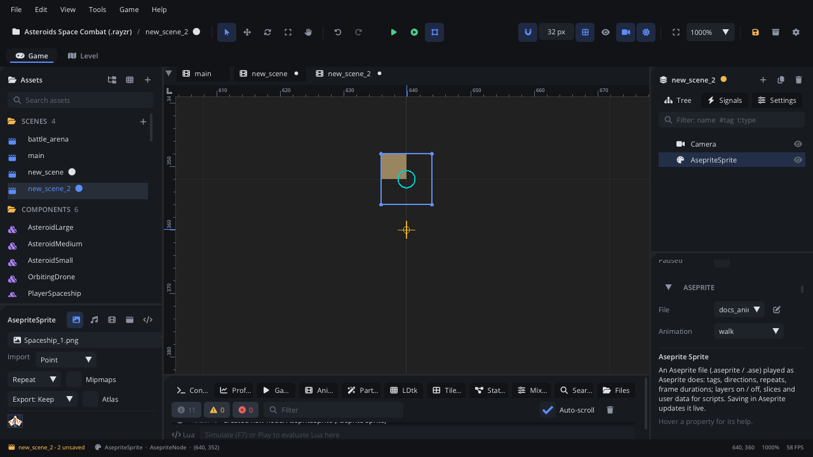

## What it's for

An Aseprite Sprite shows an Aseprite file (`.aseprite` / `.ase`) and plays
it the way Aseprite does: its tags with their directions and repeat
counts, each frame for its own duration, its layers blended as in
Aseprite. There is no sprite sheet to export: save in Aseprite and the
editor, and a running game, update at once.

## When to use it

- **Characters and props drawn in Aseprite**: tag the animations there
  (`idle`, `run`, `hurt`) and play them by name.
- **Outfits and equipment**: hide or show layers per node (a helmet, a
  sword) without separate files.
- **Data drawn with the art**: slices for hitboxes or a pivot that moves
  frame by frame, user data on cels for footsteps.
- **Not** for plain images or sprite sheets from other tools: use an
  [Animation Player](AnimationPlayerNode.md) (sheets, several animations,
  keyed tracks) or a [Frame Animation](FrameAnimationNode.md) (a list of
  images).
- **Not** for keyed motion or events on frames: put the sprite under an
  [Animation Player](AnimationPlayerNode.md), or listen to
  `frame_changed`.
- **Not** for Spine or DragonBones exports: use a [Skeleton](SkeletonNode.md).

## Using it

1. Save the `.aseprite` file into the project. Assets lists it in an
   *Aseprite* section with its first frame as the thumbnail.
2. Drag it into the viewport: that makes an *Aseprite Sprite* playing the
   file's first tag. Or **Add Node** (Ctrl+A) > *Aseprite Sprite* and pick
   the **File** in the Inspector.
3. In the Inspector's **Aseprite** section:
   - **File**, with a button that opens it in Aseprite (set the program in
     Settings > General > Aseprite).
   - **Animation**: the tag to play, each listed with its frames,
     direction, repeats and length. Empty plays every frame in order.
   - **Frame** with a play button: previews the tag in the viewport.
   - **Pivot Slice**: a slice with a pivot; the node's origin follows it,
     frame by frame.
   - **Aseprite Layers**: every layer's visibility for this node.
   - **Aseprite Data**: the file's slices and the sprite's user data.
4. **Autoplay** starts the tag when the scene starts, **Loop** decides
   whether tags without a repeat count loop or play once, **Speed** scales
   the frame durations, **Tint** multiplies the colours.

Guide with a tutorial: [Aseprite](../../engine/docs/aseprite.md).

## How it works

- A tag plays forward, reverse, ping-pong or ping-pong reverse, as set in
  Aseprite. A tag with a repeat count plays that many times and then
  raises `animation_finished`; one without loops (or plays once with
  **Loop** off).
- Layers are drawn as Aseprite draws them: order, blend modes, opacity,
  groups. Hiding a layer on the node is saved on the node (**Hide Layers**
  / **Show Layers**), not in the file. Hiding a group hides its layers.
- The file is loaded once and shared by every node that shows it.
- Saving in Aseprite reloads it everywhere it is used, in the editor and
  in a running game.
- Exported games include the `.aseprite` files as they are and read them
  at runtime, on every platform.

## Signals

| Signal | When | Value |
|---|---|---|
| `animation_finished` | A tag's repeats are done (or a tag played once with Loop off) | The tag's name |
| `animation_looped` | A tag started again: a repeat or a ping-pong turn | The tag's name |
| `frame_changed` | Another frame is shown | The frame (0-based) |

## Example

A hero with tags `idle`, `run` (looping) and `hurt` (repeat 1). The
script is on the Aseprite Sprite.

```lua
---@class Hero : ScriptInstanceBase
local Hero = {}

function Hero:ready()
    self.playing = nil
    self.hurting = false
end

function Hero:update(dt)
    if self.hurting then return end
    local x = Input.get_axis("move_left", "move_right")
    local want = x ~= 0 and "run" or "idle"
    if self.playing ~= want then
        self.node:aseprite_play(want) -- starts the tag from its first frame
        self.playing = want
    end
    if x ~= 0 then self.node:set_scale(x, 1) end -- face the way it runs
end

function Hero:hit()
    self.hurting = true
    self.node:aseprite_play("hurt")
end

function Hero:on_animation_finished(tag)
    if tag == "hurt" then
        self.hurting = false
        self.playing = nil
    end
end

-- A cel with user data "step" (Cel Properties in Aseprite) plays a sound.
function Hero:on_frame_changed(frame)
    local d = self.node:aseprite_cel_data("Body", frame)
    if d and d.text == "step" then Audio.play_sound("audio/step.wav") end
end

return Hero
```

`aseprite_play` restarts the tag each time, so the script only calls it
when the tag changes. `aseprite_slice("hitbox")` returns a slice's
rectangle in the frame shown, for hitboxes drawn in Aseprite.

## Screenshot


