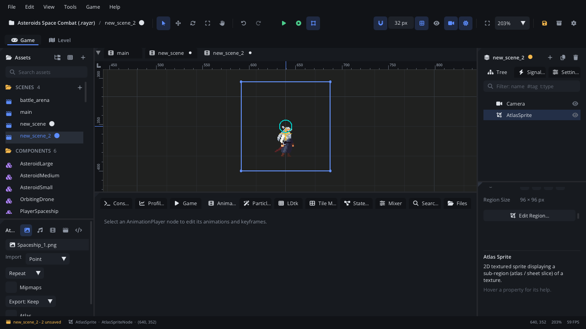

## What it's for

An Atlas Sprite draws one rectangle of an image: a single cell of a sprite
sheet, one icon of an icon sheet, one prop of a tileset image. The rest of
the image isn't drawn.

## When to use it

- **One cell of a sheet**: an item icon, a prop or a still frame cut from a
  bigger image.
- **Picking the cell from a script**: `atlas_set_region` shows another part
  of the same image (an item's icon by its index, a door open or closed).
- **Not** for the whole image: a [Texture Sprite](TextureNode.md) is
  simpler.
- **Not** for frame animation: an
  [Animation Player](AnimationPlayerNode.md) plays the cells of a sheet with
  timing, events and tracks; an [Aseprite Sprite](AsepriteNode.md) plays an
  Aseprite file's tags.
- **Not** for laying out a level from a tileset: use a
  [Tile Map](TileMapNode.md).

## Using it

1. **Add Node** (Ctrl+A) > *Atlas Sprite*.
2. In the Inspector's **Atlas Sprite** section, pick the image in
   **Texture** (the files under `textures/`). The region starts as the
   whole image.
3. Click **Edit Region...**. In the **Atlas Region Editor**, drag a
   rectangle on the image, or type **X**, **Y**, **Width** and **Height**.
   **Snap to Grid** (with columns and rows, or a cell size) snaps it to the
   sheet's cells. **Full Texture** selects everything; **Reset** goes back
   to the region you opened with. Click **Apply**.
4. Or type the four numbers in **Region** in the Inspector.
5. Many cells at once: **Tools > Sprite Sheet Slicer...**, pick the image,
   select cells, and click **Create Atlas Sprite** (or **Create Atlas
   Sprites (n)**). Each cell becomes its own Atlas Sprite.

## How it works

- **Region** is a rectangle in pixels of the image: x and y of its top-left
  corner, then width and height. A region with no width or height draws the
  whole image.
- The sprite's size is the region's size, times the node's scale.
  `texture_get_size()` returns the region's width and height.
- **Origin** (in Transform) is a fraction of the region: the centre by
  default. `texture_set_origin(x, y)` sets it in pixels of the region.
- Changing the region keeps the origin at the same fraction, so a centred
  sprite stays centred when the cell size changes.
- A negative scale mirrors it. **Tint** multiplies its colours (alpha fades
  it).
- Filtering comes from the image's import settings (Point by default), as
  for a [Texture Sprite](TextureNode.md#how-it-works).
- Layer and Z index work as for any sprite: see
  [Draw order](../../engine/docs/draw_order.md).

## Example

An item slot that shows the icon of the item it holds. The icons are 32 x
32 cells in one row of `textures/items.png`; the script is on the Atlas
Sprite.

```lua
---@class ItemIcon : ScriptInstanceBase
local ItemIcon = {}

ItemIcon.properties = {
    cell_size = { type = "int", default = 32, label = "Cell Size" },
}

-- index is 0-based: the column of the icon in the sheet.
function ItemIcon:show(index)
    local s = self.cell_size
    self.node:atlas_set_region(index * s, 0, s, s)
end

function ItemIcon:ready()
    self:show(0)
end

return ItemIcon
```

Another script calls `slot:get_script():show(3)` to show the fourth icon.
`atlas_get_region()` returns the current x, y, width and height.

## Screenshot


