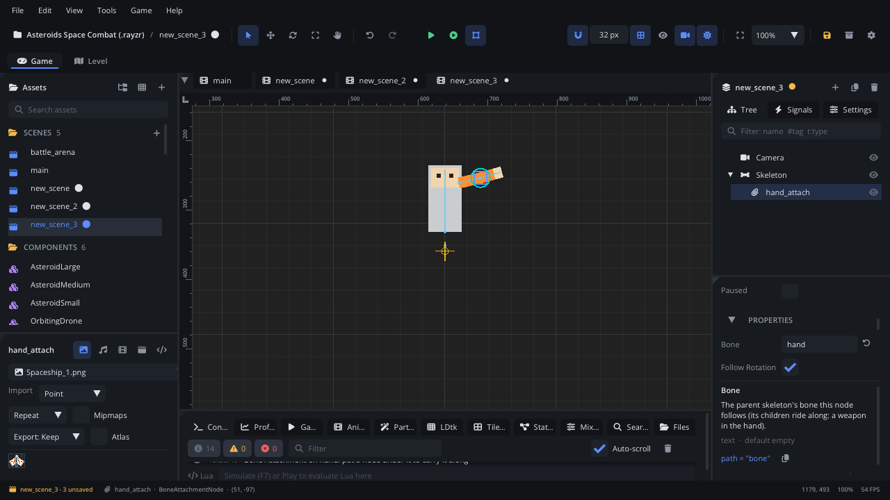

## What it's for

A Bone Attachment sits under a [Skeleton](SkeletonNode.md) and follows one
of its bones as the animation plays. Whatever you put under it rides
along: a sword in the hand, a light on a lantern, dust at a foot, a hitbox
on a fist.

## When to use it

- **Holding things**: weapons, tools, a torch, swapped by changing the
  child (or the **Bone**) instead of re-exporting the skeleton.
- **Effects on a moving part**: a [Particle Emitter](ParticleEmitterNode.md)
  on a foot, a [Trail](TrailNode.md) on a sword's tip.
- **Hitboxes that move with the animation**: a
  [Trigger Area](AreaNode.md) on the fist.
- **Rigid vector parts**: a [Vector Shape](VectorShapeNode.md) that should
  move with a bone without bending.
- **Not** outside a Skeleton: it only follows the bones of its parent
  Skeleton. To move something along a curve, use a
  [Path Follow](PathFollowNode.md); to move it with keys, an
  [Animation Player](AnimationPlayerNode.md).
- **Not** for reading a bone once (where to spawn a bullet): a script can
  ask the skeleton with `skeleton_bone_position` /
  `skeleton_bone_rotation`.

## Using it

1. Select the Skeleton. In the Inspector's **Bones** list, click the link
   button next to a bone: a Bone Attachment named `<bone>_attach` is added
   under the skeleton, following that bone. Or **Add Node** (Ctrl+A) >
   *Bone Attachment* with the Skeleton selected, and type the bone's name
   in **Bone**.
2. Add what should ride along as children of the attachment: a Texture Sprite, a
   Particle Emitter, a Trigger Area.
3. Move the children, not the attachment, to place them relative to the
   bone (the sword's grip in the hand).
4. **Follow Rotation** (on by default) turns it with the bone; **Follow
   Scale** (off by default) scales it with the bone.

## How it works

- It must be a direct child of the Skeleton.
- Each frame the skeleton places it on the bone: its position, and its
  rotation and scale when those are followed. Its own position is
  overwritten, so offsets go on its children.
- It follows the bone in the editor too, while you scrub or preview the
  skeleton's animation.
- A **Bone** name the skeleton doesn't have leaves the attachment where it
  is.

## Example

A player whose Skeleton (`Body`) holds a gun: `Body/GunSlot` is a Bone
Attachment on `hand_r`, with a *Texture Sprite* `Gun` under it and an *Empty Node*
`Muzzle` at the gun's tip. The script is on the player.

```lua
---@class Player : ScriptInstanceBase
local Player = {}

function Player:ready()
    self.slot = self.node:get_node("Body/GunSlot") ---@type BoneAttachmentNode
    self.muzzle = self.node:get_node("Body/GunSlot/Gun/Muzzle")
end

function Player:update(dt)
    if Input.is_action_pressed("fire") then
        local x, y = self.muzzle:get_global_position()
        local bullet = Scene.instantiate("components/Bullet.component.json", nil, x, y)
        if bullet then bullet.rotation = self.muzzle:get_global_rotation() end
    end
    -- Swap hands (the gun moves with the slot).
    if Input.is_action_pressed("swap_hand") then
        self.slot.bone = self.slot.bone == "hand_r" and "hand_l" or "hand_r"
    end
end

return Player
```

The bullet starts at the muzzle and points the way the hand does, whatever
frame of the animation the skeleton is on.

## Screenshot


