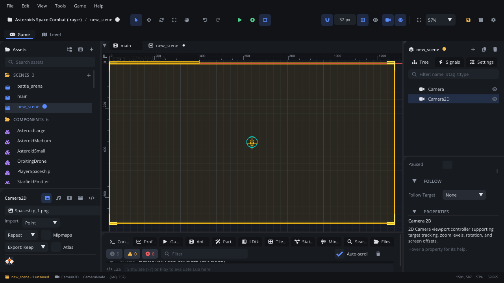

## What it's for

A Camera 2D is the eye the game sees the world through. Its frame is the
part of the world on screen: it can stay put, follow the player, frame
several nodes at once, zoom, rotate, stay inside limits and shake. A scene
shows the world through one camera, its current camera.

## When to use it

- **Every scene the player sees** needs a camera. A new scene already has
  one, named *Camera*.
- **Following the player**: pick the camera's **Follow Target** and it
  follows with smoothing, look-ahead, a dead zone and limits. No script is
  needed.
- **Co-op or a boss fight**: Multi Target frames several nodes and zooms
  out to keep them all on screen.
- **Not** for several shots that switch and blend (a boss arena, a
  cutscene rail) or for shake that stacks hit after hit: use
  [Advanced Cameras](AdvancedCameraNode.md). The Camera 2D shows them.
- **Not** for a HUD: put the score and health bar under a
  [Screen Layer](ScreenLayerNode.md), which the camera doesn't move.
- **Not** for knowing when something is on screen: a
  [Visibility Notifier](VisibilityNotifierNode.md) answers that.

## Using it

1. A new scene starts with a camera. To add another, **Add Node** (Ctrl+A)
   > *Camera 2D*. Keep **Is Current** on for only one camera per scene.
2. Place it: with no follow target, the game starts looking at the
   camera's position. The viewport draws its frame (yellow for the current
   or selected camera); **Fit Game View** (Shift+Home) zooms the viewport
   to it. The toolbar's camera button shows or hides camera frames.
3. To follow a node, pick it in the Inspector's **Follow** section
   (**Follow Target**), or drop a node from the Scene panel onto the field,
   or right-click the node in the Scene panel > *Camera Follows This*.
4. Tune it in the Node tab's **Properties** section: **Follow Mode**, **Drag Type** and **Smooth
   Drag Speed** for how it catches up, **Offset**, **Target Zoom**,
   **Has Limits** with the four limits, **Use H Margins** / **Use V
   Margins** for a dead zone.
5. Press Play, or Simulate (F7) to see it move in the editor.

## How it works

- **The frame is the virtual resolution.** The frame the editor draws is
  the project's virtual resolution (Project Settings > Video), divided by
  the zoom: the size the game draws at. Screen Layers (the HUD) are drawn
  over this frame in the editor, where the player will see them.
- **Screen Fill: Expand.** With Project Settings > Video > **Screen Fill**
  set to *Expand*, a screen whose shape differs from the virtual resolution
  shows more of the world on its longer side instead of black bars. A
  screen-shape picker appears next to the toolbar's camera button (16:9,
  16:10, 4:3, 21:9, phone portrait), and the viewport outlines the grown
  frame on that screen with a dashed line. Edge-anchored Screen Layers move
  to its edges. See [Pixel perfect](../../engine/docs/pixel_perfect.md#screen-fill).
- **Where it looks.** With a follow target, it looks at the target plus
  **Offset**. With no target and no **Target Position**, it looks at its
  own position.
- **Follow Mode**: *Static* stays put; *Single Target* follows the Follow
  Target; *Multi Target* frames the weighted centre of its group and, with
  **Auto Zoom**, zooms to fit them (between **Min Zoom** and **Max Zoom**,
  with **Zoom Margin** around them); *Manual* goes where scripts send it.
  Setting a target from a script switches the mode for you.
- **Drag Type** is how it catches up: *None* locks on, *Smooth Damp* eases
  in (**Smooth Drag Speed** is the lag in seconds per axis), *Spring Damp*
  springs (**Spring Constant**, **Damping Ratio**), *Look Ahead* aims ahead
  of a moving target (**Prediction Time**), *Auto Speed* lags less the
  faster it moves.
- **Dead zone**: with **Use H Margins** / **Use V Margins**, the target
  moves freely inside the margins (fractions of the screen) before the
  camera follows. Single Target only.
- **Limits**: with **Has Limits**, the view never shows past **Left /
  Right / Top / Bottom Limit** (world pixels). A level narrower than the
  view is centred.
- **Zoom**: the camera starts at **Target Zoom** and eases to new values
  (**Smooth Zoom**). 2 makes everything twice as big.
- A followed node that is destroyed is dropped; a Follow Target that only
  appears later (spawned, or from an LDtk level) is found when it appears.
- When the scene has [Advanced Cameras](AdvancedCameraNode.md), the
  current camera shows the active one instead of following on its own.
  A scene with Advanced Cameras and no Camera 2D gets one when the game
  runs (it isn't saved).

## Example

A camera script for a side-scroller: it follows the player inside the
level's bounds, and zooms out to frame the boss when the fight starts.

```lua
---@class LevelCamera : ScriptInstanceBase
local LevelCamera = {}

LevelCamera.properties = {
    level_width  = { type = "float", default = 3200, label = "Level Width" },
    level_height = { type = "float", default = 720,  label = "Level Height" },
}

function LevelCamera:ready()
    local cam = self.node ---@type CameraNode
    cam:camera_set_target(Scene.find_node("Player"))
    cam:camera_set_limits(0, self.level_width, 0, self.level_height)
end

-- Called by the boss arena's trigger.
function LevelCamera:start_boss_fight()
    local cam = self.node ---@type CameraNode
    cam:camera_add_target(Scene.find_node("Boss"), { weight = 1, radius = 120 })
    cam:camera_set_zoom(0.8)
end

function LevelCamera:end_boss_fight()
    local cam = self.node ---@type CameraNode
    cam:camera_set_target(Scene.find_node("Player"))
    cam:camera_set_zoom(1.0)
end

return LevelCamera
```

The script is on the Camera 2D. `camera_add_target` puts the player (the
current target) and the boss in a group, so the camera frames both.
`camera_set_target` goes back to following the player alone. The global
`Camera` module (`Camera.set_target`, `Camera.add_target`,
`Camera.screen_to_world`, ...) does the same for the scene's current camera
from any script.

## Screenshot


