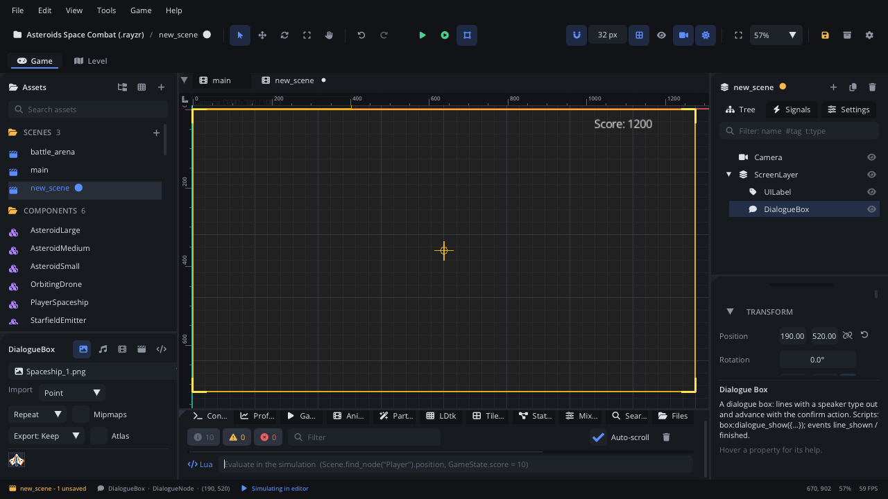

## What it's for

A Dialogue Box shows conversation: a speaker's name and a line of text that
types out letter by letter. The player presses the advance action to see
the rest of the line, then the next one; after the last line the box
closes. A script fills it with lines.

## When to use it

- **Characters talking**: an NPC greets the player, a sign is read, a
  shopkeeper explains the prices.
- **Voice-over and barks without a box**: set **Mode** to Subtitles and the
  lines go on the subtitle track, each for its voice's length, then the
  next follows by itself.
- **Choices**: a line can end with options for the player (a branching
  conversation, a visual novel). The **Visual Novel** template builds a
  whole story on this.
- **A talking mouth**: point **Lip Sync** at a Lip Sync node and voiced
  lines move a vector mouth (see [Lip Sync](LipSyncNode.md)).
- **Not** for a fixed caption or score: use a [UI Label](UILabelNode.md).
- **Not** for text in the world: use a **Text** node (Graphics &
  Rendering), which has its own typewriter.

## Using it

1. **Add Node** (Ctrl+A) > *Dialogue Box*. Put it under a
   [Screen Layer](ScreenLayerNode.md) so the camera doesn't move it.
2. Place and size it: its **Position** is its top-left corner, **Size** its
   width and height (900 x 170 to start).
3. In the Node tab's **Properties** section set the look (**Font Size**,
   **Text Color**, **Speaker Color**, **Panel Color**, **Border Color**,
   **Padding**), **Reveal Speed** (characters per second; 0 shows whole
   lines) and **Advance Action** (the input action that advances,
   `confirm` by default). The **Font** section picks a project font.
4. Turn on **Localized** if the lines are keys in the `locale/*.csv`
   tables.
5. In a script, open it with `dialogue_show` (below). The box is empty and
   hidden until then, so in the editor you only see its outline when it's
   selected.

## How it works

- **Lines**: `dialogue_show` takes a list. Each entry is a plain string or
  a table with `text` and optional `speaker` and `voice` (a sound played
  when the line starts). Calling it again replaces the lines.
- **Typing out**: the text appears at **Reveal Speed** characters per
  second. Text can use rich-text tags such as `[color=..]`, `[size=..]`,
  `[wave]` and `[shake]`.
- **Advancing**: a press of the advance action shows the rest of a typing
  line; on a finished line it moves to the next. A small bobbing triangle
  in the corner shows that the line is done. `dialogue_next()` does the
  same from a script, `dialogue_close()` closes the box at once.
- **Speaker**: drawn above the text in **Speaker Color**, slightly smaller.
  Leave it out for narration.
- **Localized**: the speaker and text are looked up in the locale tables
  for the current language.
- **Subtitles mode**: no box is drawn. Each line is shown on the subtitle
  track for its voice's length (or a reading time), then the next follows
  by itself; the advance action skips ahead. If the player turned subtitles
  off, the lines still play and time out, and the events still fire. See
  [Accessibility](../../engine/docs/accessibility.md).
- **Voices** play on the SFX bus unless the sound's import settings name
  another bus. A voice stops when its line ends.
- **Choices**: give a line `choices = {"Left", "Right"}`. When the line is
  shown, the choices appear as a column of buttons above the box.
  `move_up` / `move_down` or the mouse picks one, and the advance action or
  a click takes it. The `chosen` signal fires with the choice's number,
  then the next line follows. If the handler calls `dialogue_show` with new
  lines, those are shown instead, which is how a story branches.
  `dialogue_choose(i)` takes a choice from a script, and
  `dialogue_has_choices()` says whether the box is waiting for one. The
  selected choice is filled with **Choice Color**. With **Localized** on,
  choices are locale keys too.
- **Auto advance**: with **Auto Advance** on, each line goes on by itself
  **Auto Delay** seconds after it's shown, plus a little per character so
  long lines stay up longer. `dialogue_set_auto(on, delay)` sets it from a
  script.
- **Skip**: `dialogue_set_skip(true)` shows and passes lines at once, for
  example while the player holds a key.
- Auto advance and skip both stop at choices.

## Signals

| Signal | When | Value |
|---|---|---|
| `line_shown` | A line is fully shown (typed out or skipped). In Subtitles mode, when the line starts. | The line's number, from 1 |
| `chosen` | The player (or `dialogue_choose`) took a choice | The choice's number, from 1 |
| `finished` | The box closes: after the last line, or `dialogue_close()` | none |

## Example

An NPC with a Trigger Area: when the player walks up, the guard speaks, and
the gate opens after the last line.

```lua
---@class Guard : ScriptInstanceBase
local Guard = {}

function Guard:ready()
    self.box = Scene.find_node("Dialogue") ---@type DialogueNode
    self.box:connect("finished", function()
        if self.talking then
            self.talking = false
            Scene.find_node("Gate"):set_visible(false)
        end
    end)
end

-- The script is on the guard's Trigger Area.
function Guard:on_body_entered(body)
    if body == nil or body:get_name() ~= "Player" then return end
    if self.box:dialogue_is_open() then return end
    self.talking = true
    self.box:dialogue_show({
        { speaker = "Guard", text = "Halt! Nobody passes the gate after dark." },
        { speaker = "Guard", text = "...Oh, it's you. [color=yellow]Go on through.[/color]" },
    })
end

return Guard
```

A question with choices: the handler answers with new lines.

```lua
self.box:connect("chosen", function(choice)
    if choice == 1 then
        self.box:dialogue_show({ { speaker = "Guard", text = "Then pay the toll." } })
    else
        self.box:dialogue_show({ { speaker = "Guard", text = "Come back in daylight." } })
    end
end)
self.box:dialogue_show({
    { speaker = "Guard", text = "Do you want to cross?", choices = { "Yes", "No" } },
})
```

For a single line: `box:dialogue_show("The door is locked.")`, or with a
speaker, `box:dialogue_show("Halt!", "Guard")`.

## Screenshot


