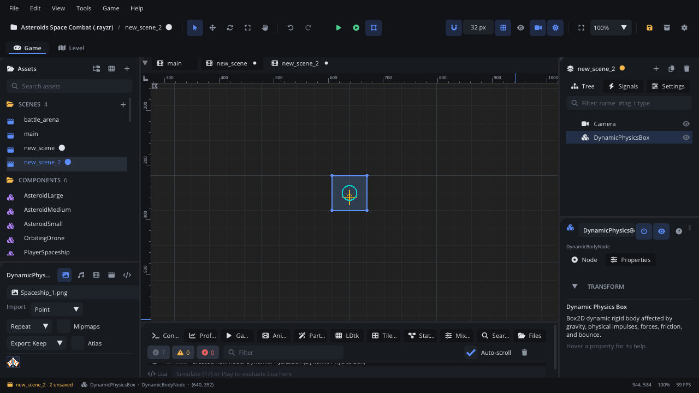

## What it's for

A Dynamic Physics Box is a body the physics simulation moves. Gravity pulls
it, it falls, bounces, slides and tumbles, and other bodies push it about.
Use it for crates, barrels, balls, rocks, debris, ragdoll parts and thrown
objects.

## When to use it

- **Things that should behave physically**: a crate that falls off a ledge
  and tips over, a ball that bounces, a stack that topples when hit.
- **Projectiles that fly and bounce**: grenades, cannonballs. Turn on
  **Is Bullet** for very fast ones so they don't pass through other moving
  bodies.
- **Parts held together by joints**: chains, bridges, swinging signs (see
  [Joint](JointNode.md)).
- **Not** for floors and walls that never move: use a
  [Static Body](StaticBodyNode.md).
- **Not** for platforms, doors and lifts that move on a set path: use a
  [Kinematic Body](KinematicBodyNode.md). Forces don't move those, and they
  carry what stands on them.
- **Not** for the player or enemies that walk and jump with tight control:
  use a [Character Mover](CharacterMoverNode.md).
- **Not** for "has something touched this region": use a
  [Trigger Area](AreaNode.md).

## Using it

1. **Add Node** (Ctrl+A) > *Dynamic Physics Box*. It starts with a 64 x 64
   box shape.
2. Shape it: **Edit Shapes** in the viewport (or **Edit in Viewport** in
   the Inspector's **Collision Shapes**) to resize the box, or switch it to
   a circle, capsule, polygon or other shape. A body can have several
   shapes; together they are the body.
3. Set the material on each shape in **Collision Shapes**: **Density**
   (how heavy), **Friction** (0 ice, 1 rubber) and **Restitution** (0 no
   bounce, 1 keeps all its speed).
4. Add a sprite as a child so you can see it. The body moves its children
   with it.
5. Set the body's behaviour in the Inspector: **Gravity Scale**,
   **Linear Damping** and **Angular Damping** (drag), **Fixed Rotation**
   (never turns), **Is Bullet** (continuous collision against other
   moving bodies, for fast projectiles).
6. Collision layers decide what it hits: each shape's **Category Layers**
   are the layers it is on, its **Mask Layers** the layers it collides
   with. Name the layers in Project Settings > Physics.
7. Press Simulate (or Play) to watch it fall.

## How it works

- Gravity comes from Project Settings > Physics > **Gravity** (px/s², +y
  is down), multiplied by the body's **Gravity Scale**: 0 floats, negative
  rises.
- **Linear Velocity** is in px/s and **Angular Velocity** in degrees/s.
  While the game runs the Inspector shows the live values; editing them (or
  calling `set_linear_velocity`) changes the body's speed at once and wakes
  it.
- Moving the node yourself (its position or rotation, from the Inspector or
  a script) teleports the body there and wakes it. It doesn't push
  anything on the way: to move it smoothly, give it a velocity.
- Mass is **Density** x the shape's area in square pixels, so bodies are
  heavy: a 64 x 64 box at density 1 weighs 4096. Forces and impulses are
  in those units. `apply_impulse(0, -300)` barely moves that box;
  `apply_impulse(0, -300 * 4096)` changes its speed by 300 px/s - or,
  for any body, `apply_impulse(0, -self.node:get_mass() * 300)`. To set a
  speed directly, use `set_linear_velocity`.
- A body at rest falls asleep after a moment (below **Sleep Threshold**,
  px/s) to save time. A contact, a joint, a new velocity or `set_awake(true)`
  wakes it. **Is Awake** shows its state; turn off **Enable Sleep** to keep
  it always simulated.
- **Fixed Rotation** stops it turning, whatever hits it.
- **Allow Fast Rotation** lets it spin very fast (wheels); it can be less
  stable.
- **Enabled** off takes the body out of the world: it doesn't move and
  nothing collides with it until it's enabled again.
- With **Show Bounds & Colliders** (View menu) the shapes are drawn in its
  **Debug Color**.

## Signals

| Signal | When | Value |
|---|---|---|
| `collision_started` | It starts touching another body | The other body node |
| `collision_ended` | It stops touching that body | The other body node |

Each pair of bodies is reported once, even when either has several shapes:
`collision_started` when the first pair of shapes touches,
`collision_ended` when the last pair separates. A shape reports contacts
while its **Enable Contact Events** is on (the default). Trigger Areas
don't raise these; they raise their own `body_entered` / `body_exited`.

## Example

A grenade: thrown when it's created, it clinks on each bounce and is removed
when its fuse runs out.

```lua
---@class Grenade : ScriptInstanceBase
local Grenade = {}

Grenade.properties = {
    speed = { type = "float", default = 400, label = "Throw Speed" },
    fuse = { type = "float", default = 2.0, label = "Fuse (s)" },
}

function Grenade:ready()
    -- Up and to the right, spinning.
    self.node:set_linear_velocity(self.speed, -self.speed * 0.6)
    self.node:set_angular_velocity(360)
    self.time_left = self.fuse
end

function Grenade:on_collision_started(other)
    Audio.play_sound("sounds/clink.wav", 0.5)
end

function Grenade:update(dt)
    self.time_left = self.time_left - dt
    if self.time_left <= 0 then
        self.node:destroy()
    end
end

return Grenade
```

The script is on the Dynamic Physics Box. Give its shape some
**Restitution** (0.4) so it bounces. `on_collision_started` is the
`collision_started` signal handled in the node's own script.

## Screenshot


