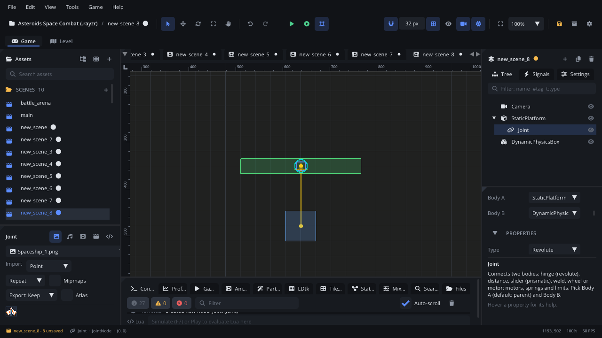

## What it's for

A Joint connects two physics bodies so they move together in a set way: a
hinge they turn about, a rope's fixed distance, a slider along one line, a
weld that holds them rigidly, a car's wheel on a spring. Joints can have
motors, springs and limits.

## When to use it

- **Hinges** (Revolute): doors, flaps, swinging signs, pendulums, chains
  made of links, a drawbridge with a motor.
- **Ropes and springs** (Distance): a lamp hanging on a cord, a bouncy
  tether.
- **Sliders** (Prismatic): pistons, lifts on a rail, sliding gates.
- **Wheels** (Wheel): a vehicle's wheels on suspension, with a motor.
- **Gluing bodies** (Weld): breakable structures, parts that bend a little
  (with softness).
- **Driving one body towards another** (Motor), **dragging with the
  mouse** (Mouse), or **stopping two bodies colliding** with each other
  (Filter).
- **Not** for moving platforms on a set path: use a
  [Kinematic Body](KinematicBodyNode.md) (with a
  [Path Follow](PathFollowNode.md) if you like).
- **Not** for sticking a sprite to a body: make it a child of the body.

## Using it

1. Add the two bodies: [Static](StaticBodyNode.md),
   [Dynamic](DynamicBodyNode.md), [Kinematic](KinematicBodyNode.md) or a
   [Character Mover](CharacterMoverNode.md). At least one should be
   dynamic, or nothing moves.
2. Select body A and **Add Node** (Ctrl+A) > *Joint*. It becomes a child,
   and **Body A** is its parent by default.
3. In the Inspector's **Joint Bodies**, pick **Body B** (and another
   **Body A** if the joint isn't under it). The lists show the scene's
   bodies. The viewport draws a line between the two anchors.
4. Pick the **Type**: Distance, Filter, Motor, Mouse, Prismatic, Revolute
   (the default), Weld or Wheel. Only that type's settings are shown.
5. Set the anchors: **Local Anchor A** and **Local Anchor B** are points
   on each body, relative to its origin (px). For a hinge they are the same
   point in the world: the pivot.
6. Turn on what you need: **Enable Limit** (with its lower / upper
   values), **Enable Spring** (**Hertz**, **Damping Ratio**),
   **Enable Motor** (**Motor Speed**, and the maximum force or torque).
7. Press Simulate (or Play): the joint is made when both bodies exist.

## How it works

- The joint is created once both bodies exist while the game runs. If
  either body is destroyed, the joint goes with it. It's made again if the
  bodies come back (a body with the same path).
- Settings changed while it runs (in the Inspector or with
  `set_property`) apply at once and wake both bodies.
- The anchors are pulled together (Revolute, Weld, Wheel, Prismatic) or
  kept at **Length** (Distance). With both anchors at (0, 0), a revolute
  joint pulls body B's origin onto body A's when it starts. Place the
  bodies where the joint will hold them and set the anchors to match.
- Units: lengths and anchors in px, angles in degrees, **Motor Speed** in
  px/s for Distance and Prismatic and in radians/s for Revolute and Wheel.
- Bodies are heavy at pixel scale (mass is density x area in px²), so
  motor force and torque need big numbers. A new joint's motors start
  strong enough for typical bodies.
- **Collide Connected** off (the default): the two bodies pass through
  each other. On: they collide as usual.
- The viewport draws the line between the anchors in **Debug Color**; in
  the running game the line is drawn while colliders are shown.
- Set **Type** before the game runs: changing it while running makes a
  joint of the new type without removing the old one.

## Example

A drawbridge: a Dynamic Physics Box **Bridge** hinged at one end to a
Static Platform **Wall**. The Joint **Hinge** is a child of Wall (Body A),
Body B is Bridge, type Revolute, with **Enable Limit** on (Lower Angle 0,
Upper Angle 90) and the anchors at the hinge point. The script on Wall
lowers and raises the bridge with the motor.

```lua
---@class Drawbridge : ScriptInstanceBase
local Drawbridge = {}

function Drawbridge:ready()
    self.hinge = self.node:get_node("Hinge") ---@type JointNode
    self.hinge:set_property("joint.revolute.enableMotor", true)
    self.hinge:set_property("joint.revolute.motorSpeed", 0)
end

function Drawbridge:lower()
    self.hinge:set_property("joint.revolute.motorSpeed", 1.5)  -- radians/s
end

function Drawbridge:raise()
    self.hinge:set_property("joint.revolute.motorSpeed", -1.5)
end

function Drawbridge:update(dt)
    if Input.is_action_pressed("interact") then
        self.down = not self.down
        if self.down then self:lower() else self:raise() end
    end
end

return Drawbridge
```

The limit stops the bridge at each end; the motor holds it there.

## Screenshot


