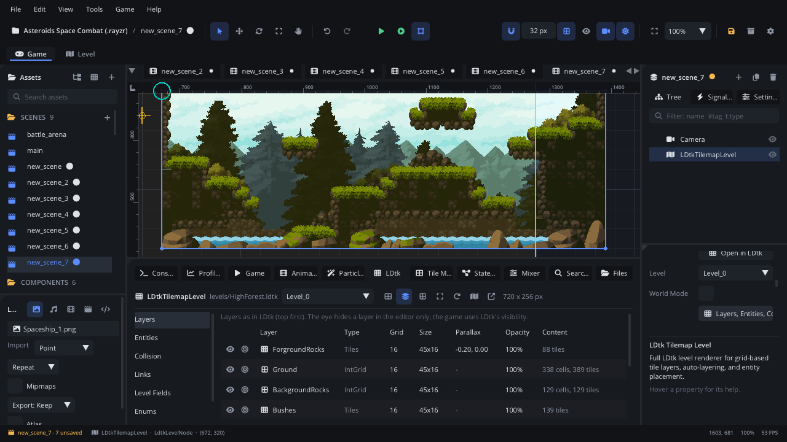

## What it's for

An LDtk Tilemap Level puts a level made in [LDtk](https://ldtk.io) (or in
the editor's **Level** tab) into a scene. It draws the level's layers -
tiles, auto-layers, IntGrid, background - with LDtk's parallax, builds
colliders and trigger areas from IntGrid values, spawns the level's
entities as nodes, and links them through their EntityRef fields. It can
show one level, or every level of a world at once.

## When to use it

- **Levels designed in LDtk or in the Level tab**: platformers, top-down
  maps, metroidvania rooms with auto-tiled walls and placed entities.
- **Level data that scripts read**: IntGrid values (lava, ice, water), level
  fields (music, gravity), entity fields and references.
- **Not** for a grid you paint in the scene itself: a
  [Tile Map](TileMapNode.md) is simpler, and can be filled by a
  [Level Generator](LevelGeneratorNode.md).
- **Not** for a single background image: use a
  [Texture Sprite](TextureNode.md) or a
  [Parallax Background](ParallaxNode.md).

## Using it

1. Import the `.ldtk` file: Assets **+** > Import, or drop it on the Assets
   panel (its tileset images come along).
2. Double-click it under **Levels** in Assets, or drag it into the
   viewport. This adds the level node. (Or **Add Node** (Ctrl+A) > *LDtk
   Tilemap Level*, then pick the file in the Inspector's **LDtk Level**
   section > **Project**.)
3. In the **LDtk Level** section, pick the **World** (when the project has
   several) and the **Level**. **World Mode** shows and builds every level
   of the world at its world position.
4. Click **Layers, Entities, Collision...** to open the **LDtk** tab of the
   bottom panel:
   - **Layers**: hide (in the editor only) or solo a layer.
   - **Entities**: what each entity spawns as - *Auto* (the component
     `components/<Identifier>.component.json` if there is one), a chosen
     component, a custom node type, a plain Node, or nothing. **Create
     Component...** makes a component and a script with a property per
     field.
   - **Collision**: None, Solid, One-way or Trigger for each IntGrid value,
     with friction and bounce.
   - **Links**: what EntityRef fields do (connect a signal to a method, or
     parent one entity to the other).
   - **Level Fields**, **Enums**, **World** (a map of the levels).
5. **Edit in Level Tab** edits the level in the editor; **Open in LDtk**
   opens the file in LDtk. Saving the file reloads the level.
6. Press Play, or Simulate, to see colliders and spawned entities.

## How it works

- Without world mode the level is drawn with its top-left corner at the
  node's position. Its position, scale and **Tint Color** apply to every
  layer.
- Colliders, trigger areas and spawned entities are built when the node is
  ready (in the game, or in Simulate) and never saved into the scene. In
  the editor you see entity placements and their reference arrows instead.
- **Collision**: Solid cells become boxes on a static body, One-way cells
  are solid only from above (platforms you jump through), Trigger cells
  become a Trigger Area named `<Layer>_<value>` that raises `body_entered`
  / `body_exited`. Neighbouring cells with the same rule merge into a few
  large boxes. Solid and one-way colliders cast [Light](LightNode.md)
  shadows.
- **Entities**: each one is spawned as a child of the level node at its
  position, named after its identifier. Its LDtk fields set the script
  properties of the same name; all fields stay readable with
  `ldtk_field(name)` on the spawned node.
- **Properties** (the Node tab's section): **Enable Physics** (build colliders), **Spawn Entities**,
  **Parallax** (use the LDtk layers' parallax), **Draw Background**,
  **Draw Entity Tiles** (draw entities' LDtk tiles), **Tint Color**, **Draw
  Debug Colliders**, **Draw Debug Entities**, and **Match Custom Nodes**
  (an *Auto* entity with no component of its name spawns as the project's
  custom node type of that name).
- `ldtk_load_level(id)` switches level in the game; colliders and entities
  are rebuilt, and `level_loaded` fires again.
- Positions in the Lua functions are world positions (they take the node's
  position and scale into account); entity tables also carry `x, y` in
  level pixels.
- Details: the [LDtk guide](../../engine/LDTK.md) and the
  [Level tab](../../engine/docs/level_editor.md).

## Signals

| Signal | When | Value |
|---|---|---|
| `level_loaded` | The level was built, once its spawned entities (and their scripts) are ready; again after each `ldtk_load_level` | The level's identifier |
| `entity_spawned` | An entity was spawned | The spawned node |

## Example

A level script on the level node: music from a level field, spikes from a
Trigger IntGrid value, a count of the enemies spawned, and a way to the
next level.

```lua
---@class Level : ScriptInstanceBase
local Level = {}

function Level:on_level_loaded(identifier)
    Log.info("Entered " .. identifier)
    local music = self.node:ldtk_get_level_field("music")
    if music then Audio.play_music(music, true) end

    -- "spikes" is an IntGrid value of the Collisions layer, set to Trigger.
    local spikes = self.node:ldtk_get_triggers()["Collisions_spikes"]
    if spikes then
        spikes:connect("body_entered", function(body)
            if body ~= nil and body:get_name() == "Player" then
                body:get_script():hurt(1)
            end
        end)
    end
end

function Level:on_entity_spawned(node)
    if node:get_name() == "Enemy" then
        self.enemies = (self.enemies or 0) + 1
    end
end

-- Called by the exit door's script: the next level, in the project's order.
function Level:next_level()
    local levels = self.node:ldtk_get_levels()
    local current = self.node:ldtk_get_level_identifier()
    for i, id in ipairs(levels) do
        if id == current and levels[i + 1] then
            self.node:ldtk_load_level(levels[i + 1]) -- level_loaded fires again
            return
        end
    end
end

return Level
```

Reading the level under the player: `ldtk_get_int_grid_name("Collisions", x,
y)` gives the IntGrid value's name there, and `ldtk_get_collision(x, y)`
returns `"solid"`, `"one_way"`, `"trigger"` or `"none"`.

## Screenshot


