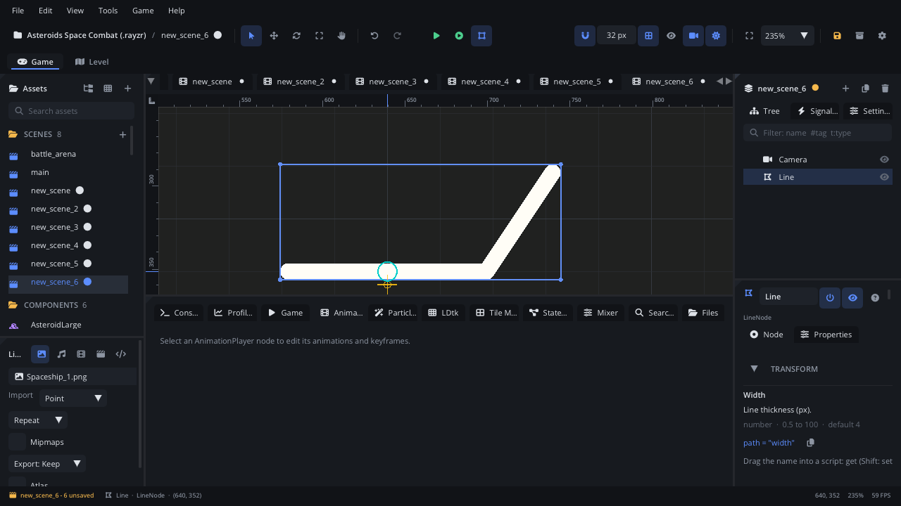

## What it's for

A Line draws straight segments through a list of points, with a width and
a colour. Lasers, ropes and tethers, aiming guides, outlines, a route on a
map, simple level art made of strokes.

## When to use it

- **A line between things that move**: a tether from the player to a hook,
  a laser from a turret to its target. Update its points from a script.
- **Drawn shapes**: an outline (turn on **Closed**), a fence, a crack.
- **Showing a path**: the waypoints of a path search, joined up.
- **Not** for a curve that things move along: use a [Path](PathNode.md)
  (and a [Path Follow](PathFollowNode.md)).
- **Not** for a fading streak behind something moving: use a
  [Trail](TrailNode.md).
- **Not** for filled or curved vector art: use a
  [Vector Shape](VectorShapeNode.md).

## Using it

1. **Add Node** (Ctrl+A) > *Line*. It starts as a 120-pixel horizontal line
   with two points.
2. Edit the points in the Inspector's **Points** section: each row is a
   point's x and y, relative to the node. **Add Point** adds one 40 pixels
   to the right of the last; the x button removes a point (a line keeps at
   least two).
3. In the Node tab's **Properties** section: **Width** (pixels), **Color**, **Closed** (join the
   last point back to the first) and **Rounded** (round joints and ends; on
   by default).
4. Move, rotate and scale the whole line with the viewport tools.

## How it works

- Points are in the node's own space: the node's position, rotation and
  scale apply to all of them. A Line at the scene root with position (0, 0)
  takes world positions as they are.
- The width grows with the node's larger scale axis.
- **Rounded** draws a circle at every point, which rounds the joints and
  the two ends. Without it, the ends are square and sharp corners show
  small notches.
- Each segment is drawn on its own. With a see-through colour, the places
  where segments and round joints overlap look darker.
- A Line has no **Origin**: the points themselves say where it is drawn
  around the node's position.
- New lines are on Layer1 with Z index 0. See
  [Draw order](../../engine/docs/draw_order.md).

## Example

A tether from the player to an anchor. The script is on a Line at the
scene root, at position (0, 0), so its points are world positions.

```lua
---@class Tether : ScriptInstanceBase
local Tether = {}

Tether.properties = {
    from = { type = "node", label = "From" },
    to = { type = "node", label = "To" },
}

function Tether:update(dt)
    local x1, y1 = self.from:get_global_position()
    local x2, y2 = self.to:get_global_position()
    self.node:line_set_points({ {x1, y1}, {x2, y2} })
end

return Tether
```

To draw a route point by point, clear the line and add each point:

```lua
local route = Scene.find_node("Route") ---@type LineNode
route:line_clear()
for _, p in ipairs(waypoints) do
    route:line_add_point(p[1], p[2])
end
```

## Screenshot


