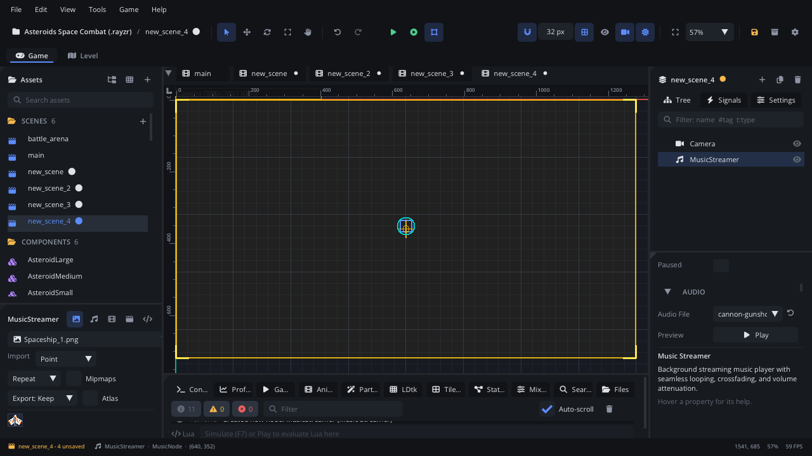

## What it's for

A Music Streamer plays one long track: background music, an ambience
loop, a boss theme. The track is streamed as it plays rather than loaded
whole, it loops by default, and it can fade in, fade out and crossfade to
another Music Streamer.

## When to use it

- **A level's music**: one Music Streamer in the scene with **Autoplay**
  and **Looping** on. No script needed.
- **Music that changes**: an exploration track and a battle track as two
  Music Streamers, crossfaded with `Audio.crossfade` when a fight starts.
- **Long ambience** (wind, rain, a crowd) that loops under the level.
- **Not** for short sounds (jumps, hits, footsteps): use a
  [Sound Effect](SoundNode.md), which plays over itself, varies each
  play and can be positional.
- **Not** needed for music started from a script with no node: call
  `Audio.play_music("audio/theme.ogg")`.

## Using it

1. **Add Node** (Ctrl+A) > *Music Streamer*.
2. In the Inspector's **Audio** section, pick the track in **Audio File**
   (the reset button next to it clears it).
3. **Preview** plays it here, through its bus, at its volume and pitch,
   without changing the node. It stops when you select something else.
4. In the Node tab's **Properties** section, set **Volume**, **Pitch**, **Pan**, **Bus**,
   **Caption**, **Looping** (on by default) and **Autoplay** (start when
   the node becomes ready).
5. Or start it from a script with `music_play()` (below).

## How it works

- `music_play()` starts the track from the beginning, or resumes it if it
  was paused. `music_stop()` stops it and goes back to the start;
  `music_pause()` / `music_resume()` keep the position.
- **Fades**: `music_fade(volume, seconds, stop_at_end)` fades to a volume
  (0 to 1) over some seconds, on top of **Volume**. It starts the track
  if it isn't playing (from silence). With `stop_at_end`, a fade to 0
  stops the track, and the next play starts at full volume.
  `Audio.crossfade(from, to, seconds)` fades one Music Streamer out
  (stopping it) while another fades in.
- **Looping** off: the track plays once and raises `finished` at the end.
- **Bus**: the mixer bus it plays into (the Mixer tab). Empty: the
  track's import bus, else *Music*. The bus fader, effects and output
  apply.
- **Caption**: shown on the subtitle track when it starts, for players
  who turn sound captions on (e.g. "[calm music]").
- The Inspector's **Runtime State** shows **Is Playing** and **Is Paused**
  while the game runs.

## Signals

| Signal | When | Value |
|---|---|---|
| `finished` | A track with Looping off reached its end (not raised by `music_stop()`) | nil |

## Example

Two Music Streamers, `ExploreMusic` (Autoplay on) and `BattleMusic`, under
a `Music` node. The script on `Music` crossfades to the battle track when
enemies notice the player and back when they're gone, and fades out on
game over.

```lua
---@class MusicDirector : ScriptInstanceBase
local MusicDirector = {}

MusicDirector.properties = {
    fade_time = { type = "float", default = 1.5, label = "Fade Time" },
}

function MusicDirector:ready()
    self.explore = self.node:get_node("ExploreMusic") ---@type MusicNode
    self.battle = self.node:get_node("BattleMusic") ---@type MusicNode
    self.in_battle = false
end

function MusicDirector:set_battle(on)
    if on == self.in_battle then return end
    self.in_battle = on
    if on then
        Audio.crossfade(self.explore, self.battle, self.fade_time)
    else
        Audio.crossfade(self.battle, self.explore, self.fade_time)
    end
end

function MusicDirector:game_over()
    local playing = self.in_battle and self.battle or self.explore
    playing:music_fade(0, 2.0, true) -- fade out and stop
end

return MusicDirector
```

A stinger that plays once, then hands back to the level music:

```lua
function Level:boss_defeated()
    local victory = self.node:get_node("VictoryMusic") ---@type MusicNode
    Scene.find_node("BattleMusic"):music_stop()
    victory:connect("finished", function()
        Scene.find_node("ExploreMusic"):music_play()
    end)
    victory:music_play() -- Looping off in the Inspector
end
```

## Screenshot


