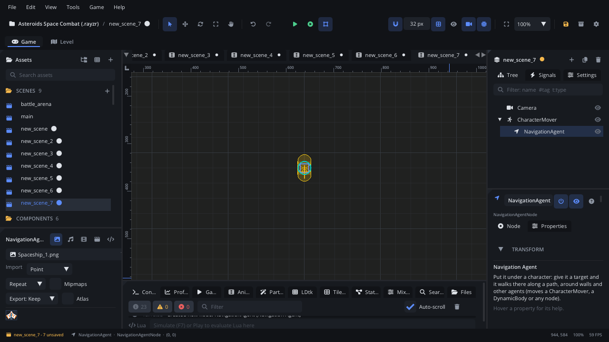

## What it's for

A Navigation Agent walks a character somewhere on its own. Give it a target
and it finds a path around walls, follows it at its speed, keeps clear of
other agents, and moves its parent along. It's the "go there" part of
enemy and unit AI.

## When to use it

- **Enemies that chase the player** through a level with walls in the way.
- **Units sent with a click** in a strategy or top-down game.
- **Characters with places to go**: guards walking a route, villagers
  heading home.
- **Not** for following a fixed, hand-drawn route: a
  [Path Follow](PathFollowNode.md) on a [Path](PathNode.md) does that.
- **Not** for platformer jumps: paths are for walking on a floor seen from
  above (or flying).
- It needs somewhere to find paths: a
  [Navigation Region](NavigationRegionNode.md), a
  [Tile Map](TileMapNode.md) or an [LDtk level](LdtkLevelNode.md).

## Using it

1. Add a [Navigation Region](NavigationRegionNode.md) over the level (or
   use a tile map / LDtk level).
2. Select the character and **Add Node** (Ctrl+A) > *Navigation Agent*. It
   becomes a child of the character it moves.
3. Set **Speed** (px/s) and **Radius** (the character's size: paths keep
   this far from walls, and agents this far from each other).
4. Set **Repath Interval**: seconds between new paths while moving, so it
   follows a moving target and notices opened doors. 0 finds a path only
   when the target changes.
5. Leave **Nav Map** empty to use the region the character stands in, or
   set it to the path of a region, tile map or LDtk level.
6. In a script, call `nav_set_target(x, y)`. In Simulate the viewport draws
   each agent's remaining path in green.

## How it works

- **Move Parent** on: it moves its parent each frame.
  - A [Character Mover](CharacterMoverNode.md): it sets its velocity, and
    in **Control Mode** Script it also moves and slides it. Use Script
    mode: in the built-in mode the mover runs its own movement and input.
  - A [Dynamic Body](DynamicBodyNode.md) or
    [Kinematic Body](KinematicBodyNode.md): it sets the body's velocity.
    Gravity still pulls a dynamic body, so give it **Gravity Scale** 0 in a
    top-down game.
  - Any other node: it moves the node's position.
  When it stops, it sets the body's velocity to 0 once, then leaves it to
  physics.
- **Move Parent** off: it moves nothing. Read `agent.velocity` (px/s) in
  your script each frame and move the character yourself.
- The path is found on the next update after `nav_set_target`. Each call
  finds a new path, so don't call it every frame for a moving target:
  call it when the target has moved, and let **Repath Interval** keep the
  path fresh.
- It arrives when it is within **Arrive Distance** of the target, then
  raises `navigation_finished`, stops and forgets the target.
- No path (the target is walled off, there's no region, or no place the
  agent's **Radius** fits): it raises `target_unreachable` and forgets the
  target. This can also happen while walking, when a repath finds the way
  shut.
- **Avoidance** pushes agents apart when they come closer than their two
  radii, also while standing still, so a crowd at one spot spreads out.
  Turn it off for agents that may overlap (it costs a little per pair).
- `nav_is_finished()` is true when it has arrived or has no target.

## Signals

| Signal | When | Value |
|---|---|---|
| `navigation_finished` | It reached its target | None |
| `target_unreachable` | No path to its target | None |

## Example

An enemy that chases the player and attacks on arrival. The enemy is a
Character Mover with **Control Mode** Script; its child
**NavigationAgent** has **Repath Interval** 0.4.

```lua
---@class Chaser : ScriptInstanceBase
local Chaser = {}

function Chaser:ready()
    self.agent = self.node:get_node("NavigationAgent") ---@type NavigationAgentNode
    self.player = Scene.find_node("Player")
    self.agent:connect("navigation_finished", function() self:attack() end)
    self.agent:connect("target_unreachable", function() self.lost = true end)
end

function Chaser:update(dt)
    -- A new target only when the player has moved a fair way.
    local px, py = self.player:get_global_position()
    if not self.tx or math.abs(px - self.tx) + math.abs(py - self.ty) > 24 then
        self.tx, self.ty = px, py
        self.lost = false
        self.agent:nav_set_target(px, py)
    end
end

function Chaser:attack()
    Log.info("caught you")
end

return Chaser
```

Click to move a unit:

```lua
function Unit:update(dt)
    if Input.is_mouse_button_pressed("LEFT") then
        local mx, my = Input.get_mouse_position()      -- screen pixels
        local wx, wy = Camera.screen_to_world(mx, my)  -- the world under the camera
        self.node:get_node("NavigationAgent"):nav_set_target(wx, wy)
    end
end
```

More in the [navigation guide](../../engine/docs/navigation.md).

## Screenshot


