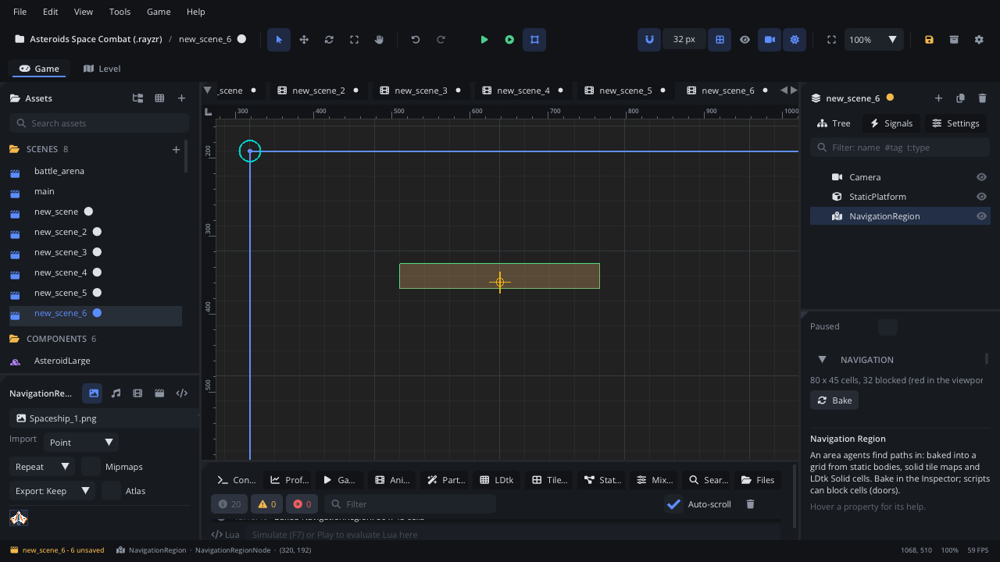

## What it's for

A Navigation Region is the area where characters find their way around
walls. It covers a rectangle of the level and divides it into a grid of
cells, each walkable or blocked. A
[Navigation Agent](NavigationAgentNode.md) finds paths through those
cells, and scripts can ask it for a path directly.

## When to use it

- **Enemies that chase the player around obstacles**, units sent somewhere
  with a click, villagers walking home: give them Navigation Agents and put
  a Navigation Region over the area they walk in.
- **Levels built from static bodies**: the region blocks the cells under
  their shapes. Solid tile maps' tiles and LDtk cells whose collision rule
  is Solid block too.
- **Doors and bridges** that open and close a way through at runtime:
  scripts block and unblock cells.
- **Not** always needed: a [Tile Map](TileMapNode.md) or an
  [LDtk level](LdtkLevelNode.md) is a navigation grid by itself. An agent
  can path in one directly (its **Nav Map**). A region is for levels made
  of bodies, or a mix.
- **Not** for platformers: paths are for walking on a floor seen from
  above (or flying). Jumps and falls aren't planned.

## Using it

1. **Add Node** (Ctrl+A) > *Navigation Region*.
2. Place it: its **Position** is the rectangle's top-left corner, and
   **Size** its width and height (px). Cover everywhere the agents walk.
3. Set **Cell Size**: 8-16 px follows tight corridors closely; 32 px finds
   paths faster in big open maps.
4. Choose what blocks: **Use Physics** (static bodies' shapes),
   **Use Tile Maps** (solid tile maps' tiles), **Use Ldtk** (LDtk Solid
   cells).
5. Press **Bake** in the Inspector's **Navigation** section. With the
   region selected the viewport shows the blocked cells in red, and the
   Inspector counts them. The game bakes again when the scene starts, so
   baking in the editor is only to check.
6. Add [Navigation Agents](NavigationAgentNode.md) under the characters.

## How it works

- Only static bodies block, not dynamic or kinematic ones, nor areas. A
  cell is blocked when its centre is inside a shape, so give thin walls
  some thickness or use a smaller **Cell Size**.
- Paths use the 8 directions without cutting a blocked corner, then are
  straightened wherever the line of sight is clear.
- An agent with an empty **Nav Map** uses the region its parent stands
  in. With several regions, keep them from overlapping.
- The cells are baked when the scene starts and when you call
  `nav_rebake()` (after moving walls, painting tiles or loading a level).
  Moving the region doesn't move its cells until it is baked again.
- `nav_set_blocked(x, y, w, h, blocked)` blocks (or opens, with `false`)
  the cells under a world rectangle. Those cells stay blocked across
  rebakes until a script opens them. The viewport shows them in yellow.
- The viewport always draws the region's outline (blue); the cells only
  while it's selected.

## Example

A door that closes the way through for path finding while it's shut. The
script is on the door, a 32 x 64 node centred on its position.

```lua
---@class Door : ScriptInstanceBase
local Door = {}

Door.properties = {
    open = { type = "bool", default = false, label = "Open" },
}

function Door:ready()
    self:set_open(self.open)
end

function Door:set_open(open)
    self.open = open
    local x, y = self.node:get_global_position()
    local region = Scene.find_node("NavigationRegion") ---@type NavigationRegionNode
    region:nav_set_blocked(x - 16, y - 32, 32, 64, not open)
end

return Door
```

A region is also a grid scripts can ask directly:

```lua
local region = Scene.find_node("NavigationRegion")
local x, y = self.node:get_global_position()
local path = region:nav_find_path(x, y, 600, 400, { radius = 12 })
if path then
    for i, p in ipairs(path) do Log.info(i, p[1], p[2]) end
end
if region:nav_is_walkable(600, 400, { radius = 12 }) then Log.info("fits") end
```

More, with the agent, in the [navigation guide](../../engine/docs/navigation.md).

## Screenshot


