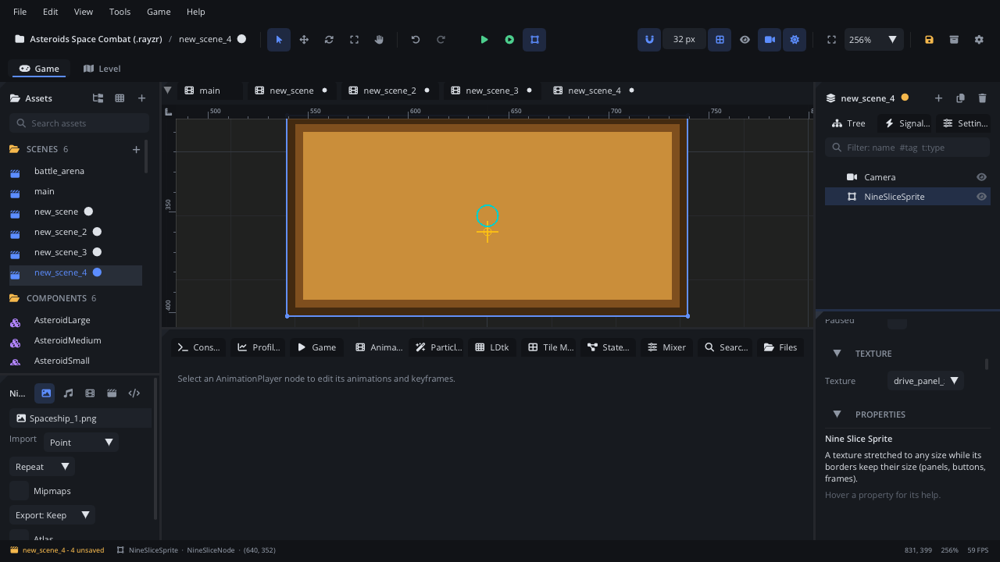

## What it's for

A Nine Slice Sprite draws an image at any size while its borders keep their
width. The image is cut into nine parts: the four corners stay as they are,
the edges stretch along their length, and the middle stretches both ways.
It's how one small frame image becomes panels, buttons, speech bubbles and
bars of any size.

## When to use it

- **Panels and frames in the world**: a sign board, a speech bubble, a
  window frame, a box behind a menu.
- **Bars with shaped ends**: a health bar whose rounded caps shouldn't
  squash when it gets shorter.
- **Not** for an image drawn at its own size: use a
  [Texture Sprite](TextureNode.md).
- **Not** for a background that repeats: use a
  [Parallax Background](ParallaxNode.md).
- **Not** for UI widgets with layout and input: use the UI nodes
  ([UI Container](UIContainerNode.md), [UI Button](UIButtonNode.md)) under a
  [Screen Layer](ScreenLayerNode.md).

## Using it

1. **Add Node** (Ctrl+A) > *Nine Slice Sprite*. Until it has an image it
   draws a faint rectangle where it will be.
2. Pick the image in the Inspector's **Texture** section > **Texture**.
3. In the Node tab's **Properties** section, set **Size** (the drawn width and height in pixels).
4. Set the border widths, in pixels of the image: **Margins L T** (left,
   top) and **Margins R B** (right, bottom). Match them to the frame drawn
   in the image.
5. **Tint** colours or fades it.

## How it works

- The four margins cut the image into nine parts. Corners are drawn at
  their size in the image; the top and bottom edges stretch sideways, the
  left and right edges stretch up and down, and the middle fills the rest.
- **Size** is the whole drawn rectangle. The node's scale multiplies
  **Size**, but the borders keep their width in pixels: to make a bigger
  panel with the same frame, change **Size** or scale it - both stretch
  only the middle and edges.
- **Origin** (in Transform) is a fraction of **Size**: the centre by
  default. (0, 0) puts the top-left corner at the node's position. It
  rotates around the origin.
- New nine slices are 200 x 100 with 16-pixel margins.
- With no image the editor draws a faint rectangle in its **Tint** colour;
  the game draws nothing.
- Filtering comes from the image's import settings (Point by default), as
  for a [Texture Sprite](TextureNode.md#how-it-works).

## Example

A health bar: a Nine Slice Sprite named `Fill` with a rounded bar image,
its origin at the left (0, 0.5) so it shrinks towards the left. The script
is on the bar's parent.

```lua
---@class HealthBar : ScriptInstanceBase
local HealthBar = {}

HealthBar.properties = {
    full_width = { type = "float", default = 200, label = "Full Width" },
    height = { type = "float", default = 24, label = "Height" },
}

function HealthBar:ready()
    self.fill = self.node:get_node("Fill") ---@type NineSliceNode
end

-- Called by the player when its health changes.
function HealthBar:set_health(health, max_health)
    local w = self.full_width * math.max(health, 0) / max_health
    self.fill:set_property("size", math.max(w, 1), self.height)
end

return HealthBar
```

The bar's caps keep their shape while the bar is wider than its left and
right margins together; only the middle stretches.

## Screenshot


