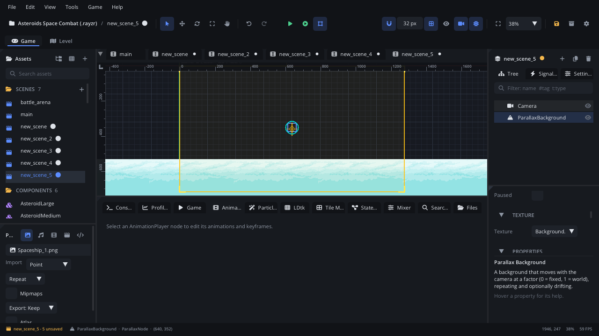

## What it's for

A Parallax Background is an image that moves with the camera more slowly
(or faster) than the world, and repeats to fill the view. Stack a few with
different speeds and a flat scene gets depth: far mountains crawl, near
hills move faster, the ground moves with the world.

## When to use it

- **Backgrounds behind a scrolling level**: sky, mountains, city skylines,
  star fields.
- **Foreground layers** that pass in front of the action faster than the
  world (Factor above 1).
- **Drifting layers** that move by themselves: clouds, fog (**Scroll
  Speed**).
- **Not** for a background that never moves: a
  [Texture Sprite](TextureNode.md) on Layer1 does that (or a Parallax
  Background with Factor 0, which also repeats).
- **Not** for LDtk levels: an [LDtk Tilemap Level](LdtkLevelNode.md) applies
  the parallax of its own LDtk layers.

## Using it

1. **Add Node** (Ctrl+A) > *Parallax Background*.
2. Pick the image in the Inspector's **Texture** section > **Texture**.
3. In the Node tab's **Properties** section, set **Factor**: how much it follows the world as the
   camera moves, for X and Y. 1 moves with the world, 0 stays fixed on
   screen, 0.5 (the default) moves half as far.
4. **Repeat X** (on by default) and **Repeat Y** tile the image to fill the
   view that way.
5. **Scroll Speed** makes it drift by itself, in pixels per second
   (negative X drifts left).
6. For several layers, add one node per image: far layers get small
   factors, near ones bigger. Order them with **Z Index** (in Transform)
   so the near ones draw on top.
7. Pan the viewport to see the effect: in the editor the layers follow the
   editor's view. **Scroll Speed** drifts only while the game (or Simulate)
   runs.

## How it works

- Each frame the image is shifted by the camera's centre times
  (1 - Factor), plus what **Scroll Speed** has added so far. With Factor 1
  it sits in the world like a sprite; with Factor 0 it moves with the
  camera, so it looks fixed on screen.
- The node's position is where the image's top-left corner is when the
  camera centre is at (0, 0). Move the node to line the layer up (a
  mountain range at the horizon, for example).
- The image is drawn at its size times the node's scale. Rotation is not
  used, and a negative scale doesn't mirror it.
- Without **Repeat Y**, the image is one row tall: place it with the node's
  Y position. With both repeats off, it is a single image.
- Factors go from 0 to 2. Above 1, the layer moves faster than the world
  (foreground).
- New Parallax Backgrounds are on Layer1, under the usual sprites. See
  [Draw order](../../engine/docs/draw_order.md).
- **Tint** multiplies its colours: darker, bluer layers read as farther
  away.

## Example

Clouds that blow faster in a storm. The script is on the Parallax
Background.

```lua
---@class Clouds : ScriptInstanceBase
local Clouds = {}

Clouds.properties = {
    calm_speed = { type = "float", default = -10, label = "Calm Speed" },
    storm_speed = { type = "float", default = -120, label = "Storm Speed" },
}

function Clouds:ready()
    self:set_storm(false)
end

function Clouds:set_storm(on)
    local speed = on and self.storm_speed or self.calm_speed
    self.node:set_property("scrollSpeed", speed, 0)
    self.node:set_property("tint", on and "#8a90a0" or "#ffffff")
end

return Clouds
```

Another script calls `Scene.find_node("Clouds"):get_script():set_storm(true)`.

## Screenshot


