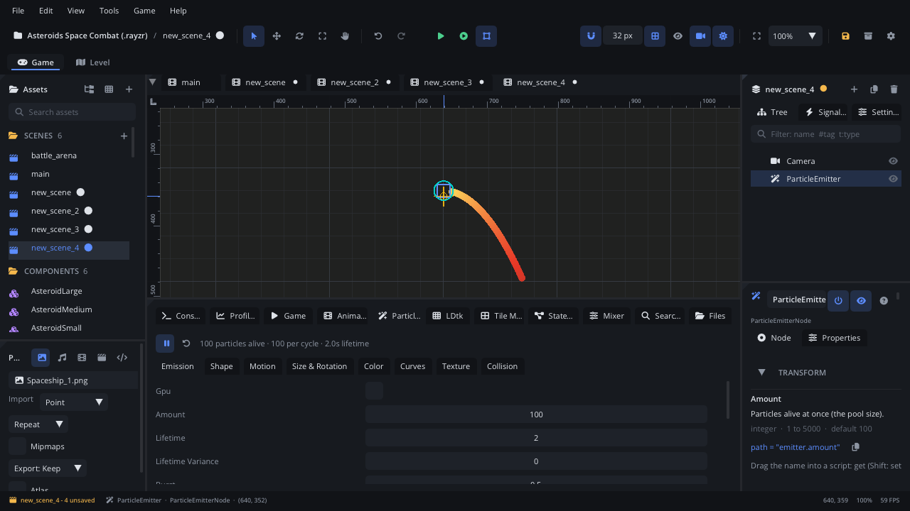

## What it's for

A Particle Emitter sends out many small, short-lived particles: fire,
smoke, sparks, dust, rain, magic, explosions, a ship's exhaust. Each
particle is born, moves, changes size and colour over its life, and dies;
the emitter makes new ones to replace them.

## When to use it

- **Effects made of many small things**: a torch's flame, a trail of smoke,
  falling snow, a burst of coins.
- **One-off bursts**: a hit spark, dust when a character lands, an
  explosion. Emit a burst from a script (`particle_emit`) or from an
  animation's *Emit Particles* track.
- **Particles that bounce off the level**: rain splashing on the ground,
  shell casings. Turn on **Collision**.
- **Not** for a ribbon behind something that moves (a sword swing, a
  comet's tail): use a [Trail](TrailNode.md).
- **Not** for one picture that animates: use an
  [Animation Player](AnimationPlayerNode.md) or a
  [Frame Animation](FrameAnimationNode.md).

## Using it

1. **Add Node** (Ctrl+A) > *Particle Emitter*. It starts emitting at once:
   every emitter runs in the viewport while you edit, so each change shows
   straight away.
2. Selecting it shows the **Particles** tab in the bottom panel (or click
   **Open Particle Editor** in the Inspector). **View > Workspaces >
   Animation** gives the tab more room. The tab's sub-tabs:
   - **Emission**: **Amount**, **Lifetime**, **Burst**, **Emitting**,
     **Continuous**, **Local Space**, **Prewarm**, **Seed**, **Gpu** and the
     particle **Shape** (circle, ellipse, rectangle, pixel, line, texture).
   - **Shape**: where particles are born (**Emission Shape**: rectangle,
     point, circle, ring, line, rectangle edge) and the direction they
     leave in (**Angle**, **Angle Spread**).
   - **Motion**: **Velocity**, gravity, **Wind**, **Radial Velocity**,
     **Orbit Velocity**, **Damping**.
   - **Size & Rotation**: **Size**, **Scale Start** / **Scale End**,
     rotation and spin.
   - **Color**: a gradient over the particle's life (drag its stops,
     double-click the bar to add one, right-click a stop to remove it) and a
     plot whose alpha points you drag. Untick **Gradient** for a simple
     start and end colour.
   - **Curves**: size, alpha and speed over the particle's life.
   - **Texture**: a picture for the particles (picking one switches Shape
     to Texture), a sprite sheet's **Sheet Columns** / **Sheet Rows** and
     **Frame Mode**, the **Blend Mode** (Additive for fire and glow) and
     **Align To Velocity**.
   - **Trails**: a ribbon behind each particle (**Trail Length** points,
     one every **Trail Segment** pixels, **Trail Width** at the particle).
   - **Collision**: particles hitting physics bodies.
3. The tab's play / pause button pauses or resumes the preview of every
   emitter; the arrow restarts this one. **Preset** gives the emitter a
   starting look - **Fire**, **Smoke**, **Sparks**, **Rain**, **Snow**,
   **Explosion** or **Magic** - replacing its look and motion settings (its
   texture stays; one Undo puts the old settings back), ready to tweak. The
   line next to them shows how many particles are alive.
4. Put the emitter where the effect belongs: a child of a torch, the
   player's feet, a ship's engine.

## How it works

- **Amount** particles are made each cycle, and a cycle lasts **Lifetime**
  seconds. **Burst** 0 spreads them evenly over the cycle; 1 releases them
  all at once. Amount is also how many can be alive at once.
- **Continuous** on: cycles repeat. Off: one cycle, then the emitter turns
  **Emitting** off.
- **Emitting** off: no new particles; the ones alive finish their lives.
  `particle_emit(n)` still makes a burst of `n` when it is off.
- **Local Space** on (the default): particles move, turn and scale with the
  node (an exhaust, an aura). Off: they stay where they were born in the
  world (smoke left behind a moving rocket).
- Most settings have a **Variance** (how much of the spread is used, 0-1)
  and a **Spread** (the largest random change), so particles differ.
- **Seed** above 0 makes the same pattern every time it starts; **Prewarm**
  starts it as if it had already run a whole lifetime.
- **Gpu** moves the particles on the graphics card: 100k+ particles at
  almost no CPU cost. It doesn't do collision or the speed curve, and
  radial / orbit motion is close to, not the same as, CPU mode. Set the
  **Visibility Rect** (with **Auto Visibility** off) so it is culled
  correctly.
- **Collision** (CPU only) makes particles hit the physics world: bodies,
  tile maps and LDtk solids on the **Collision Layers**, not trigger areas.
  **Collision Mode**: Bounce (with **Elasticity** and **Friction**), Stop
  (rest there) or Kill.
- **Auto Visibility** on: the emitter is skipped when its particles are off
  screen. Off: the **Visibility Rect** decides (cheaper; make it cover the
  effect).
- **Trail Length** above 0 draws each particle's recent path behind it: a
  point every **Trail Segment** pixels it moves, joined into a ribbon that
  starts **Trail Width** times the particle's size and thins and fades to
  nothing (comets, sparks, magic). CPU particles only.
- **Sub Emitter** names another Particle Emitter - a path from this node,
  usually a child's name - that bursts **Sub Emitter Amount** particles
  where each of this emitter's particles dies (**Sub Emitter On**: Death),
  hits a body (Hit, Collision on) or both. Fireworks: rockets that pop into
  sparks; rain that splashes where it lands. Give the sub-emitter
  **Emitting** off (only these bursts) and **Local Space** off (its
  particles stay where they were born). CPU particles only: Gpu ones don't
  report their deaths or hits.

## Signals

| Signal | When | Value |
|---|---|---|
| `particle_hit` | A particle hit a body (Collision on) | The node it hit |
| `finished` | The emitter isn't emitting and its last particle died: a one-cycle emitter, a burst, or after `particle_stop` | - |

In a `particle_hit` handler, `particle_get_last_hit()` returns where: the
world point, the surface normal and the node.

## Example

Dust when the player lands. The player is a
[Character Mover](CharacterMoverNode.md) with a Particle Emitter child
named `Dust` (Emitting off, Local Space off).

```lua
---@class Player : ScriptInstanceBase
local Player = {}

function Player:ready()
    self.dust = self.node:get_node("Dust") ---@type ParticleEmitterNode
    self.was_on_floor = true
end

function Player:update(dt)
    local on_floor = self.node:character_is_on_floor()
    if on_floor and not self.was_on_floor then
        self.dust:particle_emit(12)
    end
    self.was_on_floor = on_floor
end

return Player
```

A one-shot explosion saved as a component: the script is on the emitter
(Continuous off). It plays once when it appears and removes itself when
the last particle is gone.

```lua
---@class Explosion : ScriptInstanceBase
local Explosion = {}

function Explosion:ready()
    self.node:particle_restart()
end

function Explosion:on_finished()
    self.node:destroy()
end

return Explosion
```

A splash where each raindrop hits the ground (the script is on the rain
emitter; Collision on, mode Kill):

```lua
function Rain:on_particle_hit(body)
    local x, y = self.node:particle_get_last_hit()
    if x then Scene.instantiate("components/Splash.component.json", nil, x, y) end
end
```

## Screenshot


