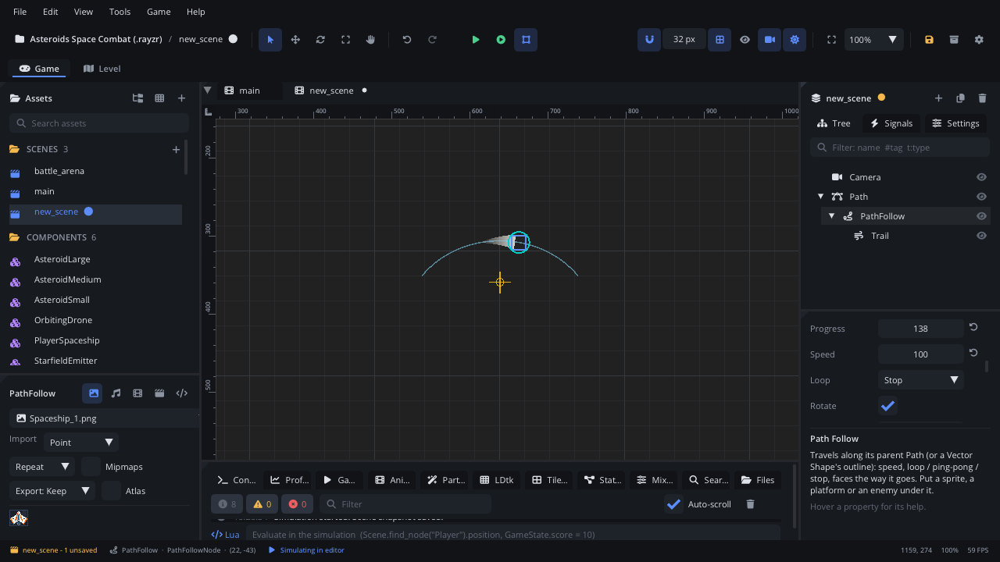

## What it's for

A Path Follow travels along its parent [Path](PathNode.md) (or along the
outline of a parent [Vector Shape](VectorShapeNode.md)). Put a sprite, a
platform or an enemy under it and it moves along the curve, turning to
face the way it goes.

## When to use it

- **Moving platforms and elevators**: speed, then Ping Pong to go back and
  forth.
- **Patrols, flying enemies, formations**: Loop round a closed path;
  **Side Offset** puts several followers side by side.
- **Carts on rails, objects on a conveyor**, projectiles on a curved
  flight.
- **Movement a script controls along a route**: set **Speed** to 0 and
  move **Progress** yourself (or tween it): an elevator called to a floor.
- **Not** for free movement: a [Character Mover](CharacterMoverNode.md)
  for the player, a [Navigation Agent](NavigationAgentNode.md) for
  finding a way round obstacles.
- **Not** for motion set by keys and easing over time: an
  [Animation Player](AnimationPlayerNode.md) track does that.

## Using it

1. Select the Path, then **Add Node** (Ctrl+A) > *Path Follow*. It must be
   a direct child of the path.
2. Add what should travel under the follower. A physics body under it
   should sit at position 0, 0.
3. In the Inspector:
   - **Progress**: the distance along the path in pixels. Change it to
     preview where it starts; the follower moves there in the viewport.
   - **Speed**: pixels per second it moves by itself (negative: backwards,
     0: only scripts move it).
   - **Loop**: what happens at the end: **Stop**, **Loop** (back to the
     start, or round a closed path) or **Ping Pong** (turn back).
   - **Rotate**: face the direction of travel.
   - **Side Offset**: pixels to the right of the travel direction (lanes,
     a formation's slots).
4. Press *Simulate* or Play to see it move: while you edit it sits at its
   Progress.

Guide with tutorials: [Paths and path followers](../../engine/docs/paths.md).

## How it works

- Each frame it adds **Speed** × the frame time to **Progress** and places
  itself at that distance along the curve, local to the path.
- **Stop** keeps it at the end and raises `path_finished`; after that it
  doesn't move until `follow_restart()`. **Loop** and **Ping Pong** raise
  `path_looped` each time it wraps round or turns back.
- With **Rotate** on its rotation is the path's direction, so the children
  turn with it. Turn it off for platforms and anything that should stay
  upright.
- Bodies under a follower are moved with it each frame. A
  [Character Mover](CharacterMoverNode.md) standing on a moving platform
  rides along; dynamic bodies resting on it aren't carried.
- **Progress** is in pixels; `follow_ratio()` and `follow_set_ratio()` work
  in 0..1 of the path's length.

## Signals

| Signal | When | Value |
|---|---|---|
| `path_finished` | Loop is Stop and it reached the end (or the start, moving backwards) | - |
| `path_looped` | Loop is Loop or Ping Pong and it wrapped round or turned back | - |

## Example

An elevator: the Path runs from the ground floor up; the follower
(Speed 0, Rotate off) carries a Static Platform. The script is on the
follower and moves it to a floor when asked.

```lua
---@class Elevator : ScriptInstanceBase
local Elevator = {}

Elevator.properties = {
    floors = { type = "int", default = 3, label = "Floors" },
}

-- Called by the buttons (0 = ground floor).
function Elevator:go_to(floor)
    local ratio = floor / (self.floors - 1)
    local route = self.node:get_parent() ---@type PathNode
    Tween.to(self.node, "progress", ratio * route:path_length(), 1.5, "in_out_sine")
end

return Elevator
```

A cart that waits two seconds at the end of its track, then starts again
from the beginning (Loop: Stop; the script is on the follower):

```lua
function Cart:on_path_finished()
    self.wait = 2
end

function Cart:update(dt)
    if self.wait then
        self.wait = self.wait - dt
        if self.wait <= 0 then
            self.wait = nil
            self.node:follow_restart()
        end
    end
end
```

## Screenshot


