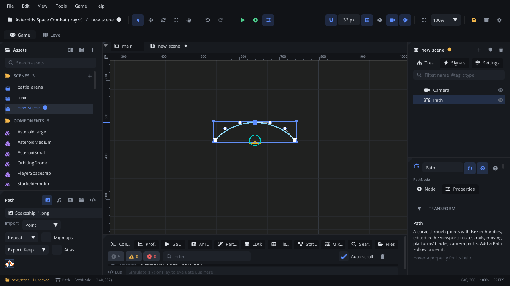

## What it's for

A Path is a curve you draw in the viewport: points joined by straight
lines or smooth Bézier curves. On its own it is a route; a
[Path Follow](PathFollowNode.md) under it travels along the curve and
carries whatever is under the follower.

## When to use it

- **Moving platforms and elevators**: a Path, a Path Follow on it, the
  platform under the follower.
- **Patrol routes and flying formations**: enemies that follow a set route.
- **Rails, conveyor carts, roller coasters**, and projectiles on curved
  flights.
- **Camera tracks**: an Advanced Camera can follow a path.
- **Drawn lines in the game**: give it a **Line Width** to draw it as a
  rail or a rope.
- **Not** for a line that isn't a route (a laser, a lightning bolt): a
  *Line* node draws a polyline.
- **Not** for paths that go round obstacles by themselves: use a
  [Navigation Agent](NavigationAgentNode.md).

## Using it

1. **Add Node** (Ctrl+A) > *Path*. It starts as an arc between two points.
2. Select it and shape it in the viewport:
   - drag a **square** to move a point;
   - drag a **dot** to bend the curve (a point's two handles mirror each
     other; hold **Alt** to move one alone);
   - **double-click** the curve to add a point there;
   - **Alt+click** a point to remove it;
   - **Ctrl/Cmd+click** empty space to add a point at the end.
3. The Inspector lists the points with their position and handles. Each
   point's curve button switches between a sharp corner and a smooth point.
4. **Closed** joins the last point back to the first. **Line Width** draws
   the path in the game (0 keeps it invisible; the editor always shows
   it) in its **Color**. **Bake Interval** is how finely the curve is
   measured: smaller follows it more closely.
5. Add a **Path Follow** with the path selected to put something on it.

Guide with tutorials (a moving platform, a patrol route):
[Paths and path followers](../../engine/docs/paths.md).

## How it works

- Each point has an in and an out handle, stored as offsets from the
  point. Zero handles make a sharp corner.
- Points are local to the path: move, turn or scale the Path node and the
  whole curve goes with it.
- The curve is turned into short straight pieces (one every Bake Interval
  pixels) the first time it is needed after an edit, and only again when
  the points change. Followers then cost next to nothing.
- Script methods take and return 1-based point indices; positions passed
  to `path_add_point` / `path_set_point` are local to the path, while
  `path_point_at` and `path_closest_offset` work in the world.

## Example

A guard who walks towards the nearest spot on a route, then follows it.
The script is on the guard; the route is a Path named `Route`.

```lua
---@class Guard : ScriptInstanceBase
local Guard = {}

function Guard:ready()
    self.route = Scene.find_node("Route") ---@type PathNode
    -- Start from the point of the route nearest to the guard.
    local x, y = self.node:get_global_position()
    self.distance = self.route:path_closest_offset(x, y)
    self.speed = 60
end

function Guard:update(dt)
    local length = self.route:path_length()
    self.distance = (self.distance + self.speed * dt) % length
    local pos, dir = self.route:path_point_at(self.distance)
    self.node:set_position(pos.x, pos.y)   -- (the guard is at the scene's root)
    self.node:set_scale(dir.x < 0 and -1 or 1, 1)
end

return Guard
```

Building a path from code (points local to the path, with handles for a
smooth middle):

```lua
local route = self.node:get_node("Route") ---@type PathNode
route:path_clear()
route:path_add_point(Vec2(0, 0))
route:path_add_point(Vec2(200, -80), Vec2(-60, 0), Vec2(60, 0))
route:path_add_point(Vec2(400, 0))
route.closed = true
```

For most moving things a [Path Follow](PathFollowNode.md) does this with no
script: set its **Speed** and **Loop**.

## Screenshot


