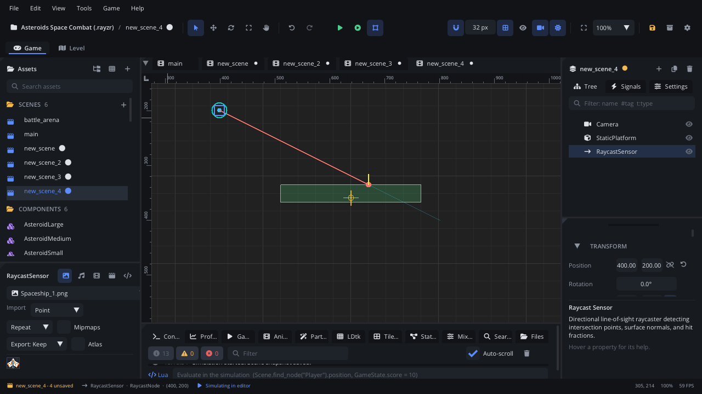

## What it's for

A Raycast Sensor casts a straight line from its position each frame and
reports the first physics shape the line hits: where, which node, and the
surface direction there. It's how a game asks "what's along this line?":
ground and ledge checks, line of sight, laser beams, a gun's aim.

## When to use it

- **Ledge and wall checks**: an enemy that turns round at the edge of a
  platform casts a short ray down just ahead of its feet.
- **Line of sight**: a guard that only chases the player when no wall is
  in between.
- **Beams and aiming**: a laser drawn up to the hit point, a sight line
  for a turret.
- **Not** for "is anything inside this region": use a
  [Trigger Area](AreaNode.md).
- **Not** for a one-off check from code between any two points:
  `Physics.raycast(x1, y1, x2, y2)` does that without a node.

## Using it

1. **Add Node** (Ctrl+A) > *Raycast Sensor*.
2. Make it a child of the node it belongs to (the enemy, the turret), so
   it moves and turns with it. Its **Position** is where the ray starts.
3. Set **Direction** (any length; it's normalised) and **Length** (px).
   The ray turns with the node's rotation and its parents'.
4. Choose what it hits: **Mask Layers** are the layers it reports,
   **Category Layers** the layers it counts as. A shape is hit when it's on
   one of the ray's mask layers and its own **Mask Layers** include one of
   the ray's category layers (as between two bodies). Project Settings >
   Physics names the layers. Tick **Collide With Sensors** to have Trigger
   Areas stop it too.
5. Read the result in a script (`raycast_is_colliding`,
   `raycast_get_hit_point`, ...) or handle `hit_started` / `hit_ended`, or
   connect them in the Inspector's **Signals** section.

## How it works

- With **Monitoring** on it casts once per frame and stores the closest
  hit: **Is Colliding**, **Hit Point** (world px), **Hit Normal** (the
  surface direction) and **Hit Fraction** (0 at the start, 1 at the end).
  The Inspector shows them live while the game runs.
- `raycast_cast()` casts again at once (after you moved or turned it this
  frame) and updates those values. It doesn't raise signals.
- It finds bodies (static, dynamic, kinematic, Character Movers) and tile
  map and LDtk colliders. Areas and other sensor shapes are skipped unless
  **Collide With Sensors** is on.
- **Exclude Parent** (on by default): the ray skips the body it's under,
  so a ray on a character doesn't report the character. Off: start the
  ray outside the parent's shapes, or leave its layer out of the ray's
  **Mask Layers**.
- **Monitoring** off: it doesn't cast, clears its hit and raises no
  signals. `raycast_cast()` still works.
- With **Show Bounds & Colliders** (View menu) or the game's Show
  Colliders, the ray is drawn in **Ray Color**; when it hits, in
  **Hit Color** up to the hit point, with the surface normal in yellow.

## Signals

| Signal | When | Value |
|---|---|---|
| `hit_started` | The ray starts hitting a node (or hits a different one) | The node hit |
| `hit_ended` | The ray stops hitting a node (nothing there now, or another node in front) | The node it was hitting |

They compare nodes, not points: sliding along the same wall raises nothing.
When the ray moves from one node straight onto another, `hit_ended` (old)
comes before `hit_started` (new). A node that is destroyed while hit doesn't
raise `hit_ended`.

## Example

A patrolling enemy (a Character Mover with **Control Mode** Script) that
turns round at ledges and walls. Its child **LedgeRay** is a Raycast Sensor
at (20, 20), **Direction** (0, 1), **Length** 24: just ahead of its feet,
pointing down.

```lua
---@class Patrol : ScriptInstanceBase
local Patrol = {}

Patrol.properties = {
    speed = { type = "float", default = 60, label = "Speed" },
}

function Patrol:ready()
    self.dir = 1
    self.ledge = self.node:get_node("LedgeRay") ---@type RaycastNode
end

function Patrol:update(dt)
    local _, vy = self.node:character_get_velocity()
    local _, gy = self.node:character_get_gravity()
    vy = vy + gy * dt

    -- On the ground with no floor ahead, or against a wall: turn round.
    if self.node:character_is_on_floor()
        and (not self.ledge:raycast_is_colliding() or self.node:character_is_on_wall()) then
        self.dir = -self.dir
        local x, y = self.ledge:get_position()
        self.ledge:set_position(-x, y) -- the ray goes to the other side
    end

    self.node:character_set_velocity(self.dir * self.speed, vy)
    self.node:character_move_and_slide(dt)
end

return Patrol
```

Line of sight with the signals: a guard's ray **Eye** points at the player
each frame, and the guard is alert while the ray hits the player first.
**Direction** is in the ray's own space, so this assumes the guard and its
Eye aren't rotated. Give the ray a **Length** as far as the guard can see.

```lua
function Guard:ready()
    self.eye = self.node:get_node("Eye") ---@type RaycastNode
    self.eye:connect("hit_started", function(node)
        if node:get_name() == "Player" then self.alert = true end
    end)
    self.eye:connect("hit_ended", function(node)
        if node:get_name() == "Player" then self.alert = false end
    end)
end

function Guard:update(dt)
    local px, py = Scene.find_node("Player"):get_global_position()
    local gx, gy = self.eye:get_global_position()
    self.eye:raycast_set_direction(px - gx, py - gy)
end
```

## Screenshot


