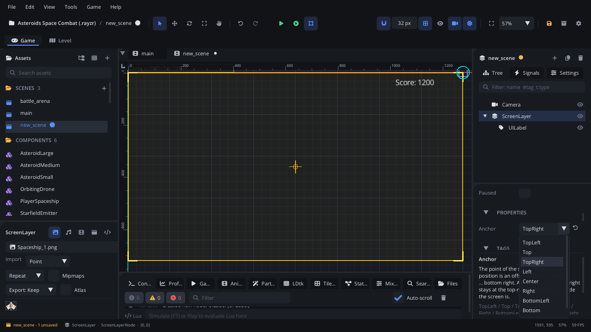

## What it's for

A Screen Layer is a HUD. Everything under it is drawn in screen space:
after the world, on top of it, and never moved by the camera. Health bars,
the score, a minimap frame and the pause button go under one.

## When to use it

- **UI that stays on the screen**: put your [UI Label](UILabelNode.md),
  [UI Button](UIButtonNode.md), [UI Progress Bar](UIProgressBarNode.md) and
  other UI nodes under a Screen Layer, so the camera doesn't scroll them
  away and the mouse hits them where they are drawn.
- **Something pinned to a corner or an edge**: a score anchored top right
  stays at the top-right edge however wide the screen is.
- **Not** for text that belongs to the world (a sign, a name over an
  enemy): use a **Text** node (Graphics & Rendering) in the scene instead.
- **Not** for lines of dialogue: a [Dialogue Box](DialogueNode.md) types
  them out (put it under a Screen Layer too).

## Using it

1. **Add Node** (Ctrl+A) > *Screen Layer*. It starts at its anchor, at
   position (0, 0).
2. In the Node tab's **Properties** section, set **Anchor**: one of nine
   points of the screen (top left, top, top right, left, centre, right,
   bottom left, bottom, bottom right).
3. With the layer selected, add UI nodes (Add Node > UI & Interface). They
   become its children.
4. Move the children (or the layer's **Position**) to place them. The
   layer's position is an offset from its anchor point: anchored top right,
   (-260, 16) is 260 px left of the right edge and 16 px down.
5. Press Shift+Home to fit the game's frame in the viewport: the editor
   draws the layer over the scene camera's frame, where the player will see
   it.

## How it works

- **The frame**: screen space is the game's frame, the project's virtual
  resolution (Project Settings > Video). With the **Expand** screen fill
  the frame grows to the window's shape, and anchored layers follow its
  edges.
- **Anchor + position**: the layer's place on screen is its anchor point
  plus its position. Its children are placed relative to the layer as
  usual.
- **Nesting**: Screen Layers can sit inside each other, but each one
  anchors to the screen, not to its parent. One `HUD` layer can hold a
  top-left layer for the health bar and a bottom-right layer for buttons.
- **Drawing order**: all Screen Layers draw after the world. Inside them
  the usual order applies: layer, Z index, then tree order. A new Screen
  Layer is on Layer8.
- **Input**: under a Screen Layer, what you see is where you click. A UI
  node outside one is drawn in the world (the camera moves it) and reads
  the mouse in the world too. While a widget has the mouse (hovered,
  pressed, dragged), the game's mouse input (`Input.is_mouse_button_*`,
  mouse-bound actions) skips it, so clicking a button doesn't also shoot.
  A hidden widget (`set_visible(false)`) takes no clicks or keys.
- **In the editor** the frame is the scene camera's view, so the layer
  moves with that camera in the viewport. The camera frame button in the
  toolbar shows it; with Expand, a screen-shape picker previews other
  window shapes.
- The layer itself draws nothing.

See [Draw order](../../engine/docs/draw_order.md#huds-screen-layers) for
more.

## Example

A HUD script on the Screen Layer, with a UI Label called `Score` under it.
It moves the HUD to the bottom-left corner when the player picks that in
the options.

```lua
---@class Hud : ScriptInstanceBase
local Hud = {}

function Hud:ready()
    self.score = 0
    self.label = self.node:get_node("Score") ---@type UILabelNode
    if Save.get("hud_bottom", false) then
        self.node:set_property("anchor", "BottomLeft")
        self.node:set_position(16, -40)
    end
end

function Hud:add_score(points)
    self.score = self.score + points
    self.label:set_text("Score: " .. self.score)
end

return Hud
```

Other scripts call it with
`Scene.find_node("HUD"):get_script():add_score(10)`.

## Screenshot


