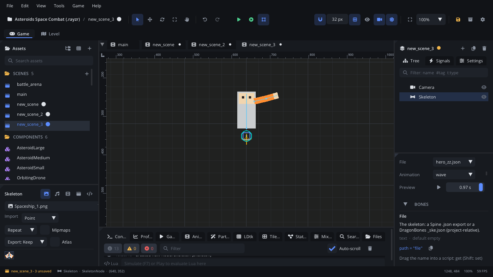

## What it's for

A Skeleton plays a character made of parts (a torso, arms, a head) moved
by bones, exported from **Spine** (3.8 - 4.2, `.json` with its `.atlas`) or
**DragonBones** (5.x, `_ske.json` with its `_tex.json`). Motion stays
smooth at any frame rate, textures stay small, animations crossfade into
each other, and a script can turn a bone (aim an arm at the mouse).

## When to use it

- **Characters animated in Spine or DragonBones**: walk, run, attack, with
  skins for outfits.
- **Aiming and looking**: override one bone's rotation from a script while
  the rest of the animation plays.
- **Attaching things to a moving part**: a sword in the hand, dust at a
  foot. Add a [Bone Attachment](BoneAttachmentNode.md) under the skeleton.
- **Vector art on bones**: export just the bones and put
  [Vector Shapes](VectorShapeNode.md) under the Skeleton; with *Bend with*
  they bend round the joints
  ([vector skinning](../../engine/docs/vector.md#bending-with-bones-vector-skinning)).
- **Not** for frame-by-frame art: use an [Aseprite Sprite](AsepriteNode.md),
  an [Animation Player](AnimationPlayerNode.md) or a
  [Frame Animation](FrameAnimationNode.md).

## Using it

1. Copy the export into the project (for example `characters/hero/`).
2. **Add Node** (Ctrl+A) > *Skeleton*.
3. Inspector > **Skeleton** > **File**: pick the `.json`. The list shows
   Spine exports with an `.atlas` next to them and DragonBones `_ske.json`
   files. Set **Atlas** only when it isn't next to the file with the usual
   name; **Armature** picks a DragonBones armature (empty: the first).
4. Pick the **Animation**: the viewport shows it. **Preview** plays it, or
   drag the time slider to scrub.
5. Set **Loop**, **Autoplay**, **Speed**, **Mix Time** (seconds to
   crossfade from one animation to the next; 0.1-0.25 feels natural),
   **Skin** and **Tint**. **Show Bones** draws the bones, also in the game.
6. The **Bones** list shows every bone by hierarchy. Hover one to light it
   up in the viewport; its link button adds a
   [Bone Attachment](BoneAttachmentNode.md) that follows it.

Guide: [Skeletal animation](../../engine/docs/skeletal_animation.md).

## How it works

- With **Autoplay** on, the **Animation** starts when the scene starts,
  looping if **Loop** is on.
- `skeleton_play` starts an animation from its beginning and crossfades
  from the one playing over **Mix Time** (or the time you pass). It
  returns false when the skeleton has no animation of that name.
- `skeleton_set_bone_rotation` replaces a bone's own rotation (degrees,
  relative to its parent) over whatever the animation does; pass `nil` to
  give the bone back to the animation.
- `skeleton_bone_position` and `skeleton_bone_rotation` read a bone in the
  world: where to spawn a bullet, which way an arm points.
- A file is loaded once and shared by every Skeleton that shows it.
- Supported: bones, region and mesh attachments (weighted and linked),
  skins, IK, slot colour and attachment changes, draw order (Spine),
  events, linear / stepped / bezier curves. Not supported: path,
  transform and physics constraints, clipping, deform (FFD). Bake those
  in the tool.

## Signals

| Signal | When | Value |
|---|---|---|
| `animation_finished` | A non-looping animation reached its end | The animation's name |
| `skeleton_event` | An event key in the animation was passed | The event's name |

## Example

A player whose body is a Skeleton child named `Body`: it runs, jumps and
aims its arm at the mouse. The script is on the player, a
[Character Mover](CharacterMoverNode.md).

```lua
---@class Player : ScriptInstanceBase
local Player = {}

function Player:ready()
    self.skel = self.node:get_node("Body") ---@type SkeletonNode
    self.anim = ""
    self.skel:connect("skeleton_event", function(name)
        if name == "footstep" then Audio.play_sound("audio/step.wav") end
    end)
end

function Player:set_anim(name, loop)
    if self.anim ~= name then
        self.anim = name
        self.skel:skeleton_play(name, loop)
    end
end

function Player:update(dt)
    local vx = self.node:character_get_velocity()
    if not self.node:character_is_on_floor() then
        self:set_anim("jump", false)
    elseif math.abs(vx) > 10 then
        self:set_anim("run", true)
    else
        self:set_anim("idle", true)
    end

    -- The arm follows the mouse.
    local mx, my = Camera.screen_to_world(Input.get_mouse_position())
    local shoulder = self.skel:skeleton_bone_position("shoulder")
    if shoulder then
        local deg = math.deg(math.atan(my - shoulder.y, mx - shoulder.x))
        -- (A local rotation: this is right when the arm's parent isn't turned.)
        self.skel:skeleton_set_bone_rotation("arm", deg)
    end
end

return Player
```

`set_anim` calls `skeleton_play` only when the animation changes, since
each call starts it again. The bone names (`shoulder`, `arm`) and the
`footstep` event are the ones in your Spine or DragonBones project.

## Screenshot


