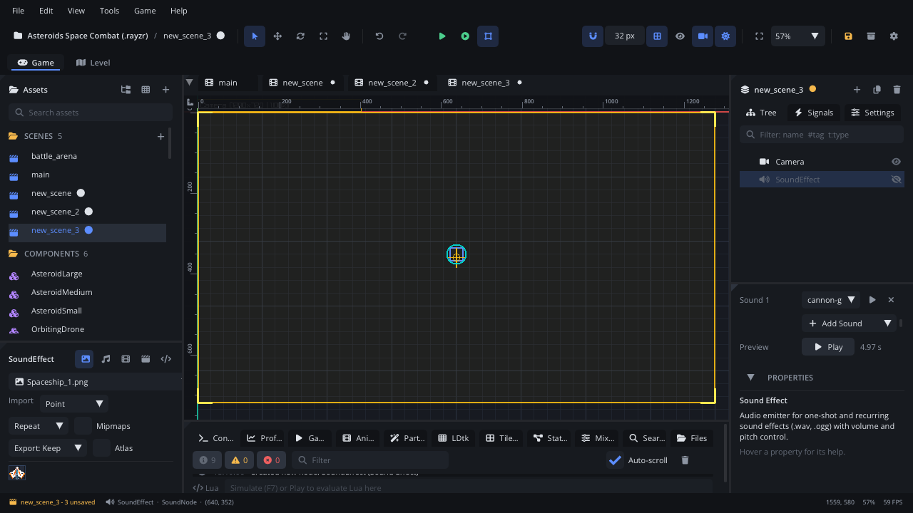

## What it's for

A Sound Effect plays short sounds: a jump, a gunshot, a footstep, a door.
It holds a **list of sounds** and a **Play Mode** that picks what each play
starts, so one node can give five different footsteps in turn or at
random. Each play can vary a little in volume, pitch, pan and timing, so
repeated sounds don't sound copied. It can also be positional: quieter
with distance from the listener, panned to its side.

## When to use it

- **Sounds a node makes**: put a Sound Effect under the player, an enemy,
  a door, and play it from the node's script.
- **Variation**: several footstep or impact recordings with *Random* or
  *Shuffle*, plus **Pitch Random**; *All* layers several sounds at once (a
  body, a tail, a crunch).
- **Sounds in the world**: turn on **Positional** so an explosion
  across the level is quiet and to one side.
- **Not** for background music or long ambience: a
  [Music Streamer](MusicNode.md) streams a track from disk, loops and
  crossfades.
- **Not** needed for a quick one-shot from a script with no node: call
  `Audio.play_sound("audio/hit.wav")` (or `Audio.play_sound_at` for a
  position).

## Using it

1. **Add Node** (Ctrl+A) > *Sound Effect*, under the node that makes the
   sound.
2. In the Inspector's **Audio** section, **Add Sound** picks an audio file
   from the project (or drop audio from Assets onto the list). Add more
   for variation. Drag a row's number (*Sound 1*, *Sound 2*...) onto
   another row to reorder; each row has its own play button and a remove
   button.
3. **Preview** plays one play the way the game will: by the Play Mode,
   with its variation and Delay Random, through its bus (not positioned).
   Sequential and Shuffle step on each press without moving the node's own
   place; the Cooldown (for repeated plays) doesn't apply. It stops when
   you select something else.
4. In the Node tab's **Properties** section, set **Play Mode** (and **Single** for the Single
   mode), **Volume**, **Pitch**, the variation (**Volume Random**, **Pitch
   Random**, **Pan Random**, **Delay Random**), **Cooldown**, **Bus**,
   **Caption**, **Voices**, **Positional** with **Min / Max Distance**,
   and **Autoplay** to play once when the node becomes ready.
5. Play it from a script with `sound_play()` (below).

## How it works

- **Play Mode** picks what one play starts:

  | Mode | Plays |
  |---|---|
  | Single | The sound chosen by **Single** (1 = the first) |
  | All | Every sound at once |
  | Sequential | The next one each time, then the first again |
  | Sequential Reversed | The same, from the last one |
  | Random | One by weight, never the one just played |
  | Shuffle | Each once in a random order, then a new order |

  In *Random* mode each row has a **weight**: 1 is as likely as the
  others, 0 never.
- **Variation** is rolled for each play (in *All* mode, for each sound on
  its own): **Volume Random** is +/- around Volume, **Pitch Random** is
  +/- semitones (1 or 2 suit footsteps and impacts), **Pan Random** is +/-
  pan, **Delay Random** waits a random 0 to N seconds before the sound
  starts.
- **Cooldown** skips plays that come within N seconds of the last one, so
  rapid fire doesn't stack dozens of copies. `sound_play_index` ignores
  the cooldown.
- **Voices** is how many times it can play over itself (1: a new play
  restarts it). When all voices are busy, the oldest is cut. *All* mode
  gets at least one voice per sound.
- **Positional**: full volume within **Min Distance** of the listener,
  silent beyond **Max Distance**, panned by its side. The listener is the
  current camera, or the node given to `Audio.set_listener`.
- **Bus**: the mixer bus it plays into (the Mixer tab). Empty: the sound's
  import bus, else *SFX*.
- **Caption**: shown on the subtitle track each time it plays, for
  players who turn sound captions on (e.g. "[door creaks]").

## Signals

| Signal | When | Value |
|---|---|---|
| `finished` | Everything it started has ended (including delayed plays). Not raised by `sound_stop()` or while paused. | nil |

## Example

Footsteps for a player: a Sound Effect named `Footsteps` under the player,
with four step recordings, Play Mode *Shuffle*, Pitch Random 1.5 and
Volume Random 0.1. The script plays a step every 0.3 seconds while the
player walks on the ground.

```lua
---@class Player : ScriptInstanceBase
local Player = {}

Player.properties = {
    step_time = { type = "float", default = 0.3, label = "Step Time" },
}

function Player:ready()
    self.steps = self.node:get_node("Footsteps") ---@type SoundNode
    self.jump_sound = self.node:get_node("JumpSound") ---@type SoundNode
    self.step_left = 0
end

function Player:update(dt)
    local mover = self.node ---@type CharacterMoverNode
    local walking = Input.is_action_down("move_left") or Input.is_action_down("move_right")
    if walking and mover:character_is_on_floor() then
        self.step_left = self.step_left - dt
        if self.step_left <= 0 then
            self.steps:sound_play() -- the next step of the shuffle, varied
            self.step_left = self.step_time
        end
    else
        self.step_left = 0
    end
    if Input.is_action_pressed("jump") then
        self.jump_sound:sound_play()
    end
end

return Player
```

`sound_play_index(i)` plays one sound of the list (1 = the first) whatever
the mode; `sound_count()` is how many it has and `sound_last()` the one it
played last (0: none yet). `sound_stop()`, `sound_pause()` and
`sound_resume()` control what's playing.

## Screenshot


