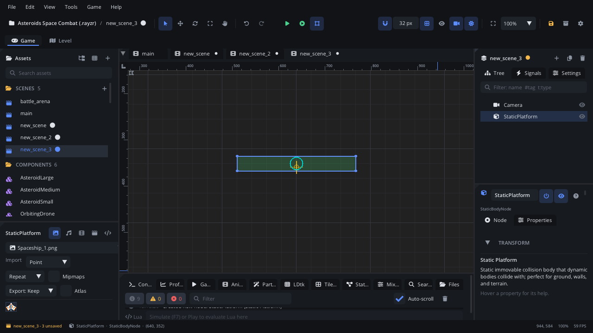

## What it's for

A Static Platform is a body that never moves on its own. Other bodies
collide with it and stop, slide or bounce off it, but nothing can push it.
Use it for the ground, walls, ceilings, ledges and any solid scenery.

## When to use it

- **Level geometry**: floors, walls, slopes, the edges of the world.
- **Jump-through platforms**: turn on **One Way** and dynamic bodies and
  Character Movers pass up through it and land on top.
- **Obstacles for path finding**: a [Navigation Region](NavigationRegionNode.md)
  marks the cells under static bodies' shapes as blocked when it bakes.
- **Not** for tile maps and LDtk levels: a solid
  [Tile Map](TileMapNode.md) and an [LDtk level](LdtkLevelNode.md) build
  their own static colliders.
- **Not** for platforms, lifts and doors that move: use a
  [Kinematic Body](KinematicBodyNode.md), which carries what stands on it.
- **Not** for objects that fall or get knocked about: use a
  [Dynamic Body](DynamicBodyNode.md).
- **Not** for regions that only notice things: use a
  [Trigger Area](AreaNode.md).

## Using it

1. **Add Node** (Ctrl+A) > *Static Platform*. It starts with a 256 x 32
   box shape.
2. Shape it: **Edit Shapes** in the viewport (or **Edit in Viewport** in
   the Inspector's **Collision Shapes**) to resize the box, or switch it to
   another shape. A **Chain** follows uneven ground with many points; a
   **Segment** is a thin line. One body can have several shapes.
3. Set each shape's **Friction** (0 ice, 1 rubber) and **Restitution**
   (bounciness) in **Collision Shapes**.
4. Add a sprite (or a nine-slice) as a child to draw it.
5. Collision layers decide what collides with it: each shape's
   **Category Layers** are the layers it's on, its **Mask Layers** the
   layers it collides with. Name the layers in Project Settings > Physics.
6. For a jump-through platform, tick **One Way**.

## How it works

- Physics never moves it. If you move the node (a script, an animation, a
  moving parent), the body jumps to the new place each frame: it doesn't
  push or carry anything on the way. For moving platforms use a
  [Kinematic Body](KinematicBodyNode.md).
- **One Way**: dynamic bodies and Character Movers coming from below (and
  from the sides) pass through; those landing from above rest on it.
  "Above" turns with the node's rotation, so a platform rotated 90 degrees
  is solid from one side only.
- Its contacts (and so its signals) come from dynamic bodies. Box2D
  doesn't make contacts between two bodies that aren't dynamic, so other
  static and kinematic bodies don't raise them. A
  [Character Mover](CharacterMoverNode.md) stops, slides and stands on it
  through its own movement checks, which don't raise them either.
- **Enabled** off takes the body out of the world: nothing collides with
  it.
- With **Show Bounds & Colliders** (View menu) the shapes are drawn in its
  **Debug Color**.

## Signals

| Signal | When | Value |
|---|---|---|
| `collision_started` | A body starts touching it | The other body node |
| `collision_ended` | That body stops touching it | The other body node |

Each body is reported once, even when either has several shapes. A shape
reports contacts while its **Enable Contact Events** is on (the default).

## Example

A floor of thin ice: it breaks once enough falling crates have landed on it.

```lua
---@class ThinIce : ScriptInstanceBase
local ThinIce = {}

ThinIce.properties = {
    hits = { type = "int", default = 3, label = "Hits Before Breaking" },
}

function ThinIce:ready()
    self.left = self.hits
end

-- collision_started, handled in the Static Platform's own script.
function ThinIce:on_collision_started(other)
    if other == nil or not other:is("DynamicBodyNode") then return end
    self.left = self.left - 1
    if self.left <= 0 then
        Audio.play_sound("sounds/ice_break.wav")
        self.node:destroy()
    end
end

return ThinIce
```

Destroying the platform removes its body, so the crates on it fall.

## Screenshot


