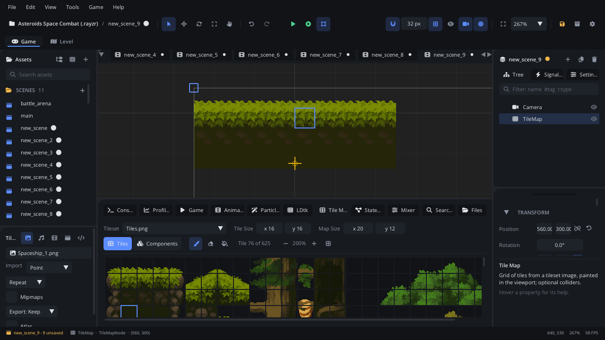

## What it's for

A Tile Map is a grid of tiles cut from one tileset image, painted in the
viewport. Ground, walls, floors and platforms built from small square
pieces. With **Solid** on, the painted tiles become colliders. The same grid
can also hold components - coins, enemies, spikes - one per cell.

## When to use it

- **Levels built in the scene**: paint the ground and walls of a room
  directly in the viewport.
- **Generated levels**: a [Level Generator](LevelGeneratorNode.md) writes
  its output into a Tile Map.
- **Walls for path finding**: enemies find their way round a Solid map with
  `nav_find_path`.
- **Placing many copies of a component on a grid**: the Tile Map tab's
  **Components** layer.
- **Not** for levels with many layers, auto-tiling rules and entities with
  fields: use an [LDtk Tilemap Level](LdtkLevelNode.md) (edited in LDtk or
  the Level tab).
- **Not** for one picture: use a [Texture Sprite](TextureNode.md).

## Using it

1. **Add Node** (Ctrl+A) > *Tile Map*. The bottom panel switches to the
   **Tile Map** tab (the Inspector's **Edit in Tile Map Tab** button opens
   it too).
2. In the tab's top row, pick the **Tileset** image, set **Tile Size** (the
   size of one tile in the image, in pixels) and **Map Size** (columns and
   rows). Or right-click an image in Assets > **Use as Tileset of Selected
   Tile Map**.
3. Click a tile in the tile list, then paint in the viewport with the left
   button. The tools: **Paint**, **Erase**, **Fill** (flood fill). The
   right button always erases. One stroke is one undo step.
4. The **-** / **+** buttons size the tile list; the grid button joins the
   tiles with lines between them.
5. Tick **Solid** in the Node tab's **Properties** section to make the painted tiles block bodies.
6. To paint components instead of tiles, switch to the **Components** layer
   (next to **Tiles**), pick a component, and paint. Shift places one off
   the grid.

## How it works

- Cell (0, 0) has its top-left corner at the node's position. Cells count
  right and down; tiles are drawn at **Tile Size** times the node's scale.
  The node can be rotated.
- Tile numbers count left to right, then top to bottom in the tileset
  image (the tooltip in the tile list shows them).
- **Map Size** is the map's outline. You can paint outside it, and making
  the map smaller never deletes tiles: they are kept and come back when
  it grows.
- **Solid**: when the scene starts (or Simulate), the map makes a static
  body child named `<Name>_Colliders`, with one box per horizontal run of
  painted tiles. Its colliders also cast [Light](LightNode.md) shadows.
  They are not saved and aren't there while you edit.
- **Terrains** (auto-tiling): a tileset's terrains - kept next to its
  image in `<name>.tileset.json` - give each cell the tile for its pattern
  of same-terrain neighbours (16 edge patterns or the 47-tile blob). Paint
  them on the Tile Map tab's Terrains layer; a Level Generator rule can
  name one. From Odin: `TileMapNode_PaintTerrain`, `TileMapNode_FillTerrain`
  (engine/terrain.odin).
- Large maps are drawn as cached chunks, so many tiles cost little.
- **Tint** multiplies the colours of every tile.
- **Aseprite Layer**: with an Aseprite file as the tileset, the map is that
  file's tilemap layer (its tiles, flips and tileset), updated when the file
  is saved. Leave it empty to paint the map here. See
  [Aseprite files](../../engine/docs/aseprite.md).
- Filtering comes from the tileset image's import settings (Point by
  default, for crisp pixel art).
- New tile maps are 20 x 12 cells of 32 x 32 pixels, on Layer1. See
  [Draw order](../../engine/docs/draw_order.md).

## Example

An enemy that walks round the walls of a Solid Tile Map towards the player.
The script is on the enemy, at the scene root, so its position is a world
position.

```lua
---@class Chaser : ScriptInstanceBase
local Chaser = {}

Chaser.properties = {
    speed = { type = "float", default = 80, label = "Speed" },
    walls = { type = "node", label = "Walls" },   -- the Tile Map (Solid on)
    target = { type = "node", label = "Target" }, -- the player
}

function Chaser:ready()
    self.repath = 0
end

function Chaser:update(dt)
    local x, y = self.node:get_global_position()
    self.repath = self.repath - dt
    if self.repath <= 0 then
        local tx, ty = self.target:get_global_position()
        -- Waypoints round the painted tiles, keeping 12 px from them.
        self.path = self.walls:nav_find_path(x, y, tx, ty, { radius = 12 })
        self.next = 2 -- path[1] is where the enemy is
        self.repath = 0.5
    end
    local p = self.path and self.path[self.next]
    if not p then return end
    local dx, dy = p[1] - x, p[2] - y
    local d = math.sqrt(dx * dx + dy * dy)
    if d < 4 then
        self.next = self.next + 1
        return
    end
    self.node:set_position(x + dx / d * self.speed * dt, y + dy / d * self.speed * dt)
end

return Chaser
```

`nav_find_path` returns nil when there is no way, or when either end is
blocked or off the map's grid; the enemy then waits for the next search.

Components on the grid from a script (cells are 0-based):

```lua
local map = Scene.find_node("TileMap") ---@type TileMapNode
map:tilemap_set_component(4, 2, "components/Coin.component.json")
local coin = map:tilemap_component_at(4, 2)
map:tilemap_clear_component(4, 2)
```

Tiles from a script: read and paint cells (a tile is its index in the
tileset; -1 is empty). On a **Solid** map the colliders follow at the end
of the frame, and path finding sees the change - dig a hole under the
player:

```lua
local map = Scene.find_node("TileMap") ---@type TileMapNode
local x, y = map:tilemap_cell_at(self.node:get_global_position())
if map:tilemap_get_tile(x, y + 1) ~= -1 then
    map:tilemap_set_tile(x, y + 1, -1)
end
local wx, wy = map:tilemap_cell_position(x, y + 1) -- that cell's centre
```

## Screenshot


