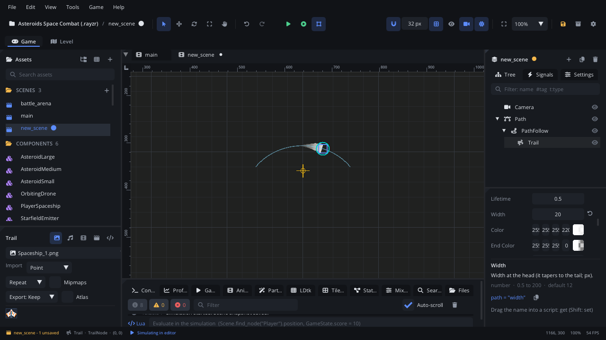

## What it's for

A Trail leaves a fading, tapering ribbon behind a moving node: a sword
swing, a dash, a comet's tail, a ball's streak, tyre marks. Make it a
child of the node that moves; it records where it has been and draws a
strip through those points, wide and bright at the head, thin and faded
at the tail.

## When to use it

- **Motion streaks**: behind a fast bullet, a dashing player, a thrown
  ball.
- **Weapon swings**: a Trail at a sword's tip (under a
  [Bone Attachment](BoneAttachmentNode.md) for a skeleton's hand).
- **Things on a route**: under a [Path Follow](PathFollowNode.md), it shows
  the way the follower went.
- **Not** for clouds of small things (smoke, sparks, dust): use a
  [Particle Emitter](ParticleEmitterNode.md).
- **Not** for a fixed line (a laser, a rope): a *Line* node draws given
  points, a [Path](PathNode.md) with a **Line Width** draws a curve.

## Using it

1. Select the node that moves, then **Add Node** (Ctrl+A) > *Trail*. The
   trail becomes its child.
2. Set its **Position** to where the ribbon should come from, relative to
   the parent: 0, 0 for its centre, or the tip of a sword.
3. In the Inspector:
   - **Lifetime**: seconds each point of the trail lasts (how long the
     ribbon is, in time).
   - **Width**: the width at the head in pixels; it tapers to nothing at
     the tail.
   - **Color** at the head and **End Color** at the tail (the default
     fades to transparent white).
   - **Min Distance**: how far the parent must move before a new point is
     recorded.
   - **Emitting**: record new points; off, the trail fades away.
4. Press *Simulate* or Play to see it: the editor doesn't move nodes while
   you edit, so there is nothing to draw until something moves.

## How it works

- Every frame, if the trail has moved at least **Min Distance** since the
  last point, it records its world position. Points older than
  **Lifetime** drop off the tail.
- Points stay where they were recorded in the world: the ribbon doesn't
  move with the parent, it is left behind.
- Width and colour follow each point's age: a new point has the full
  **Width** and **Color**, a point at the end of its life has width 0 and
  **End Color**.
- A trail keeps at most 512 points; raise **Min Distance** for long, fast
  trails.
- A teleport would draw a long streak across the screen: call
  `trail_clear()` right after moving the parent.

## Example

A player who dashes: the Trail child named `DashTrail` (Emitting off) is
on only during the dash, and cleared when the player respawns.

```lua
---@class Player : ScriptInstanceBase
local Player = {}

function Player:ready()
    self.trail = self.node:get_node("DashTrail") ---@type TrailNode
    self.dash_left = 0
end

function Player:update(dt)
    if Input.is_action_pressed("dash") and self.dash_left <= 0 then
        self.dash_left = 0.25
        self.trail.emitting = true
    end
    if self.dash_left > 0 then
        self.dash_left = self.dash_left - dt
        if self.dash_left <= 0 then
            self.trail.emitting = false   -- the ribbon fades out
        end
    end
end

function Player:respawn(x, y)
    self.node:set_position(x, y)
    self.trail:trail_clear()              -- no streak from where it died
end

return Player
```

## Screenshot


