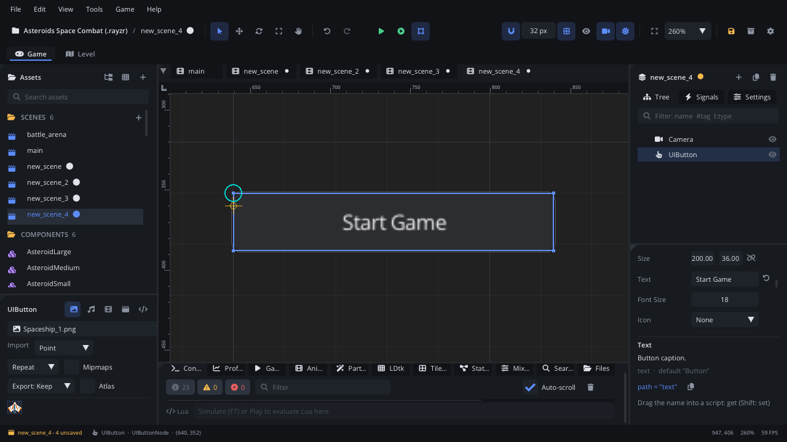

## What it's for

A UI Button is something the player clicks: Start, Options, Quit, Buy,
Retry. It changes colour under the mouse and while pressed, and raises
`clicked`. It works with the mouse, the keyboard and a gamepad.

## When to use it

- **Menu actions**: start the game, open a panel, go back, quit.
- **HUD actions**: a pause button, an inventory button.
- **Not** for an on / off setting: use a [UI Checkbox](UICheckboxNode.md)
  or a [UI Toggle Switch](UIToggleSwitchNode.md), which keep their state.
- **Not** for picking one of several choices: use a
  [UI Radio Group](UIRadioGroupNode.md) or a [UI Dropdown](UIDropdownNode.md).
- **Not** for a row of icon buttons: a [UI Toolbar](UIToolbarNode.md) holds
  them together.

## Using it

1. **Add Node** (Ctrl+A) > *UI Button*. It is 200 x 36 and says "Button".
2. Put it under a [Screen Layer](ScreenLayerNode.md), or in a
   [UI Container](UIContainerNode.md) to stack it with other buttons.
3. In the Node tab's **Properties** section set **Text**, **Font Size** and
   **Align**. **Icon** puts an icon before the text (**Icon Size** 0 sizes
   it to the button).
4. Set the colours: **Normal Color** (at rest), **Hover Color** (under the
   mouse), **Pressed Color** (held down), **Border Color** and **Text
   Color**.
5. Handle `clicked`: connect it in the Inspector's **Signals** section, or
   from a script (below).

## How it works

- **A click** happens when the mouse button goes down on the button and
  comes up on it. Pressing it and dragging off cancels the click.
- **Keyboard and gamepad**: Tab and Shift+Tab move the focus between the
  UI controls, and the arrow keys (or the D-pad and left stick) move it to
  the nearest control in that direction. A click also focuses. On the
  focused button, Enter, Space or the gamepad's A button clicks. The
  focused button has a highlighted border.
- **Keyboard Focus** (on by default): turn it off for buttons that sit
  beside gameplay keys, such as a toolbar over a game that uses the arrows
  and Space. Such a button only takes clicks: Tab and the arrows skip it,
  and a click doesn't focus it, so the next Space goes to the game. Every
  UI control has this setting.
- **Position** is the top-left corner, **Size** the width and height. In a
  container with Stretch alignment the width follows the container.
- **With an icon**, the text is drawn at the default size; **Font Size**
  only applies without one (the Inspector hides it then).
- **Disabled** or hidden buttons (the node's **Enabled** or visibility off)
  don't react.
- **Covered by a dropdown**: while a [UI Dropdown](UIDropdownNode.md)'s
  list is open over the button, the list gets the click.
- `set_text` / `get_text` change and read the caption from a script.

## Signals

| Signal | When | Value |
|---|---|---|
| `clicked` | The button is clicked, or activated with Enter / Space / A while focused | `true` |

## Example

An options screen's "Delete save" button that asks first: the first click
changes the text, a second click within three seconds deletes the save.

```lua
---@class DeleteSaveButton : ScriptInstanceBase
local DeleteSaveButton = {}

function DeleteSaveButton:ready()
    self.armed = 0
end

function DeleteSaveButton:on_clicked()
    if self.armed > 0 then
        Save.clear()
        Save.flush()
        self.armed = 0
        self.node:set_text("Save deleted")
    else
        self.armed = 3
        self.node:set_text("Sure? Click again")
    end
end

function DeleteSaveButton:update(dt)
    if self.armed > 0 then
        self.armed = self.armed - dt
        if self.armed <= 0 then self.node:set_text("Delete save") end
    end
end

return DeleteSaveButton
```

The script is on the button, so `on_clicked` runs when it is clicked. From
another script, connect it:
`self.node:get_node("StartButton"):connect("clicked", function() self:start() end)`.

## Screenshot


