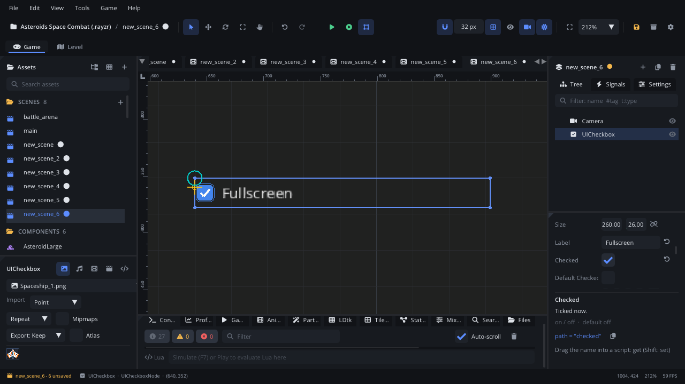

## What it's for

A UI Checkbox is a box with a label that the player ticks and unticks: an
on / off option such as Fullscreen, Subtitles or Invert Y. It raises
`value_changed` with `true` or `false`.

## When to use it

- **On / off options** in a settings menu, especially in a list of them.
- **Not** for the same choice shown as a switch: a
  [UI Toggle Switch](UIToggleSwitchNode.md) looks like a phone setting (but
  raises no event).
- **Not** for one choice out of several: use a
  [UI Radio Group](UIRadioGroupNode.md) or a [UI Dropdown](UIDropdownNode.md).
- **Not** for an action that happens once: that's a
  [UI Button](UIButtonNode.md).

## Using it

1. **Add Node** (Ctrl+A) > *UI Checkbox*. It is 260 x 26, labelled
   "Checkbox", unticked.
2. Put it under a [Screen Layer](ScreenLayerNode.md) or in a
   [UI Container](UIContainerNode.md).
3. In the Node tab's **Properties** section set **Label** and **Checked**
   (its state when the scene starts).
4. **Default Checked** is the state a right-click puts back. **Accent
   Color** colours the ticked box; **Box Size** is the box's size in
   pixels.
5. Handle `value_changed` (below).

## How it works

- **Mouse**: a click anywhere on the checkbox (box or label) flips it. A
  right-click sets it back to **Default Checked**.
- **Keyboard and gamepad**: Tab / Shift+Tab or the arrow keys move the
  focus between controls; on a focused checkbox, Enter, Space or the
  gamepad's A button flips it.
- **Position** is the top-left corner, **Size** the clickable area.
- `value_changed` fires only when the state really changes. Setting
  **Checked** from a script (`checked` or `set_property`) doesn't raise it.

## Signals

| Signal | When | Value |
|---|---|---|
| `value_changed` | The box is ticked or unticked (click, key, right-click reset) | `true` when ticked, `false` when not |

## Example

A Fullscreen option that shows the current state and switches the window.

```lua
---@class FullscreenOption : ScriptInstanceBase
local FullscreenOption = {}

function FullscreenOption:ready()
    self.node:set_property("checked", Engine.is_fullscreen())
end

function FullscreenOption:on_value_changed(checked)
    Engine.set_fullscreen(checked)
    Save.set("fullscreen", checked)
end

return FullscreenOption
```

The script is on the checkbox.

## Screenshot


