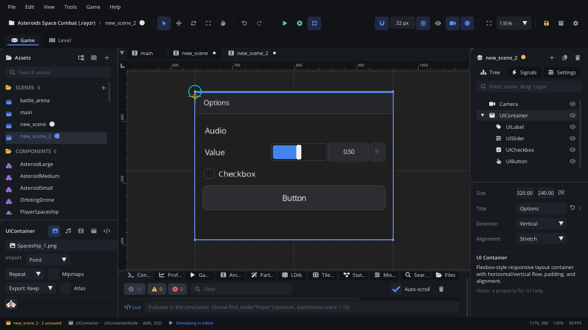

## What it's for

A UI Container is a panel that lays out its UI children for you: in a
column, in a row or in a grid, with spacing and padding. It can draw a
background, a border and a header with a title. Menus, option screens and
inventories are built from containers.

## When to use it

- **A menu or a settings panel**: put buttons, sliders and checkboxes in a
  vertical container and they stack with even gaps.
- **A row of things**: a horizontal container for a toolbar of buttons, or
  a label next to a button (containers can nest).
- **A grid**: inventory slots or level-select buttons with **Direction**
  Grid and a number of **Columns**.
- **Rows built from a script**: the Controls Menu and Accessibility Menu
  script templates fill a container with rows.
- **Not** for tabs: use a [UI Tab Container](UITabContainerNode.md).
- **Not** for a HUD that stays on screen by itself: that's a
  [Screen Layer](ScreenLayerNode.md) (put the container under one).

## Using it

1. **Add Node** (Ctrl+A) > *UI Container*. It starts as a 320 x 240 panel
   with the title "Panel", a header, a background and a border.
2. Put it under a [Screen Layer](ScreenLayerNode.md) so it stays on screen.
3. With the container selected, add UI nodes (Add Node > UI & Interface):
   they become its children, in tree order.
4. In the Node tab's **Properties** section set **Direction** (Vertical,
   Horizontal or Grid), **Alignment**, **Spacing**, the four **Padding**
   values and **Columns** (grid only). **Title**, **Show Header**, **Header
   Height**, **Draw Background**, **Draw Border** and the colours set its
   look.
5. Turn on **Auto Size Height** to make the panel as tall as its children.
6. Reorder the children in the scene tree to change their order in the
   layout.

## How it works

- **Layout** runs every frame while the game runs (and in Simulate). In
  the editor the children stay where you put them until you simulate or
  play.
- **Which children**: only enabled UI nodes are laid out. Other children
  (a sprite, a timer) are left alone, and the layout overwrites the
  position of each UI child.
- **Vertical**: children stack top to bottom with **Spacing** between them,
  below the header and inside the padding. **Alignment** places them across
  the column: Start (left), Center, End (right) or Stretch (each child is
  made as wide as the inside of the panel).
- **Horizontal**: children go left to right; Alignment works top to
  bottom, and Stretch makes each as tall as the inside.
- **Grid**: the inside width is split into **Columns** equal cells; each
  child is made as wide as a cell, and each row is as tall as its tallest
  child.
- **Nesting**: a container inside a container is laid out too, then lays
  out its own children.
- **Size**: the panel keeps its **Size** unless **Auto Size Height** is on.
  Children that don't fit spill outside; nothing is clipped.
- **No input**: the container itself doesn't take the mouse or keyboard
  focus. Its children do.
- **Hiding a menu**: turning a container's visibility off only stops the
  drawing; its buttons still take clicks. Disable it instead
  (`set_enabled(false)`): disabled nodes and their children neither update
  nor draw.

## Example

A pause menu. A Screen Layer called `PauseLayer` holds a vertical UI
Container called `Menu`. The script on the layer fills the container with
buttons and turns it on and off with the pause action.

```lua
---@class PauseMenu : ScriptInstanceBase
local PauseMenu = {}

function PauseMenu:ready()
    self.menu = self.node:get_node("Menu") ---@type UIContainerNode
    self:add_button("Resume", function() self:show(false) end)
    self:add_button("Main Menu", function()
        Engine.set_paused(false)
        Scene.change_scene("scenes/title.scene.json")
    end)
    self.menu:set_enabled(false)
end

function PauseMenu:add_button(text, on_click)
    local b = Scene.create_node("UIButtonNode", text .. "Button", self.menu) --[[@as UIButtonNode]]
    b.text = text
    b.size = Vec2(240, 40)
    b:connect("clicked", on_click)
end

function PauseMenu:update(dt)
    if Input.is_action_pressed("pause") then
        self:show(not Engine.is_paused())
    end
end

function PauseMenu:show(open)
    Engine.set_paused(open)
    self.menu:set_enabled(open)
end

return PauseMenu
```

Set the layer's **Pause Mode** (Transform section) to Always, so it and the
menu keep running while the game is paused.

## Screenshot


