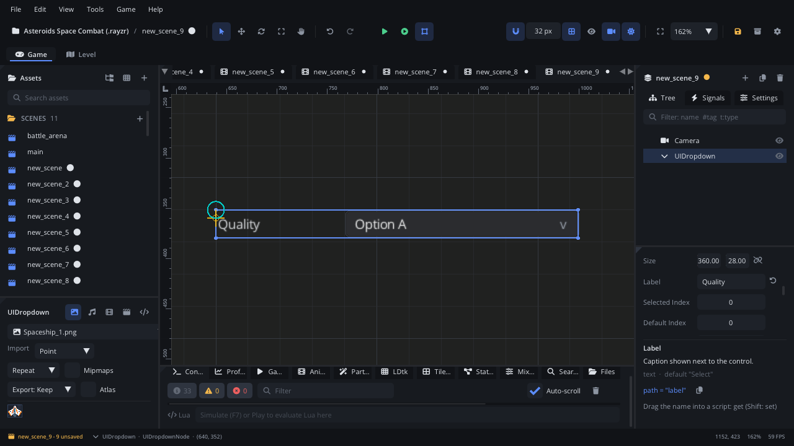

## What it's for

A UI Dropdown shows the selected item of a list in a box; a click opens
the list below it to pick another. It saves room in a settings menu where
a choice has several options.

## When to use it

- **One choice out of several, in little space**: graphics quality, window
  mode, a preset.
- **Not** when the options should all be visible at once: use a
  [UI Radio Group](UIRadioGroupNode.md).
- **Not** for on / off: use a [UI Checkbox](UICheckboxNode.md).
- **Not** for a long scrolling list: use a [UI List View](UIListViewNode.md).

## Using it

1. **Add Node** (Ctrl+A) > *UI Dropdown*. It is 360 x 28, labelled
   "Select", with the items Option A, Option B and Option C.
2. Put it under a [Screen Layer](ScreenLayerNode.md) or in a
   [UI Container](UIContainerNode.md).
3. In the Node tab's **Properties** section set **Label**, **Label Width**
   (the room for the label on the left), **Selected Index** (the item
   shown at the start, counting from 0) and **Default Index**.
4. Handle `value_changed` (below) to act on the choice.

The items themselves can't be edited yet, in the Inspector or from Lua:
every dropdown has Option A, Option B and Option C. Map the index to your
own meanings in the script.

## How it works

- **Mouse**: a click on the box opens the list under it; a click on an
  item selects it and closes the list. A click outside closes it without
  a change. While the list is open, it takes the clicks over the controls
  it covers.
- **Keyboard and gamepad**: Tab / Shift+Tab or the arrow keys focus the
  dropdown. Enter, Space or the gamepad's A button opens it; Up and Down
  move through the items, Enter (or Space) picks one, Escape closes.
- **Drawing**: the open list is drawn after everything else, on top of the
  rest of the UI.
- **Selected Index** counts from 0: the first item is 0.
- `value_changed` fires only when another item is picked. Setting
  **Selected Index** from a script doesn't raise it.

## Signals

| Signal | When | Value |
|---|---|---|
| `value_changed` | The player picks a different item | The item's index, from 0 |

## Example

A graphics quality setting: the three items stand for low, medium and
high, and the choice is saved.

```lua
---@class QualityOption : ScriptInstanceBase
local QualityOption = {}

local LEVELS = { [0] = "low", [1] = "medium", [2] = "high" }

function QualityOption:ready()
    local saved = Save.get("quality", "medium")
    for index, name in pairs(LEVELS) do
        if name == saved then self.node:set_property("selectedIndex", index) end
    end
end

function QualityOption:on_value_changed(index)
    Save.set("quality", LEVELS[index])
    Log.info("quality: " .. LEVELS[index])
end

return QualityOption
```

The script is on the dropdown.

## Screenshot


