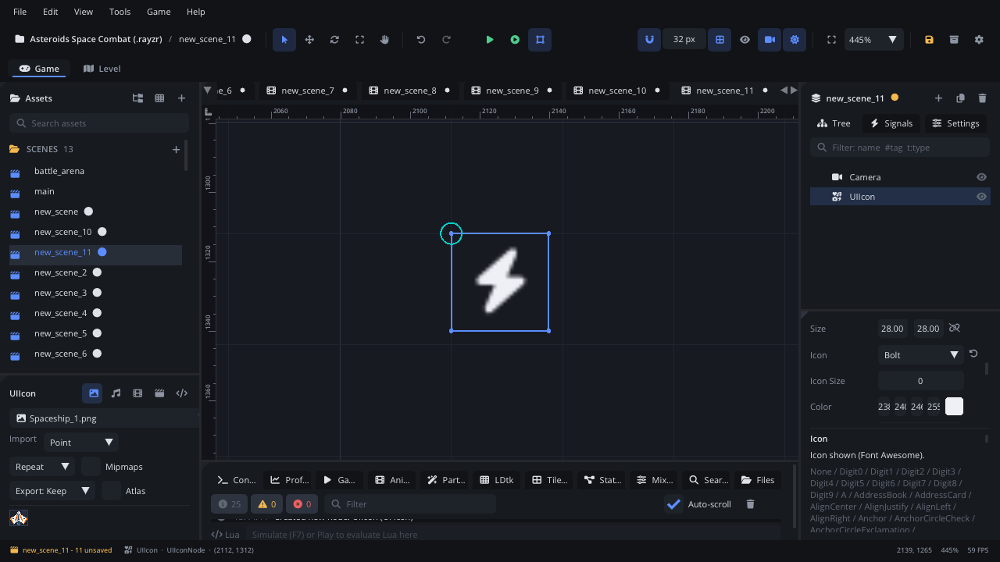

## What it's for

An Icon draws one vector icon from the built-in Font Awesome set: a heart,
a coin, a gear, a lock. It's sharp at any size and takes a colour, so you
don't need an image file for small HUD and menu symbols.

## When to use it

- **Small symbols in a HUD or menu**: a heart beside the health, a clock
  beside the timer, a lock on a locked level.
- **Status that changes colour**: tint the icon from a script.
- **Not** for a clickable icon: use a [Button](UIButtonNode.md), or a
  [Toolbar](UIToolbarNode.md) for a row of icon buttons.
- **Not** for your own artwork: use a Texture Sprite under a
  [Screen Layer](ScreenLayerNode.md).

## Using it

1. **Add Node** (Ctrl+A) > *UI Icon*. It starts 28 x 28 px with no icon,
   so it draws nothing yet.
2. Put it under a [Screen Layer](ScreenLayerNode.md), or in a
   [UI Container](UIContainerNode.md) next to a [Label](UILabelNode.md).
3. In the Node tab's **Properties** section pick the **Icon** from the list
   (Font Awesome names such as `Heart`, `Bolt`, `Coins`, `Lock`).
4. Set **Color**, and **Icon Size** in pixels (0 = 70 % of the smaller side
   of **Size**). **Align** places it left, centre or right in its box.

## How it works

- **Layout**: the node's position is the top-left corner of a box of
  **Size**. Rotation and scale don't change it. The icon is centred
  vertically in the box and placed by **Align** horizontally.
- **Size**: with **Icon Size** 0 the icon follows the box, so resizing the
  node (or a container stretching it) resizes the icon.
- With **Icon** set to None nothing is drawn.
- It takes no input and has no signals.
- **Screen space**: it's drawn where the node is; keep it under a Screen
  Layer so it stays on screen while the camera moves.

## Example

A shield icon in the HUD that turns grey when the shield is down.

```lua
---@class ShieldIcon : ScriptInstanceBase
local ShieldIcon = {}

function ShieldIcon:ready()
    self.node.icon = "ShieldHalved"
end

function ShieldIcon:set_shield(on)
    if on then
        self.node.color = {0.3, 0.6, 1.0, 1.0}
    else
        self.node.color = {0.35, 0.35, 0.4, 1.0}
    end
end

return ShieldIcon
```

Colours from a script are `{r, g, b, a}` from 0 to 1 (or a `"#rrggbb"`
string). Another script calls it with
`Scene.find_node("ShieldIcon"):get_script():set_shield(false)`.

## Screenshot


