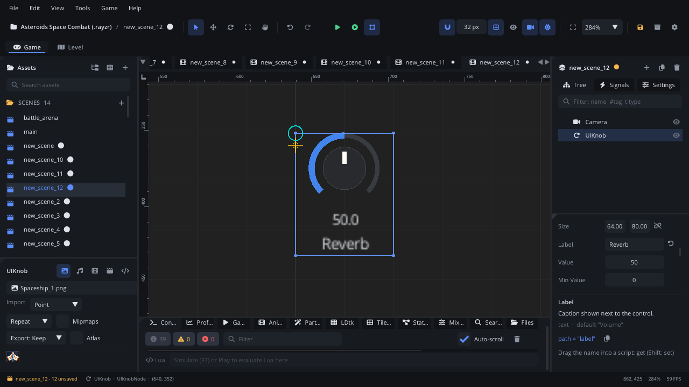

## What it's for

A UI Knob is a rotary control: a dial with an arc that fills as the value
goes up, the value written under it and a label. The player drags up or
down to turn it. It fits audio-style settings in little space.

## When to use it

- **Compact settings with a range**: reverb amount, pitch, a synth's
  cutoff in a music toy, a gauge the player sets.
- **Not** for a value that needs precise typing or a reset button: a
  [UI Slider](UISliderNode.md) has both.
- **Not** for a volume in dB: use a [UI Volume Fader](UIVolumeFaderNode.md).
- **Not** for showing a value only: use a
  [UI Progress Bar](UIProgressBarNode.md).

## Using it

1. **Add Node** (Ctrl+A) > *UI Knob*. It is 64 x 80, labelled "Volume",
   from 0 to 100 at 50.
2. Put it under a [Screen Layer](ScreenLayerNode.md) or in a
   [UI Container](UIContainerNode.md) (a horizontal one for a row of
   knobs).
3. In the Node tab's **Properties** section set **Label**, **Min Value**,
   **Max Value** and **Value**.
4. Handle `value_changed` (below).

## How it works

- **Mouse**: press on the knob and drag up to raise the value, down to
  lower it. A drag of 50 px covers the whole range; with Shift held it
  moves four times slower, for fine changes.
- **Keyboard and gamepad**: Tab / Shift+Tab or Up / Down move the focus to
  it. On the focused knob, Right and Left change the value by 5% of the
  range (1% with Shift).
- **Display**: the arc runs from bottom left round to bottom right; the
  value is shown with one decimal.
- **Size**: the dial is as big as the width allows, with room below for
  the value and the label.
- **Default Value** is kept with the knob, but the knob has no reset
  gesture: double-clicking or right-clicking doesn't restore it. Set the
  value from a script to reset it.
- `value_changed` fires for every change, so many times during a drag.
  Setting **Value** from a script doesn't raise it.

## Signals

| Signal | When | Value |
|---|---|---|
| `value_changed` | The value changes by dragging or with the keys | The new value (a number) |

## Example

A reverb knob for a mixer bus's effect send, from 0 to 1.

```lua
---@class ReverbKnob : ScriptInstanceBase
local ReverbKnob = {}

function ReverbKnob:ready()
    self.node:set_property("minValue", 0)
    self.node:set_property("maxValue", 1)
    self.node:set_property("value", Save.get("reverb", 0.3))
    Audio.set_bus_volume("Reverb", self.node:get_property("value"))
end

function ReverbKnob:on_value_changed(value)
    Audio.set_bus_volume("Reverb", value)
    Save.set("reverb", value)
end

return ReverbKnob
```

The script is on the knob. It drives a bus named "Reverb" in the project's
Mixer.

## Screenshot


