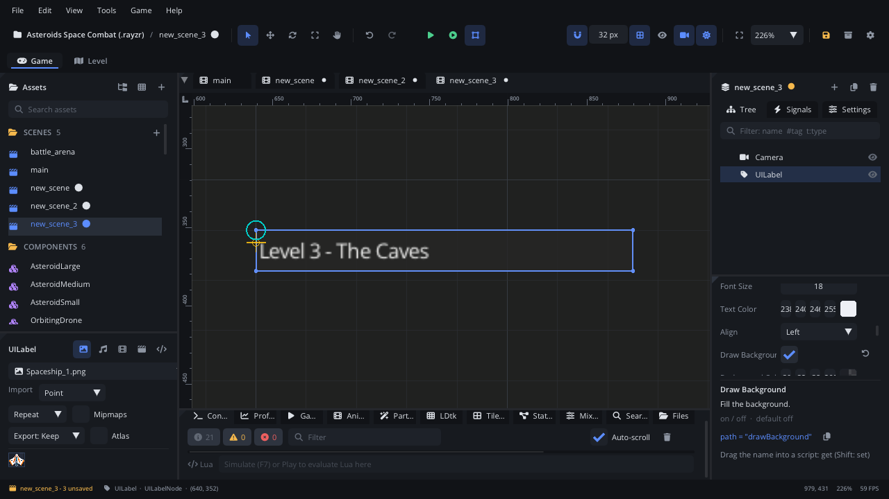

## What it's for

A UI Label shows a line of text in your interface: a score, a title, a
caption next to a control, a "Paused" banner. It can fill its box with a
background colour.

## When to use it

- **HUD text**: the score, the timer, the number of lives, under a
  [Screen Layer](ScreenLayerNode.md).
- **Titles and captions in menus**, inside a
  [UI Container](UIContainerNode.md).
- **Not** for text in the game world (a sign, damage numbers): use a
  **Text** node (Graphics & Rendering). It has project fonts, rich text,
  wrapping and a typewriter.
- **Not** for conversation: a [Dialogue Box](DialogueNode.md) shows a
  speaker and types the lines out.
- **Not** for something the player clicks: that's a
  [UI Button](UIButtonNode.md).

## Using it

1. **Add Node** (Ctrl+A) > *UI Label*. It says "Label".
2. Put it under a [Screen Layer](ScreenLayerNode.md) (or a UI Container).
3. In the Node tab's **Properties** section set **Text**, **Font Size**,
   **Text Color** and **Align** (Left, Center or Right).
4. Set **Size**: the label's box. The text is aligned inside it and
   centred top to bottom.
5. Turn on **Draw Background** to fill the box with **Background Color**.

## How it works

- **Position** is the box's top-left corner; **Size** is its width and
  height. A new label is 240 px wide and as tall as the font plus 8 px.
  Changing **Font Size** later doesn't resize the box.
- **Lines**: the text breaks only where it has a line break (`\n` in a
  script). Long lines aren't wrapped or clipped: they run past the box.
- **Font**: UI labels use the UI's built-in font. For a project font, use
  a Text node.
- **No input**: a label doesn't take clicks or the keyboard focus.
- **UI scale**: the player's UI scale (Accessibility settings) scales it
  with the rest of the UI.

## Example

A countdown timer in the HUD: the label turns red for the last ten
seconds.

```lua
---@class Countdown : ScriptInstanceBase
local Countdown = {}

Countdown.properties = {
    seconds = { type = "float", default = 90, label = "Seconds" },
}

function Countdown:ready()
    self.left = self.seconds
end

function Countdown:update(dt)
    self.left = math.max(0, self.left - dt)
    local s = math.ceil(self.left)
    self.node:set_text(string.format("%d:%02d", s // 60, s % 60))
    if self.left <= 10 then
        self.node:set_property("textColor", "#ff4040")
    end
end

return Countdown
```

The script is on the UI Label. `get_text()` reads the text back.

## Screenshot


